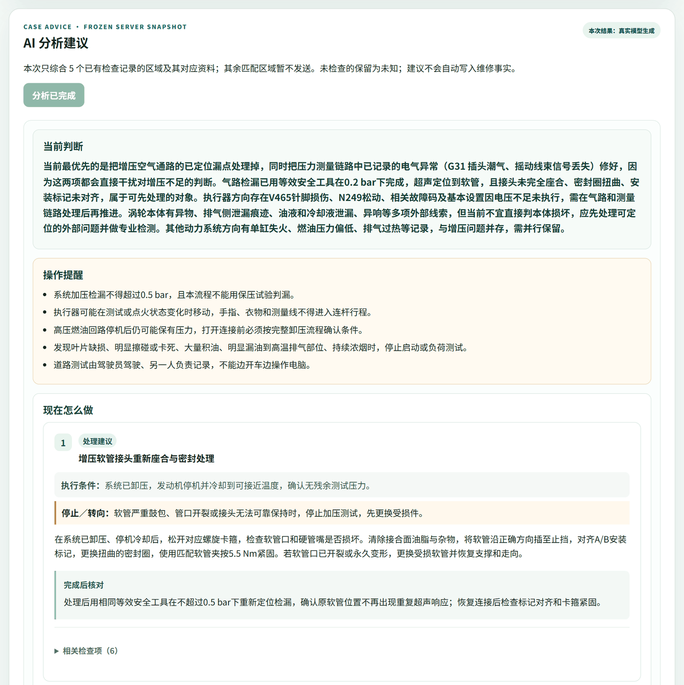
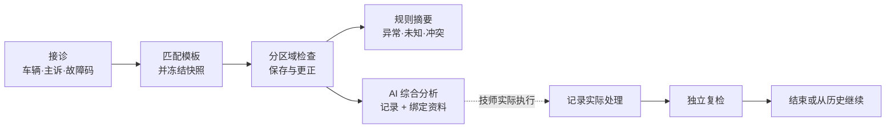
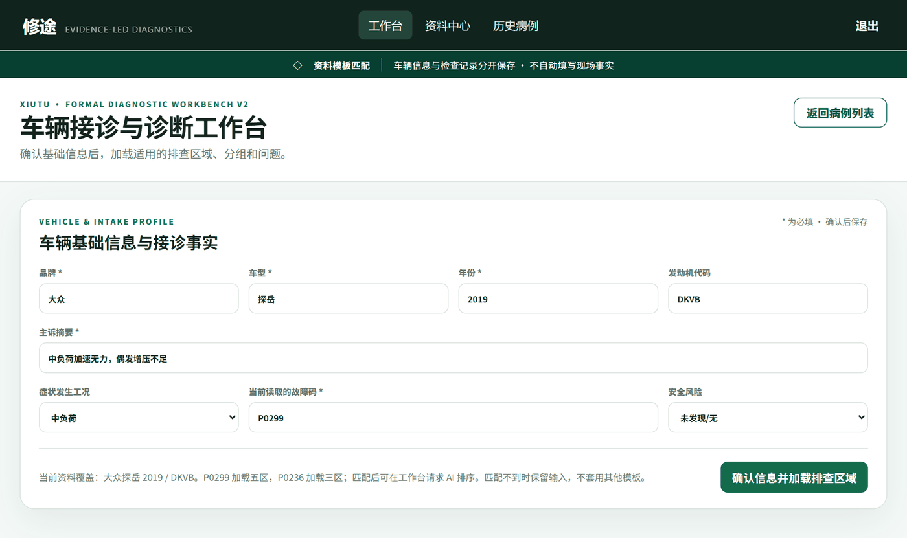
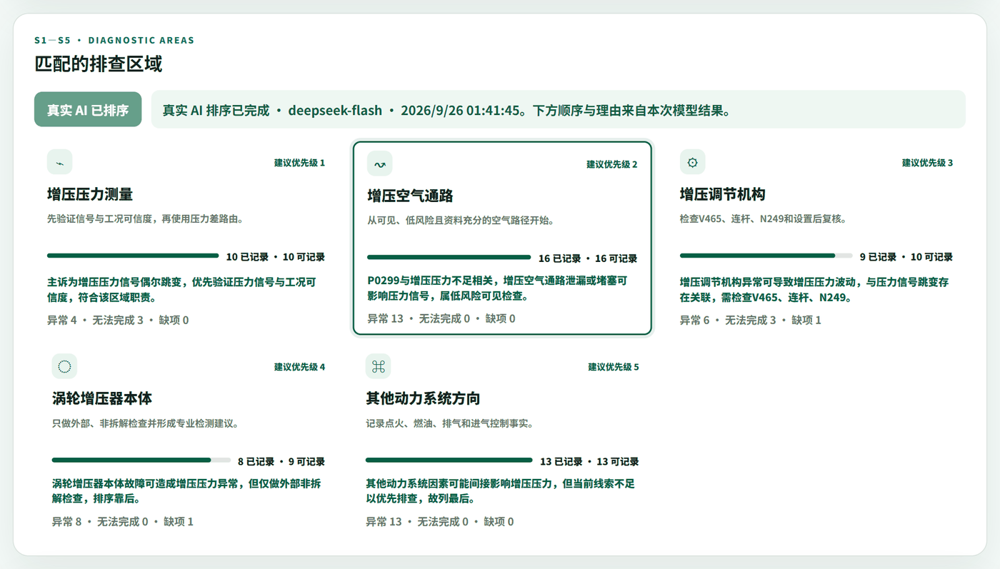
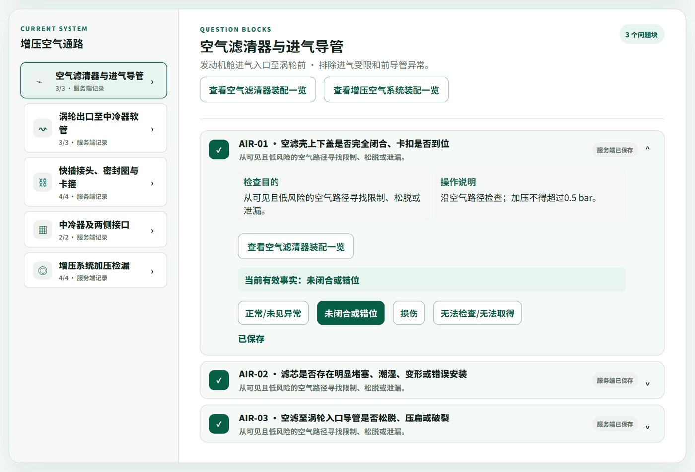
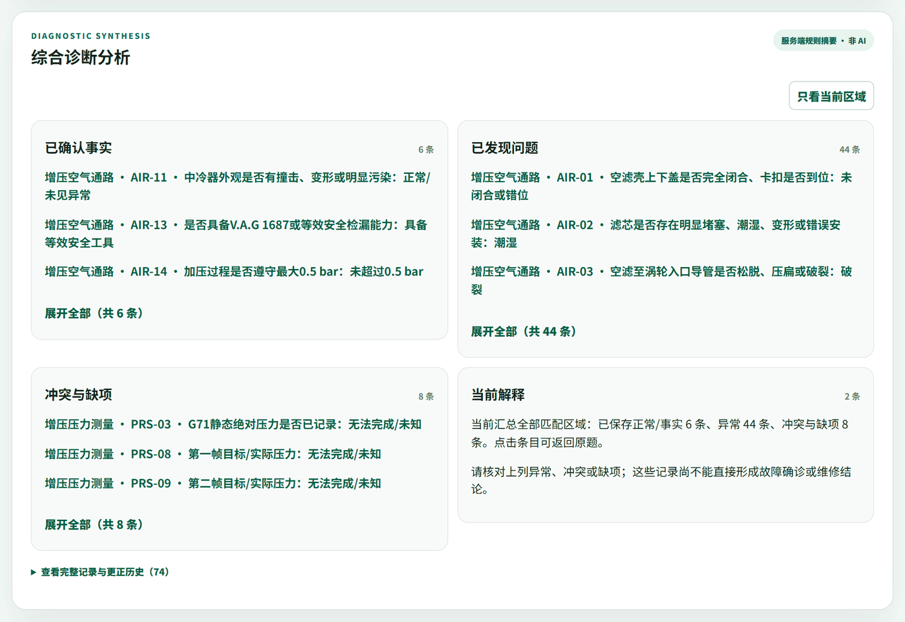
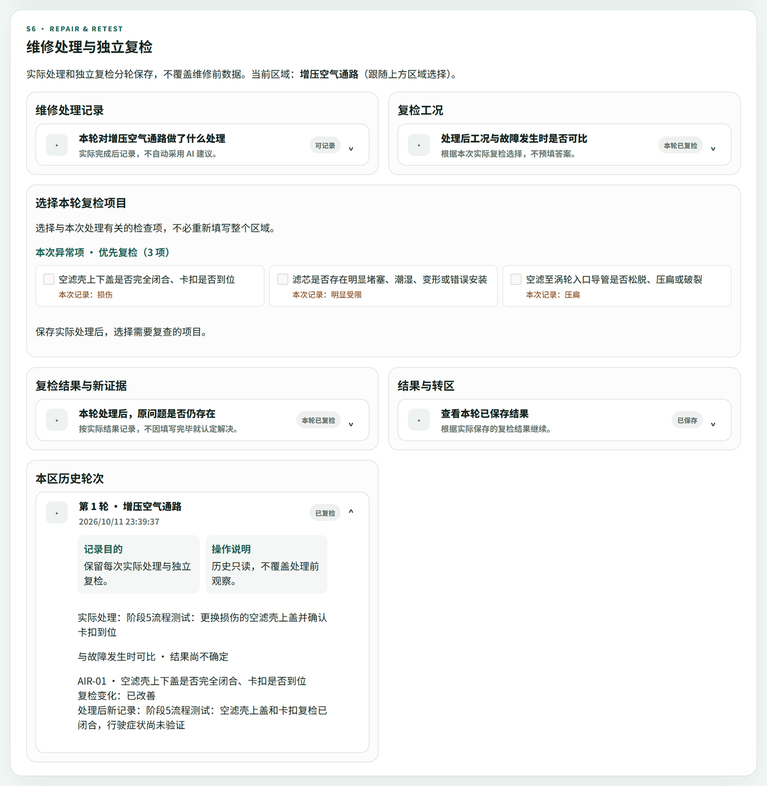
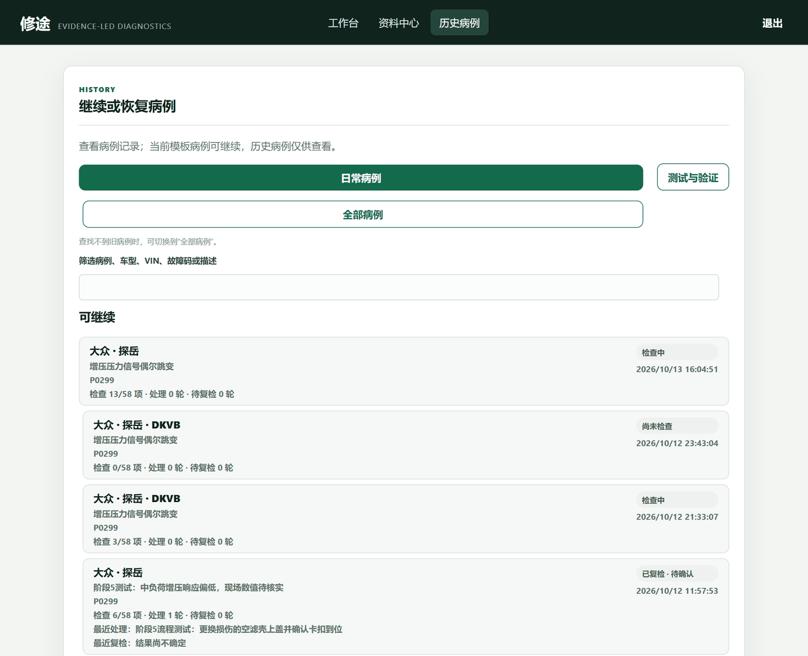
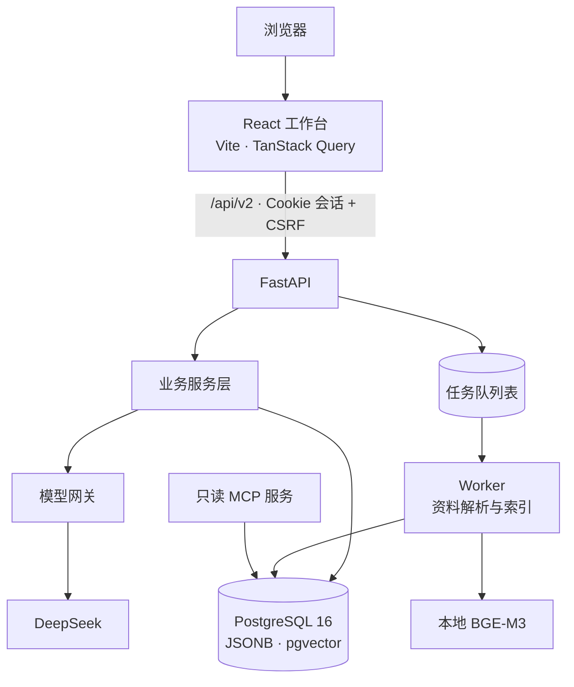

# 修途 Xiutu

**面向汽车维修现场的 AI 辅助诊断工作台。** 它不是把故障码直接丢给大模型的聊天工具：技师先按排查模板记录检查过程，再由 AI 根据已记录的事实和绑定的维修资料给出下一步建议；实际做了什么维修、修完后复检结果如何，另外单独记录。


<p align="center">
  
</p>

> 截图来自本地运行的项目，所用病例均为测试 / 演示数据，不是真实车辆的检查或维修记录。

---

## 为什么做这个项目

在维修现场，车辆主诉、故障码、检查结果和维修资料往往分散在不同地方。如果直接问大模型“P0299 怎么修”，得到的通常是一份什么都提到、却和眼前这台车的检查情况关系不大的清单。

修途想解决的是三个问题：

| 问题 | 修途的做法 |
| --- | --- |
| AI 不知道现场已经查过什么 | 按模板逐区域记录检查结果，AI 只基于**当前有效记录**和**区域绑定资料**分析，没查过的项目明确标为未知 |
| 建议、事实和维修混在一起，事后说不清 | AI 建议、现场检查、实际处理、维修后复检**分开存储**，任何一方都不会被另一方覆盖 |
| 改了记录或模板，旧病例就对不上了 | 病例创建时**冻结模板快照**；更正答案时**新增一条记录**指向旧记录，原始历史完整保留 |

## 它怎么工作



以一个增压不足（P0299）的病例为例：

1. **接诊**：填写品牌、车型、年款、主诉和故障码。后端按已发布的适用关系找到唯一匹配的排查模板，创建病例并保存完整的模板快照。
2. **检查**：前端根据模板配置生成区域（如进气管路、增压调节、传感器……）、分组和题目。技师选择检查结果、填写测量值；单选自动保存，改答案走更正接口。
3. **规则摘要**：不调用模型，按模板规则把记录整理成事实、异常、未知和数值冲突，先给出一份确定性的摘要。
4. **AI 综合分析**：技师主动点击后，后端汇总有记录的区域、这些区域绑定的维修资料和未知项，生成结构化建议——当前判断、可执行步骤、执行前提与停止条件、需要等待条件满足的后续分支、复检方式。
5. **处理与复检**：技师如实记录做了什么（例如更换了某段软管），再保存处理后的新证据。维修前的“软管破损”记录仍然保留。
6. **历史**：病例可以结束，也可以之后从历史列表打开、恢复，继续排查。

> 不配置模型密钥也能完整体验接诊、检查、规则摘要、处理复检和历史恢复；只有 AI 分析需要密钥。

## 界面一览

<table>
  <tr>
    <td width="50%" valign="top">
      <b>① 接诊</b>：填写车辆、主诉和故障码，匹配适用模板<br><br>
      
    </td>
    <td width="50%" valign="top">
      <b>② 匹配的排查区域</b>：AI 对已匹配区域排序并给出理由<br><br>
      
    </td>
  </tr>
  <tr>
    <td width="50%" valign="top">
      <b>③ 分区域检查</b>：题目由模板配置生成，答案保存在服务端<br><br>
      
    </td>
    <td width="50%" valign="top">
      <b>④ 规则摘要（非 AI）</b>：按规则整理事实、异常、冲突与缺项<br><br>
      
    </td>
  </tr>
  <tr>
    <td width="50%" valign="top">
      <b>⑤ 维修处理与独立复检</b>：分轮保存，不覆盖维修前记录<br><br>
      
    </td>
    <td width="50%" valign="top">
      <b>⑥ 历史病例</b>：显示检查进度、处理轮次与最近复检<br><br>
      
    </td>
  </tr>
</table>

## 设计要点

### 1. 模板驱动，病例冻结快照

区域、题目、选项和规则来自版本化的模板 JSON（[`resources/templates`](resources/templates)），而不是写死在前端。病例创建时保存一份完整的模板定义，之后公共模板升级不会改变旧病例的题目和规则。
→ [`workbench_templates.py`](backend/app/services/workbench_templates.py) · [`case_service.py`](backend/app/services/case_service.py)

### 2. 记录只追加，不覆盖

- 更正答案时新增一行，用 `supersedes_id` 指向被更正的记录；页面使用当前有效记录，历史全部可查。
- 写操作携带病例 `revision`，基于旧数据的提交会返回冲突，避免多窗口互相覆盖。
- 创建病例、提交观察等接口支持幂等键，重复请求不会产生重复数据；相关写入在同一事务中提交。

→ [`workbench_observation_service.py`](backend/app/services/workbench_observation_service.py)

### 3. AI 调用可追溯、可复现

每次综合分析都保存为一次“尝试”（`area_analysis_attempts`）：

- 保存**输入快照**、模型名、提示词版本和由输入内容计算的**输入身份哈希**；
- 记录变化后，旧结果自动标记为**过期**；相同输入已有有效结果时不重复发起；
- 失败保留错误信息，由用户手动重试，不会静默重放；
- 输出是统一的结构化字段（`summary` / `steps` / `conditional_branches` / `verification` / `missing` …），前端据此渲染行动卡片；
- 本地**用量账本**需要显式初始化，逐次登记模型调用，避免“启动就花钱”。

→ [`area_analysis_service.py`](backend/app/services/area_analysis_service.py) · [`model_budget.py`](backend/app/infrastructure/model_budget.py)

### 4. AI 建议 ≠ 维修事实

模型输出只进入分析结果。实际处理和复检保存在独立的维修轮次（`template_repair_rounds`）中，平台因此能回答“建议了什么、实际做了什么、结果如何”，而不只是展示一段回答。
→ [`template_repair_service.py`](backend/app/services/template_repair_service.py)

### 5. 资料中心：解析、审核、混合检索

作为独立子系统，资料中心支持上传 Markdown / PDF，由后台 Worker 解析分块；审核通过的资料建立索引：

- **稀疏检索**：自实现的 TF-IDF，对中文做字 + 二元切分，并完整保留 `P0299` 这类故障码做精确匹配；
- **向量检索**：本地 BGE-M3 模型（ONNX Runtime）生成 1024 维向量，存入 pgvector；
- **融合**：两路结果用 RRF（k=60）合并排序，再按权限和车辆适用范围过滤。

→ [`retrieval/`](backend/app/retrieval) · [`ingest.py`](backend/app/services/ingest.py)

### 6. 只读 MCP 工具服务

资料检索能力还通过 [MCP](https://modelcontextprotocol.io/) 暴露为三个只读工具（`search_manuals`、`get_evidence_context`、`get_measurement_spec`），按病例授权和白名单校验调用。服务在 Docker 中以只读文件系统、非 root 用户、`cap_drop: ALL` 运行。
→ [`mcp_server/`](backend/app/mcp_server) · [`deploy/compose.yaml`](deploy/compose.yaml)

## 系统架构



后端按 `api → services → domain / repositories → infrastructure` 分层；数据库结构由 Alembic 管理（当前 23 个迁移版本）。综合分析由 API 请求直接调用模型网关，Worker 负责资料解析与索引等后台任务。

## 技术栈

| 层 | 技术 |
| --- | --- |
| 前端 | React 19 · TypeScript 5.9 · Vite 7 · React Router 7 · TanStack Query 5 · Vitest |
| 后端 | Python 3.12 · FastAPI · Pydantic 2 · SQLAlchemy 2 · psycopg 3 |
| 数据 | PostgreSQL 16 · pgvector · Alembic |
| AI | DeepSeek（经 LangChain 适配层）· 结构化输出 · BGE-M3 本地向量模型（ONNX Runtime）|
| 检索 | 自实现 TF-IDF + 向量检索 + RRF 融合 · Markdown / PDF 解析 |
| 工具协议 | MCP（Model Context Protocol）|
| 工程 | uv · Docker Compose · Ruff · pytest · OpenAPI → TypeScript 类型生成 |

## 快速开始

**环境要求**：Python 3.12、Node.js 24.14.0、[uv](https://docs.astral.sh/uv/)、Docker Desktop（Linux 引擎）。以下命令以 Windows PowerShell 为例。

```powershell
# 1. 安装依赖
uv sync --frozen --group dev
Push-Location frontend; npm ci; Pop-Location

# 2. 配置：复制示例并填写自己的本地数据库密码与 DATABASE_URL
Copy-Item .env.example .env

# 3. 启动数据库（密码需与 .env 一致）
$env:XIUTU_DB_PASSWORD = Read-Host '本地数据库密码'
docker compose -f deploy/compose.yaml up -d postgres

# 4. 初始化：先校验模板与资料，再写入空数据库（不会重置已有病例库）
uv run python scripts/setup_workspace.py
uv run python scripts/setup_workspace.py --apply

# 5. 一键启动 API、前端和 Worker（Ctrl+C 结束）
uv run python scripts/dev.py
```

打开 <http://localhost:5215/workbench> 新建病例，或 <http://localhost:5215/history> 查看历史病例。

**启用真实 AI（可选）**：在 `.env` 中填写 `DEEPSEEK_API_KEY`，然后显式初始化用量账本：

```powershell
uv run python scripts/setup_workspace.py --enable-ai-budget
```

此后只有在页面上点击分析按钮才会请求模型。更多细节见 [本地运行指南](docs/guides/local-development.md)。

## 测试

```powershell
uv run python scripts/check_repository.py      # 资源完整性 + 密钥泄露扫描
uv run pytest tests/unit -p no:cacheprovider    # 单元测试
Push-Location frontend
npm run typecheck; npm run test:wp14 -- --run   # 前端类型检查与组件测试
Pop-Location
```

- 后端约 500 个测试用例，分为 `unit` / `integration` / `contract` / `probes`；前端 19 个测试文件。
- 需要数据库的集成测试只连接显式指定的隔离库 `xiutu_test_*`，不会误连开发库。
- 调用付费模型的 `live` 测试默认不运行。

详见 [测试指南](docs/guides/testing.md)。

## 目录结构

```text
backend/app/
  api/              HTTP 路由、认证、错误封装
  services/         业务编排（病例、检查、分析、维修复检、资料）
  domain/           领域类型与数据契约
  repositories/     数据访问
  infrastructure/   数据库、模型网关、向量模型、任务存储、用量账本
  retrieval/        分块、解析、稀疏检索、混合检索
  mcp_server/       只读 MCP 工具服务
  validators/       模型输出结构与内容校验
  worker.py         后台任务进程
frontend/src/formal/  正式工作台页面、组件、API 客户端
migrations/           Alembic 数据库迁移
resources/            版本化模板、区域维修资料、隔离历史样本
scripts/              初始化、开发启动、校验、维护脚本
tests/                单元 / 集成 / 契约 / 探针测试
deploy/               Docker Compose 与 MCP 服务镜像
docs/                 架构、指南、源码导读、路线图、历史记录
```

## 当前状态与路线

修途目前是一个**可在本地完整运行的单用户项目**，完成了“接诊 → 检查 → AI 建议 → 实际处理 → 独立复检 → 历史恢复”的记录闭环。

| 状态 | 内容 |
| --- | --- |
| ✅ 已完成 | 模板匹配与快照、检查保存与更正历史、规则摘要、AI 区域排序与综合分析、处理与独立复检、病例生命周期与历史恢复、资料中心混合检索、只读 MCP 服务 |
| 🚧 进行中 | v2 模板的资料角色与章节映射；空答案在进度、页面和 AI 输入中的统一口径 |
| 📋 计划 | 把维修后的复检结果接入下一次 AI 分析；资料中心检索与工作台分析打通；覆盖更多车型与多故障码组合 |

**知识覆盖范围**：目前发布的模板覆盖 **大众探岳 2019 款 · DKVB 发动机** 的 **P0299（增压不足）** 和 **P0236（增压压力传感器）** 两类单故障码场景。匹配机制和规则是通用配置，扩展到其他车型需要补充对应的模板与资料。

完整的能力与缺口分析见 [当前能力与缺口](docs/roadmap/current-capabilities.md)。

## 深入阅读

| 文档 | 内容 |
| --- | --- |
| [项目结构与模块实现](docs/architecture/project-structure.md) | 每个目录、模块负责什么 |
| [完整业务数据流](docs/architecture/data-flow.md) | 点击之后数据怎样一步步变化 |
| 源码导读 [①接诊与模板](docs/learning/01-intake-and-template.md) · [②检查与更正](docs/learning/02-observations-and-projection.md) · [③AI 输入与结果](docs/learning/03-analysis-and-references.md) · [④处理复检与历史](docs/learning/04-repair-retest-and-history.md) | 沿四条业务链阅读源码 |
| [架构决策记录](docs/adr) | 范围界定、本地向量模型、模型工厂等决策 |
| [文档导航](docs/README.md) | 全部文档索引 |

## 声明

修途是辅助记录与分析工具，**不能替代官方维修手册和专业技师的判断**。AI 建议的结构校验通过，不代表建议在现场一定正确；任何维修操作都应以车辆对应的官方资料为准。仓库不包含任何真实病例数据、模型调用记录或凭证。
