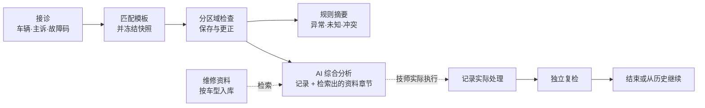
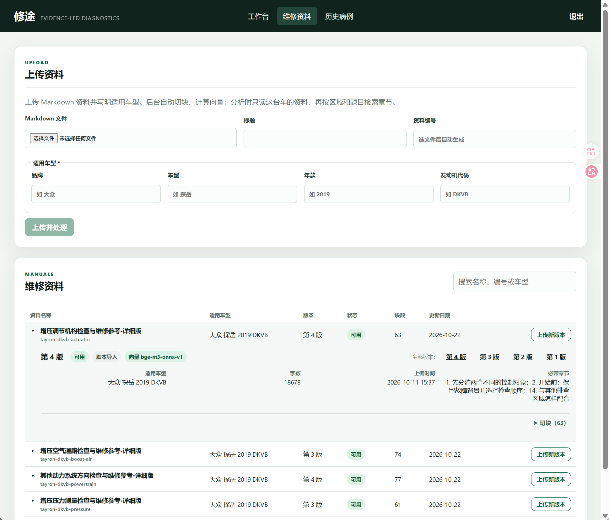
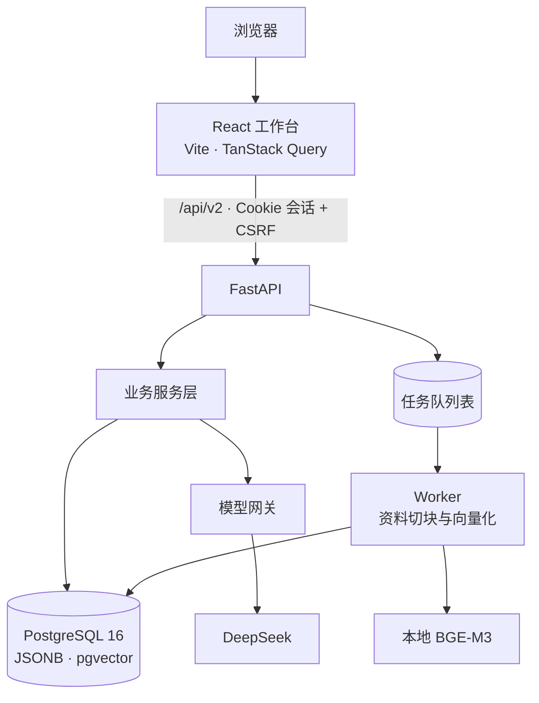

# 修途 Xiutu

**面向汽车维修现场的 AI 辅助诊断工作台。** 它不是把故障码直接丢给大模型的聊天工具：技师先按排查模板记录检查过程，再由 AI 根据已记录的事实和这台车的维修资料给出下一步建议；实际做了什么维修、修完后复检结果如何，另外单独记录。


<p align="center">
  
</p>

> 截图来自本地运行的项目，所用病例均为测试 / 演示数据，不是真实车辆的检查或维修记录。

---

## 为什么做这个项目

在维修现场，车辆主诉、故障码、检查结果和维修资料往往分散在不同地方。如果直接问大模型“P0299 怎么修”，得到的通常是一份什么都提到、却和眼前这台车的检查情况关系不大的清单。

修途想解决的是三个问题：

| 问题 | 修途的做法 |
| --- | --- |
| AI 不知道现场已经查过什么 | 按模板逐区域记录检查结果，AI 只基于**当前有效记录**和**从这台车的维修资料里检索出的相关章节**分析，没查过的项目明确标为未知 |
| 建议、事实和维修混在一起，事后说不清 | AI 建议、现场检查、实际处理、维修后复检**分开存储**，任何一方都不会被另一方覆盖 |
| 改了记录或模板，旧病例就对不上了 | 病例创建时**冻结模板快照**；更正答案时**新增一条记录**指向旧记录，原始历史完整保留 |

## 它怎么工作



以一个增压不足（P0299）的病例为例：

1. **接诊**：填写品牌、车型、年款、主诉和故障码。后端按已发布的适用关系找到唯一匹配的排查模板，创建病例并保存完整的模板快照。
2. **检查**：前端根据模板配置生成区域（如进气管路、增压调节、传感器……）、分组和题目。技师选择检查结果、填写测量值；单选自动保存，改答案走更正接口。
3. **规则摘要**：不调用模型，按模板里的规则把记录整理成事实、异常、未知和数值冲突，并给出派生结论（如三帧读数是否一致）。
4. **AI 综合分析**：技师主动点击后，后端汇总有记录的区域、规则结论、已做的处理与复检，再从这台车的维修资料里为每个区域检索相关章节，生成结构化建议——当前判断、可执行步骤、执行前提与停止条件、需要等待条件满足的后续步骤。
5. **处理与复检**：技师如实记录做了什么（例如更换了某段软管），再做独立复检；复检时重新回答的题目存成新记录，维修前的“软管破损”记录仍然保留，下一次 AI 分析会看到处理前后的变化。
6. **历史**：病例可以结束，也可以之后从历史列表打开、继续排查。

> 不配置模型密钥也能完整体验接诊、检查、规则摘要、处理复检和历史；只有 AI 分析需要密钥。

## 界面一览

<table>
  <tr>
    <td width="50%" valign="top">
      <b>① 接诊</b>：填写车辆、主诉和故障码，匹配适用模板<br><br>
      
    </td>
    <td width="50%" valign="top">
      <b>② 匹配的排查区域</b>：AI 对已匹配区域排序并给出理由<br><br>
      
    </td>
  </tr>
  <tr>
    <td width="50%" valign="top">
      <b>③ 分区域检查</b>：题目由模板配置生成，答案保存在服务端<br><br>
      
    </td>
    <td width="50%" valign="top">
      <b>④ 规则摘要（非 AI）</b>：按规则整理事实、异常、冲突与缺项<br><br>
      
    </td>
  </tr>
  <tr>
    <td width="50%" valign="top">
      <b>⑤ 维修处理与独立复检</b>：第 1 步记录处理，第 2 步复检并重新回答相关题目<br><br>
      
    </td>
    <td width="50%" valign="top">
      <b>⑥ 历史病例</b>：显示检查进度、处理轮次与最近复检<br><br>
      
    </td>
  </tr>
  <tr>
    <td width="50%" valign="top">
      <b>⑦ 维修资料</b>：按适用车型上传 Markdown，后台切块、算向量，可查看版本和切块<br><br>
      
    </td>
    <td width="50%" valign="top">
    </td>
  </tr>
</table>

## 设计要点

### 1. 模板驱动，病例冻结快照

区域、题目、选项和规则来自版本化的模板 JSON（[`resources/templates`](resources/templates)），而不是写死在前端。病例创建时保存一份完整的模板定义，之后公共模板升级不会改变旧病例的题目和规则。计算规则（如“三帧读数是否一致”）和观察规则（如“选了某项就提示关注另几题”）也写在模板数据里，由通用代码执行。
→ [`workbench_templates.py`](backend/app/services/workbench_templates.py) · [`template_projection.py`](backend/app/services/template_projection.py)

### 2. 记录只追加，不覆盖

- 更正答案时新增一行，用 `supersedes_id` 指向被更正的记录；页面使用当前有效记录，历史全部可查。数据库触发器拒绝修改或删除已有记录。
- 写操作携带病例 `revision`，并锁定病例行；基于旧数据的提交会返回冲突，避免多窗口互相覆盖。
- 创建病例、提交检查等接口支持幂等键，重复请求不会产生重复数据；相关写入在同一事务中提交。

→ [`workbench_observation_service.py`](backend/app/services/workbench_observation_service.py) · [`write_guards.py`](backend/app/services/write_guards.py)

### 3. AI 调用可追溯、可复现

每次综合分析都保存为一次“尝试”（`area_analysis_attempts`）：

- 保存**输入快照**、模型名、提示词版本和由输入内容计算的**输入身份哈希**；
- 记录或资料变化、提示词升级后，旧结果自动标记为**过期**；相同输入已有有效结果时不重复发起；
- 失败保留错误信息，由用户手动重试，不会静默重放；
- 输出是统一的结构化字段（当前判断、行动步骤及其执行前提和停止条件、暂缓的后续步骤……），前端据此渲染行动卡片；
- 本地**用量账本**需要显式初始化，逐次登记模型调用，避免“启动就花钱”。

→ [`area_analysis_service.py`](backend/app/services/area_analysis_service.py) · [`model_budget.py`](backend/app/infrastructure/model_budget.py)

### 4. AI 建议 ≠ 维修事实

模型输出只进入分析结果。实际处理和复检保存在独立的维修轮次（`template_repair_rounds`）中，平台因此能回答“建议了什么、实际做了什么、结果如何”，而不只是展示一段回答。下一次分析时，处理与复检作为输入的一部分，并标明每条检查记录是处理前还是处理后取得的。
→ [`template_repair_service.py`](backend/app/services/template_repair_service.py)

### 5. 维修资料按车型入库，分析时两步检索

资料只说明两件事：**适用哪台车**、**内容是什么**，不和任何模板或区域挂钩。

- **入库**：在“维修资料”页按车型上传 Markdown；后台 Worker 按小节切块、提取零件/工具/故障码编号，用本地 BGE-M3 模型（ONNX Runtime）算向量，存进 PostgreSQL（pgvector）。全部成功才标为可用；新版本保留旧版本。
- **第一步，选资料**：每个区域的名称、说明和题目在这台车的全部资料里检索，按命中投票，选出该区域要读的资料。
- **第二步，选章节**：在选中的资料里，每条记录、每道未做的题各检索一次——编号精准查找、BM25 关键词、向量三路结果用 RRF 融合——取排名靠前的整章原文，加上每份资料设定的必带章节，发给 AI。
- 资料还没处理完时，分析现场切块计算；没有本地向量模型时，退回发送整份资料原文。两种情况分析都照常进行。

→ [`retrieval_reading.py`](backend/app/services/retrieval_reading.py) · [`section_search.py`](backend/app/retrieval/section_search.py) · [`reference_ingest.py`](backend/app/services/reference_ingest.py)

## 系统架构



后端按 `api → services → domain / repositories → infrastructure` 分层；数据库结构由 Alembic 管理（当前 26 个迁移版本）。综合分析由 API 请求直接调用模型网关，Worker 只负责资料切块和算向量。更详细的结构与数据流见 [架构说明](docs/architecture.md)。

## 技术栈

| 层 | 技术 |
| --- | --- |
| 前端 | React 19 · TypeScript 5.9 · Vite 7 · React Router 7 · TanStack Query 5 · Vitest |
| 后端 | Python 3.12 · FastAPI · Pydantic 2 · SQLAlchemy 2 · psycopg 3 |
| 数据 | PostgreSQL 16 · pgvector · Alembic |
| AI | DeepSeek（经 LangChain 适配层）· 结构化输出 · BGE-M3 本地向量模型（ONNX Runtime）|
| 检索 | 自实现：按章节切块 · 编号精准查找 + BM25 + 向量 · RRF 融合 · 两步检索 |
| 工程 | uv · Docker Compose · Ruff · pytest · GitHub Actions · OpenAPI → TypeScript 类型生成 |

## 快速开始

**环境要求**：Python 3.12、Node.js 24.14.0、[uv](https://docs.astral.sh/uv/)、Docker Desktop（Linux 引擎）。以下命令以 Windows PowerShell 为例。

```powershell
# 1. 安装依赖
uv sync --frozen --group dev
Push-Location frontend; npm ci; Pop-Location

# 2. 配置：复制示例并填写自己的本地数据库密码与 DATABASE_URL
Copy-Item .env.example .env

# 3. 启动数据库（密码需与 .env 一致）
$env:XIUTU_DB_PASSWORD = Read-Host '本地数据库密码'
docker compose -f deploy/compose.yaml up -d postgres

# 4. 初始化：先校验模板与资料，再写入空数据库（不会重置已有病例库）
uv run python scripts/setup_workspace.py
uv run python scripts/setup_workspace.py --apply

# 5. 一键启动 API、前端和 Worker（Ctrl+C 结束）
uv run python scripts/dev.py
```

打开 <http://localhost:5215/workbench> 新建病例，<http://localhost:5215/history> 查看历史病例，<http://localhost:5215/documents> 管理维修资料。

**启用真实 AI（可选）**：在 `.env` 中填写 `DEEPSEEK_API_KEY`，然后显式初始化用量账本：

```powershell
uv run python scripts/setup_workspace.py --enable-ai-budget
```

此后只有在页面上点击分析按钮才会请求模型。

**本地向量模型（可选）**：上传新资料、按向量检索章节需要本地 BGE-M3 模型，在 `.env` 中设置 `EMBEDDING_MODEL_PATH`。没有模型时，仓库自带的资料仍可用于分析（整份发送）。更多细节见 [本地运行指南](docs/guides/local-development.md)。

## 测试

```powershell
uv run python scripts/check_repository.py      # 资源完整性 + 密钥泄露扫描
uv run python -m pytest tests/unit tests/contract -p no:cacheprovider -q --basetemp .test-runs\pt
Push-Location frontend
npm run typecheck; npm test                   # 前端类型检查与组件测试
Pop-Location
```

- 后端测试分为 `unit` / `contract` / `integration` / `probes`；需要数据库的集成测试只连接显式指定的隔离库 `xiutu_test_*`，不会误连开发库。
- 调用付费模型的测试默认不运行。
- 单元测试要用 `python -m pytest` 启动，测试才能导入项目里的 `scripts`；`--basetemp` 把临时目录放在项目内，避免 Windows 系统临时目录的权限错误。

详见 [测试指南](docs/guides/testing.md)。

## 目录结构

```text
backend/app/
  api/              HTTP 路由、认证、错误封装
  services/         业务编排（病例、检查、规则、分析、维修复检、资料入库与检索）
  domain/           数据契约与 AI 输出结构
  repositories/     病例数据访问
  infrastructure/   数据库表与事务、模型网关、向量模型、任务队列、用量账本
  retrieval/        章节检索（精准查找、BM25、向量、RRF）
  reading_config/   记录角色、必带章节等版本化配置
  worker.py         后台任务进程（资料切块与向量化）
frontend/src/
  pages/            工作台、历史病例、维修资料三个页面
  workbench/        病例工作台的各部分（接诊、检查、AI 分析、维修复检）
  components/       通用组件
  lib/              API 客户端、登录会话、类型
  styles/           全局样式
migrations/           Alembic 数据库迁移
resources/            版本化模板、维修资料原文与资料列表
evals/                检索与 AI 建议的离线评测题
scripts/              初始化、开发启动、校验、评测脚本
tests/                单元 / 契约 / 集成 / 探针测试
deploy/               本地 PostgreSQL 的 Docker Compose
docs/                 架构说明、运行与测试指南、历史记录
```

## 当前状态与路线

修途目前是一个**可在本地完整运行的单用户项目**，完成了“接诊 → 检查 → 规则摘要 → AI 建议 → 实际处理 → 独立复检 → 历史”的闭环，维修资料可以按车型上传，分析时自动检索相关章节。

**知识覆盖范围**：目前发布的模板覆盖 **大众探岳 2019 款 · DKVB 发动机** 的 **P0299（增压不足）** 和 **P0236（增压压力传感器）** 两类单故障码场景，配有 5 份区域维修资料。匹配机制和规则是通用配置，扩展到其他车型需要补充对应的模板与资料。

**已知局限与后续方向**：

- 资料目前一个区域正好一份，第一步“选资料”比较容易；资料变多、一份讲多个区域时需要重新验证。
- 前端还有少量按题号写的显示判断，下次修订模板时改为由模板数据驱动。
- 单用户、会话保存在内存、没有生产部署，只适合本地使用。
- 覆盖更多车型与多故障码组合。

## 深入阅读

| 文档 | 内容 |
| --- | --- |
| [架构说明](docs/architecture.md) | 模块分工、数据表、一次 AI 分析的完整数据流 |
| [本地运行指南](docs/guides/local-development.md) | 环境、初始化、可选的 AI 与向量模型 |
| [测试指南](docs/guides/testing.md) · [脚本入口](docs/guides/scripts.md) | 测试分层与常用脚本 |
| [架构决策记录](docs/adr) | 范围界定、本地向量模型、模型工厂等决策 |
| [文档导航](docs/README.md) | 全部文档索引（含历史记录） |

## 声明

修途是辅助记录与分析工具，**不能替代官方维修手册和专业技师的判断**。AI 建议的结构校验通过，不代表建议在现场一定正确；任何维修操作都应以车辆对应的官方资料为准。仓库不包含任何真实病例数据、模型调用记录或凭证。
