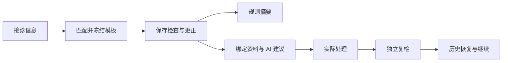

# 修途 Xiutu

基于版本化排查模板、检查记录与维修资料的车辆诊断工作台。

用户填写车辆与主诉，匹配适用模板，保存现场检查结果，结合区域资料生成 AI 建议，再单独记录实际处理与独立复检。历史病例保留检查更正、分析快照和维修轮次。

## 业务流程



AI 建议不会自动写成维修事实。未检查保持未知，更正保留原记录；用户结束工作不等于车辆已修复。

## 技术栈

- 前端：React、TypeScript、Vite、TanStack Query、React Router。
- 后端：Python 3.12、FastAPI、Pydantic、SQLAlchemy、psycopg。
- 数据：PostgreSQL 16、pgvector、Alembic。
- AI：DeepSeek 结构化输出、输入快照与调用账本。
- 资料中心：Markdown/PDF 解析、本地 embedding、稀疏与向量检索。

当前模板综合分析直接使用区域绑定资料与版本化阅读配置；资料中心检索是独立子系统。旧图执行器只保留在明确隔离支持路径，不是当前主流程。

## 项目结构

```text
backend/app/          API、业务服务、领域契约、数据库与模型设施
frontend/             正式 React 页面、静态资源、前端测试
migrations/           数据库结构迁移
resources/            可版本化的模板、参考资料和隔离历史样本
scripts/              初始化、开发启动、校验、发布与维护入口
tests/                单元、集成、契约、测试夹具
docs/                 架构、使用指南、源码阅读与历史说明
deploy/               Docker Compose 与工具服务部署
evals/                评估相关配置
skills/               保留的工具/流程资源
```

本机 `.env`、`.local-data`、虚拟环境、node_modules、数据库备份、日志和运行证据不进入 Git。

## 快速开始

需要 Python 3.12、Node.js 24.14.0、uv 和 Docker Desktop（Linux Engine）。

```powershell
# 在仓库根目录执行
Copy-Item .env.example .env
uv sync --frozen --group dev
Push-Location frontend
npm ci
Pop-Location
```

编辑 `.env`，设置本地数据库密码和 DATABASE_URL。不要使用示例占位值作为实际凭证。已有数据库/容器的机器请先确认目标，不要删除现有卷。

```powershell
# 密码仅用于当前 shell，须与 .env 中数据库连接一致
$env:XIUTU_DB_PASSWORD = Read-Host '本地数据库密码'
docker compose -f deploy/compose.yaml up -d postgres

# 先检查资源；--apply 仅初始化无病例的目标数据库
uv run python scripts/setup_workspace.py
uv run python scripts/setup_workspace.py --apply

# 前台管理本次 API、前端、worker；Ctrl+C 结束本次创建的进程
uv run python scripts/dev.py
```

打开 [工作台](http://localhost:5215/workbench) 或 [历史病例](http://localhost:5215/history)。详细步骤见 [本地运行指南](docs/guides/local-development.md)。

原开发机器的已有实例继续使用 `scripts/wp15_workbench.py start|stop|status`，沿用它登记的数据库与身份；不要对已有病例库重复执行初始化。

## AI 设置

未配置 DEEPSEEK_API_KEY 时仍可体验接诊、检查、规则摘要、处理复检和历史恢复。真实分析需要本机 key 与显式初始化的用量账本，点击按钮才请求模型；参见 [本地运行指南](docs/guides/local-development.md)。

没有上传当前病例数据库、模型调用账本或实际凭证。克隆项目得到源码和版本化模板/资料，不会获得原机器的历史病例。

## 验证

```powershell
uv run python scripts/check_repository.py
uv run pytest tests/unit/test_area_analysis.py tests/unit/test_analysis_context.py tests/unit/test_template_repair_retest.py tests/unit/test_worker_runtime_boundary.py -p no:cacheprovider
Push-Location frontend
npm run typecheck
npm run build
npm run test:wp14 -- --run
Pop-Location
```

数据库集成测试只连接明确的隔离 `xiutu_test_*` 库；不回退开发库。真实模型测试不是默认测试的一部分。更多说明见 [测试指南](docs/guides/testing.md)。

## 阅读项目

- [文档导航](docs/README.md)
- [结构与模块实现](docs/architecture/project-structure.md)
- [完整业务数据流](docs/architecture/data-flow.md)
- [源码阅读：创建病例](docs/learning/01-intake-and-template.md)
- [源码阅读：保存与更正](docs/learning/02-observations-and-projection.md)
- [源码阅读：AI 输入与结果](docs/learning/03-analysis-and-references.md)
- [源码阅读：处理复检与历史](docs/learning/04-repair-retest-and-history.md)
- [当前能力与缺口](docs/roadmap/current-capabilities.md)

## 当前边界

已发布模板主要覆盖大众探岳 2019、P0299/P0236。匹配机制与规则可配置，不代表知识已覆盖全部车辆或多故障码组合。独立维修复检已保存，但尚未直接进入综合 AI 输入；新模板资料角色/章节映射仍有待同步。结构化输出有效也不等于现场维修结论已验证。

旧阶段说明保留在 `docs/implementation`、`docs/runbooks` 等路径，并通过文档导航注明用途；原长篇首页说明保存在 `docs/archive/README-before-20261014.md`。不以历史记录作为当前使用说明。
