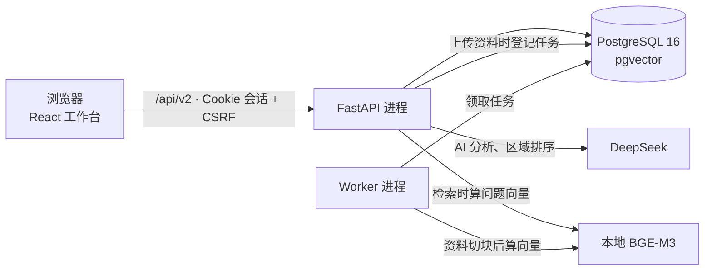
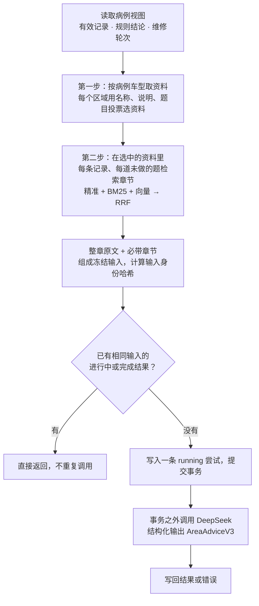

# 架构说明

修途是一个本地运行的单用户 Web 应用：React 前端、FastAPI 后端、PostgreSQL（含 pgvector）、一个后台 Worker，AI 分析调用 DeepSeek，资料向量用本地 BGE-M3 模型计算。本文说明各部分分工、数据存在哪里，以及几条主要操作的数据流。

## 1. 组成

| 进程 | 做什么 |
| --- | --- |
| 前端（Vite，端口 5215） | 工作台、历史病例、维修资料三个页面；通过 `/api` 代理访问后端 |
| API（uvicorn，端口 8215） | 全部业务接口；AI 分析在请求里直接调用模型 |
| Worker（`app.worker`） | 只处理一种后台任务：维修资料切块、提取编号、算向量（`reference_ingest`） |
| PostgreSQL（Docker，端口 5433） | 病例、记录、分析、资料及其切块和向量、任务队列 |

## 2. 后端分层

`api → services → domain / repositories → infrastructure`

| 目录 | 职责 | 关键文件 |
| --- | --- | --- |
| `api/` | 路由、登录与 CSRF 校验、错误格式 | `cases.py`、`area_analyses.py`、`template_repairs.py`、`area_references.py`、`dependencies.py` |
| `services/` | 业务逻辑 | 见下表 |
| `domain/` | 请求与响应结构、AI 输出结构 | `schemas.py`、`area_advice.py` |
| `repositories/` | 病例读写 | `cases.py` |
| `infrastructure/` | 表定义、事务、模型网关、向量模型、任务队列、用量账本 | `orm.py`、`uow.py`、`model_gateway.py`、`bge_gateway.py`、`job_store.py`、`model_budget.py` |
| `retrieval/` | 章节检索算法（纯函数，不碰数据库） | `section_search.py` |
| `topics/` | 版本化配置：记录角色、每份资料的必带章节初始值 | `record_roles_v1.json`、`reading_documents_v1.json` |

| 服务 | 负责 |
| --- | --- |
| `workbench_templates.py` | 按车型和故障码匹配模板，冻结快照 |
| `case_service.py` | 创建、读取、列出病例，附上进度摘要 |
| `workbench_observation_service.py`、`workbench_answer_validation.py`、`workbench_topic_workflow.py` | 保存与更正检查记录：校验答案、执行条件、追加写入 |
| `template_projection.py`、`template_choice_calculation.py`、`template_evidence_calculation.py`、`template_observation_rules.py` | 规则摘要：把记录整理成事实、异常、未知、冲突，计算派生结论 |
| `area_ranking_service.py` | AI 对匹配区域排序（可选） |
| `area_analysis_service.py`、`analysis_context.py` | 组织 AI 输入、调用模型、保存结果 |
| `retrieval_reading.py`、`reference_store.py` | 两步检索：选资料、选章节；读取入库时存好的切块和向量 |
| `reference_ingest.py` | 资料上传、版本、Worker 里的切块和向量化 |
| `template_repair_service.py`、`template_case_history.py` | 维修处理与独立复检；病例进度、结束与继续 |
| `write_guards.py`、`job_queue.py` | 病例行锁与版本检查、幂等键；后台任务入队 |

## 3. 数据表

| 表 | 一行是什么 |
| --- | --- |
| `workbench_templates`、`workbench_template_matches` | 模板版本的完整内容；“车型 + 年款 + 发动机 + 故障码 → 模板”的适用关系 |
| `cases` | 一个病例；`intake_snapshot` 里冻结了模板快照、检查计划和结束状态 |
| `observations` | 一条检查记录；更正时新增一行并用 `supersedes_id` 指向旧行（触发器禁止修改和删除） |
| `template_repair_rounds` | 一轮实际处理及其复检（工况、结果、证据、下一步区域） |
| `case_area_rankings` | 一个病例的 AI 区域排序结果 |
| `area_analysis_attempts` | 一次 AI 分析：输入快照、输入身份哈希、模型、提示词版本、结果或错误 |
| `area_reference_documents` | 一份维修资料的一个版本：正文、适用车型、处理状态、必带章节 |
| `area_reference_chunks`、`area_reference_chunk_vectors` | 资料按 `###` 小节切出的块（含编号数组）；每块的向量（按模型区分） |
| `runs`、`jobs`、`run_events` | 后台任务：状态、租约、事件 |
| `idempotency_keys` | 写请求的幂等键与当时的响应 |

## 4. 前端页面

| 路径 | 页面 | 主要文件 |
| --- | --- | --- |
| `/workbench` | 接诊：填写车辆、主诉、故障码，匹配模板 | `MatchedVehicleIntake.tsx` |
| `/workbench/:caseId` | 病例工作台：区域与题目、规则摘要、AI 分析、维修复检、结束/继续 | `TemplateWorkbenchPage.tsx`、`AreaAnalysis.tsx`、`TemplateRepairRetest.tsx` |
| `/history` | 历史病例：按进度分组，可筛选 | `HistoryPage.tsx` |
| `/documents` | 维修资料：上传、新版本、查看历史版本和切块 | `ReferencesPage.tsx` |

接口类型由后端 OpenAPI 生成（`docs/api/openapi.wp14.json` → `frontend/src/generated/api-schema.ts`），统一的请求工具 `api-client.ts` 负责 CSRF 头和幂等键。

## 5. 主要数据流

### 5.1 创建病例

1. 前端提交车辆、主诉、故障码（只支持一个故障码）。
2. `workbench_templates.resolve_template` 按品牌、车型、年款、故障码查适用关系；填了发动机代码就再按它过滤；同一适用范围取最新版本；匹配不唯一就报错，不猜。
3. 把整份模板内容、内容哈希和根据模板生成的检查计划写进 `cases.intake_snapshot`。之后模板升级不影响这个病例。
4. 整个过程在一个事务里，幂等键保证重复提交只建一个病例。

### 5.2 保存与更正检查记录

1. 请求带上 `expected_revision` 和幂等键；服务锁定病例行并核对版本，旧页面提交会得到 409。
2. 按冻结的模板校验：选项属于这道题、数值在字段范围内、单位一致、执行条件已满足（例如需要先确认安全）。
3. 新增一行 `observations`；更正时 `supersedes_id` 指向被更正的那行。病例 `revision` 加一。
4. 返回重新计算的页面视图（规则摘要随之更新）。

### 5.3 规则摘要

`template_projection.project_template` 只读当前有效记录，按模板里的规则计算：每道题的状态、派生结论（如三帧读数是否一致）、关注提示和冲突，再汇总成事实、异常、无法完成、缺项。不调用模型。

### 5.4 AI 综合分析

- 只有有记录（或有维修轮次）的区域进入输入；没做的题列为未知，不推测。
- 每条记录标明是处理前还是处理后取得的；处理后改写的记录附上处理前的值。
- 输入身份哈希覆盖记录、资料章节、提示词版本等全部输入。任何一项变化后，旧结果显示“已过期”。
- 模型调用在数据库事务之外，长时间的网络请求不会占住病例锁。失败只记录，不自动重试。
- 检索的问题向量和现场计算的块向量缓存在本地（`.local-data/reading-vectors/`）；资料没有可用的入库数据时现场切块计算，结果相同；向量模型不可用时该资料整份发送。

### 5.5 维修处理与独立复检

1. 第 1 步记录实际处理（某个区域、做了什么），生成一轮 `template_repair_rounds`，状态为待复检。
2. 第 2 步记录复检工况（与原故障条件是否相同）、结果、证据，并可重新回答该区域的题目；重新回答的题存成新的检查记录（更正原记录，带上这一轮的编号）。成组采集的读数不支持单项重录。
3. 下一次 AI 分析读取这些轮次：待复检时先安排复检；复检工况不同时不能视为已解决。

### 5.6 维修资料入库

1. 上传 Markdown、标题、适用车型（必填）、可选必带章节；同样内容重复上传返回原版本。
2. 新增一个版本（状态 `queued`），并在任务队列登记 `reference_ingest`。
3. Worker 领取任务：按 `##`/`###` 切块，提取零件、工具、故障码编号，导航类章节存但不参与检索；用本地模型算向量；全部成功才把版本标为 `ready`。
4. 分析时每份资料使用最新的 `ready` 版本；旧版本保留，已有分析记录不受影响。

## 6. 一致性与安全

- **并发**：写操作锁定病例行并检查 `revision`；幂等键防止重复提交；后台任务用数据库租约和心跳，过期的 Worker 不能再写结果。
- **追加写入**：检查记录只追加；更正链完整保留历史。
- **登录**：本机令牌换取 Cookie 会话；写请求要求 CSRF 头和同源 `Origin`。只面向本机使用，没有多用户和生产部署。
- **花钱的调用**：模型调用必须用户点击触发；本地用量账本需要显式初始化，逐次登记。
- **数据库目标**：脚本和测试只连接本机 `127.0.0.1:5433` 上的 `xiutu_dev` 或 `xiutu_test_*` 库，测试不会误连开发库。

## 7. 历史

开发过程中曾经有过“资料中心”（PDF/Markdown 上传、人工审核、按 token 分块、TF-IDF + 向量检索）、基于 LangGraph 的分步诊断流程、只读 MCP 服务和第一版模板。2026-10 的清理中它们被删除，数据库由迁移 `0026_retire_legacy` 处理，详见 [archive/retired-features.md](archive/retired-features.md)。更早的长篇文档保留在 [archive/before-cleanup/](archive/before-cleanup/)。
