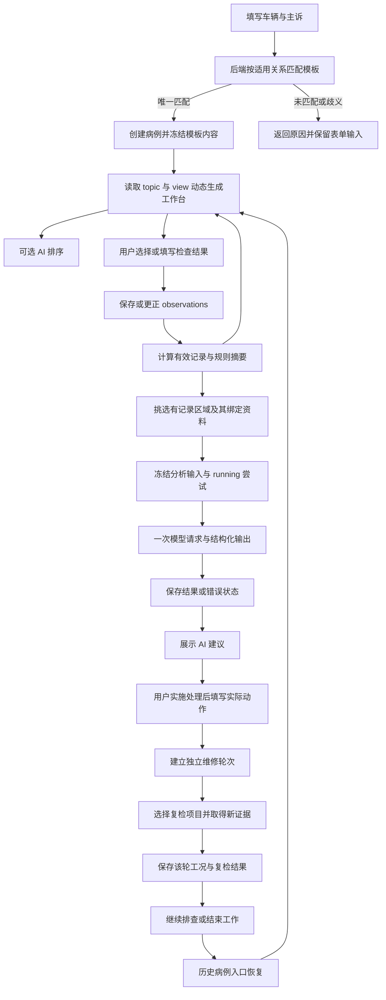
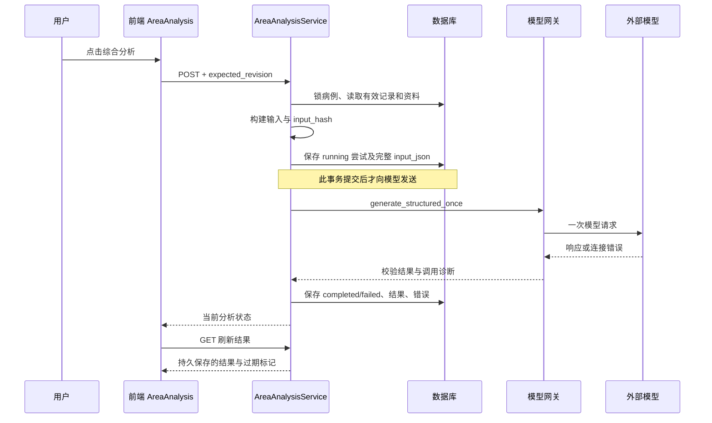
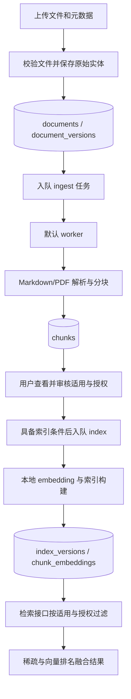

# 修途完整业务数据流与实现详解

源码核对开始：2026-10-12；完稿：2026-10-13。本文按当前源码解释用户操作、前端请求、后端组织、数据库变化及页面恢复。目标是让不熟悉项目的人能沿着一条业务线理解具体实现。

配套文档：[修途项目结构与模块实现详解](project-structure.md)。正式源码：`<project-root>`；本文所在规划目录：`<authoring-workspace>`。

本文中的简化 JSON 和虚构记录 ID 只用来说明数据结构，不代表当前病例的实际测量、维修动作或模型输出。当前实现、已有历史兼容和尚未接通的关系会明确区分。

## 阅读导航

1. [先认识数据流中的对象](#1-先认识数据流中的对象)
2. [一张图看完整主流程](#2-一张图看完整主流程)
3. [进入网页与登录会话](#3-进入网页与登录会话)
4. [接诊、匹配与创建病例](#4-接诊匹配与创建病例)
5. [恢复工作台与动态页面](#5-恢复工作台与动态页面)
6. [保存检查结果](#6-保存检查结果)
7. [更正记录与有效答案](#7-更正记录与有效答案)
8. [规则摘要和派生计算](#8-规则摘要和派生计算)
9. [AI 区域排序](#9-ai-区域排序)
10. [综合 AI 输入的构建](#10-综合-ai-输入的构建)
11. [调用模型、保存结果与重新分析](#11-调用模型保存结果与重新分析)
12. [维修处理与独立复检](#12-维修处理与独立复检)
13. [历史病例、结束与继续](#13-历史病例结束与继续)
14. [资料发布与资料中心两条链](#14-资料发布与资料中心两条链)
15. [接口总表](#15-接口总表)
16. [版本、哈希、事务和幂等](#16-版本哈希事务和幂等)
17. [常见问题怎样定位](#17-常见问题怎样定位)
18. [用一个简化病例串起来](#18-用一个简化病例串起来)
19. [当前未连接的环节](#19-当前未连接的环节)

## 1. 先认识数据流中的对象

### 1.1 HTTP 请求和 JSON

浏览器不能直接操作数据库。它通过 HTTP 请求后端。后端响应的大部分内容是 JSON，即带字段名的结构化数据。

例如创建请求中，`vehicle` 是一个对象，`fault_codes` 是一个列表。前端负责收集输入，后端负责最终校验、匹配和保存。

### 1.2 病例与病例版本

病例由 UUID 标识，比如 `/workbench/某个病例ID`。`revision` 是该病例业务记录的版本号。

需要修改病例事实时，前端带上 `expected_revision`：“我是在这个版本上填写的”。后端核对当前版本，防止基于旧页面覆盖新状态。保存成功后返回新版本。

病例 ID、模板版本、病例 revision 和分析尝试 ID 是四种不同的身份：

| 身份 | 解决的问题 |
| --- | --- |
| 病例 ID | 我正在看哪一份病例？ |
| 模板 ID + 版本 | 这份病例使用哪套检查定义？ |
| 病例 revision | 这份病例的业务记录更新到哪一次？ |
| AI 尝试 ID | 我正在看哪一次生成请求？ |

### 1.3 快照与投影

快照是保存某一时刻完整输入，避免以后配置变化造成旧结果无法解释。

投影是把数据库原始记录转换成页面需要的形状。例如从多条答案与更正链中挑出当前有效答案，计算某个区域有多少异常，形成 `view`。

投影不是另一次人工输入，也不一定是模型生成；当前综合诊断摘要属于规则投影。

### 1.4 字段、选项和题目

一个模板问题可能只有选项，也可能既有选项又有数字字段。选项 ID 是机器使用的稳定标识，label 是页面显示的文字；数字字段还保存单位。

程序主要按 ID 关联对象，不应靠页面中文标题猜测属于哪一道题。

## 2. 一张图看完整主流程



图中“AI 建议 → 实际动作”包含人的实际操作。程序不会把 AI 建议自动写成维修记录。复检结果也不是自动改写维修前 observations。

## 3. 进入网页与登录会话

### 3.1 网页启动

`main.tsx → FormalApp.tsx → SessionBoundary → BrowserRouter → 页面组件`。

React Query 管理查询缓存。当前全局查询不自动重试，窗口获得焦点时也不自动重新请求；业务组件仍可显式刷新，AI 状态组件可以轮询 running 尝试。

### 3.2 会话如何建立

前端请求 `GET /api/v2/auth/session`。普通配置下需要有效会话；本机开发模式在明确开启 `local_dev_auto_identity`、请求确实来自回环地址等条件下，可以建立本地会话。

后端用 `xiutu_session` Cookie 标识会话，返回 `actor_id` 和 CSRF token。Cookie 为 HttpOnly，前端不能直接读取其中内容；浏览器自动带上，前端另外给写请求加 `X-CSRF-Token`。

`actor_id` 用于判断病例和资料归属。不是知道一个病例 UUID 就自动能读取别人的病例。

### 3.3 服务重启为什么可能登录失效

当前 `AuthStore` 的会话在后端进程内存里。进程重启会丢掉旧会话，但不会因此删除数据库病例。

`api-client.ts` 遇到 401 或 CSRF 失效会尝试恢复会话。恢复后通知前端更新 token，并提示用户再次提交；不会自动重放原写入或模型调用。

因此“登录已恢复，输入已保留，请再次提交”表示认证恢复与业务提交是两步，不能理解成上一笔提交已经成功。

## 4. 接诊、匹配与创建病例

### 4.1 用户输入

`MatchedVehicleForm` 收集品牌、车型、年份、发动机代码、主诉、故障码、工况和风险。品牌、车型、年份、主诉与故障码必填；发动机代码选填。

前端先检查年份和故障码形式；故障码统一大写、分隔、去重。发动机代码留空时传 `null`，不会填默认值。

简化请求：

```json
{
  "workbench_flow": "template-match-v1",
  "vehicle": {
    "brand": "大众", "model": "探岳", "year": 2019,
    "engine_code": null
  },
  "fault_description": "用户填写的实际主诉",
  "fault_codes": ["P0236"],
  "topic_intake": {"symptom_condition": "intermittent", "safety_gate": "none"}
}
```

请求为 `POST /api/v2/cases`，同时携带 `Idempotency-Key`。

### 4.2 后端逐步处理

`api/cases.py → CaseService.create → workbench_templates.frozen_snapshot/resolve_template`。

处理顺序包括：

1. 校验请求结构，拒绝旧创建方式进入当前正式入口。
2. 根据操作者、操作范围和幂等键检查重复请求。
3. 规范化品牌、车型、发动机等输入。
4. 查询 `workbench_template_matches` 中的适用关系。
5. 在同一适用关系中选取最新已登记模板版本。
6. 核对唯一匹配与模板内容哈希。
7. 深拷贝模板内容，生成病例接诊快照和初始计划。
8. 创建 `cases` 行，初始业务 revision 为 1。
9. 同一事务保存可复用的幂等响应，提交后返回病例。
10. 前端导航到 `/workbench/新病例ID`。

匹配失败时不会留下半个病例，页面保留输入和错误原因。

### 4.3 匹配规则的重要边界

当前只支持已配置的单一故障码关系。多个故障码组合会被拒绝，不能把其中一个偷偷选出来套模板。

发动机代码不为空时，后端按明确输入筛选；为空时，如果其余条件能够唯一确定模板，可以继续。若仍有不同动力版本或不同模板候选，返回歧义而不是凭空替用户确定发动机。

当前新病例使用最新适用版本，已有病例则仍保留原冻结版本。

### 4.4 病例到底冻结了什么

`cases.intake_snapshot` 中保存：

```json
{
  "workbench_flow": "template-match-v1",
  "template_binding": {
    "template_id": "tayron-dkvb-p0236", "version": "2",
    "title": "模板标题", "content_hash": "模板内容的SHA256"
  },
  "template_content": {"areas": [], "cards": [], "questions": []},
  "topic_plan": {
    "version": 1, "required_question_ids": [],
    "expanded_area_ids": [], "capture_batches": {}, "rounds": [],
    "intake": {"symptom_condition": "intermittent", "safety_gate": "none"}
  }
}
```

上面的空数组仅为简化展示，实际保存完整定义。快照还保留来源说明及兼容技术字段；其中 `demo`、`formal_usable` 等旧技术标记不应直接被当作用户现场检查事实。

### 4.5 在已打开病例顶部改接诊信息会怎样

当前嵌入表单仍调用 `POST /cases`，成功后跳转到新病例。它不是修改原病例车辆信息的 PATCH 操作。

所以确认变更后，原病例及原检查历史保留，新病例重新匹配和冻结模板。新病例不会自动继承原病例的全部检查答案与维修轮次。

## 5. 恢复工作台与动态页面

### 5.1 第一次分流

`WorkbenchPage` 请求 `GET /cases/{id}`，检查快照。当前模板进入 `TemplateWorkbenchPage`；历史病例进入对应只读兼容页面。

### 5.2 工作台读取请求

当前主页面请求：

`GET /api/v2/cases/{id}/workbench-v2`

`TopicService.get` 校验归属，读取病例冻结模板、计划和完整观察记录，整理替代关系，再调用相应投影。

响应的五个重要对象：

| 对象 | 内容 |
| --- | --- |
| `case` | 病例主体、revision 和接诊快照 |
| `topic` | 区域、卡片、问题、选项和字段定义 |
| `plan` | 当前问题范围、批次、工况及兼容轮次信息 |
| `observations` | 完整保存/更正历史，以及算出的 effective 标记 |
| `view` | 当前问题状态、派生结果、区域统计和综合摘要 |

前端按区域 → 卡片 → 问题的关联生成页面。切换区域和分组主要改变浏览位置，不会自动调用模型，也不会自动给未检查问题填答案。

### 5.3 读取时怎样避免混用版本

TopicService 在组织视图后核对病例版本，尽量避免把不同时间点的病例与记录混成一个响应。前端还用 revision 比较保护最新缓存，避免较慢的旧响应覆盖已经保存的新状态。

刷新页面时，本地未保存草稿可能消失；已提交记录则从数据库恢复。两个行为不能混在一起判断“是否保存”。

## 6. 保存检查结果

### 6.1 前端从选择到请求

当前 `useAnswerSaving` 的工作是：

1. 用户选择选项或填写字段，产生草稿。
2. 按问题定义检查必需字段、数值与选项完整性。
3. 满足保存条件后入队；多选用约 350 毫秒延迟合并连续选择。
4. 真正执行时取最新服务端 view/revision，而不是最早捕获的旧值。
5. 判断是否已有有效记录：没有则首次保存，有则走更正。
6. 为同一内容尝试保留幂等键，避免重复提交。
7. 成功后用服务器返回的 view 更新页面。
8. 失败后保留草稿与失败状态，供用户核对或重试。

串行队列意味着同一页面连续保存多个问题时，会依次用更新后的 revision 提交，而不是让所有问题带着同一个旧版本并发写入。

### 6.2 简化保存请求

```json
{
  "expected_revision": 1,
  "topic_version": "tayron-dkvb-p0236-v2",
  "question_id": "AIR-01",
  "option_ids": ["open_or_misaligned"],
  "fields": {},
  "note": "",
  "unavailable_reason": "",
  "batch_id": null,
  "round_id": null,
  "retest_frames": []
}
```

路径：`POST /cases/{id}/topic-observations`。真实题目若要求采集批次或数值字段，需要传相应值，不能照抄简化例子。

### 6.3 服务端保存步骤

`TopicService.save` 在数据库事务内完成：

1. 锁定当前病例并核对归属。
2. 检查幂等尝试；同内容已提交时返回原响应。
3. 核对 expected_revision 和病例是否已结束。
4. 从冻结模板找题，检查当前有效记录与实例/批次关系。
5. 校验选项、字段、单位、无法完成状态及操作前提。
6. 更新计划版本和病例 revision。
7. 新增 observation，并标明 `USER_OBSERVATION` 来源。
8. 重新计算当前 view，随保存响应一起返回。

任一步失败会回滚本次事务；不会只涨 revision 却没有保存记录。

### 6.4 数字字段怎样存

字段值位于 payload 的 `fields` 中，例如：

```json
{
  "pressure": {"value": 1000, "unit": "hPa"}
}
```

字段 ID 是否为 `pressure`、允许什么单位，取决于题目定义。算子不是从任意备注里猜数字再参与计算。

### 6.5 保存与“确认正常”不是一回事

选“无法完成”、输入缺项、记录异常，都可以是保存的结果。页面显示“已保存”只说明持久化成功，不说明车辆正常、证据充分或问题已经解决。

## 7. 更正记录与有效答案

### 7.1 更正请求

已有有效记录时，前端调用：

`POST /cases/{id}/topic-observations/{原记录ID}/correct`

后端要求原记录仍是该题当前有效记录。如果别人或另一页面先更正了它，返回冲突，避免分叉改写。

### 7.2 数据变化示意

```text
保存前：
observation-A：AIR-01 = 未闭合，supersedes_id = null

更正后：
observation-A：仍保留原内容
observation-B：AIR-01 = 损伤，supersedes_id = observation-A

当前页面/AI：使用 B
完整历史：可以看到 A 和 B
```

数据库用更正关系表达变化，不直接覆盖 A。`effective` 是读取时根据替代关系计算的。

### 7.3 为什么要读取完整历史

只拿最近固定条数可能漏掉更正链，误把旧答案当成有效答案。当前 TopicService 的视图组织读取对应病例与专题版本的完整记录，再计算替代集合。

专用历史接口可分页展示，但分页显示与完整有效性计算是两件事。

### 7.4 AI 使用哪个答案

`build_input` 只处理 `effective=true` 的记录。更正后的新输入包含 B，不包含已经被替代的 A。旧 AI 尝试仍保存自己当时使用的 A，因而可被标为过期，不能悄悄改成“当时就用了 B”。

## 8. 规则摘要和派生计算

### 8.1 保存后的 view 是怎样来的

`template_projection.py` 根据冻结模板和有效记录形成：

- 每题状态及当前选项。
- 区域已记录、异常、无法完成、缺项数量。
- 正常/事实、问题、缺项和冲突摘要。
- 自动派生项的值与依据记录 ID。
- 检查重点与操作条件信息。

此过程不调用真实 AI，因此普通选择、刷新和区域切换不会产生模型用量。

### 8.2 原始记录与派生结果分开

原始记录来自用户；自动派生项根据这些记录计算。自动派生不会读取尚未提交的草稿，也不会自行制造新的现场测量。

例如一项数字一致性判断，需要配置指定的数字、单位、有效选项和批次。如果某个输入缺失，就返回待输入或不可计算；不能假设缺失数字为零。

### 8.3 通用规则与兼容规则的选择

新独立模板使用声明式 `choice-v1` 或 `evidence-v1` 算子。已冻结 v1 模板可以显式使用旧计算兼容目录。服务按模板内容选择，而不是所有新问题都强制套用旧 B02 数值算法。

### 8.4 前置条件与综合建议的关系

模板定义可以要求某项操作前具备特定记录或安全状态，服务端保存也会校验；页面可显示阻碍条件。

分析输入会把相关条件交给 AI，但生成文字仍由模型负责。页面规则不会自动执行模型动作，也不会替用户证明前提已经解除。

## 9. AI 区域排序

### 9.1 读取与请求

前端读取 `GET /cases/{id}/area-ranking`，获得状态、可用性、顺序和理由。用户点击排序按钮，才调用同路径 POST，携带 expected_revision。

### 9.2 输入与结果

```text
主诉 + 故障码 + 症状工况 + 匹配好的候选区域
                     ↓
              模型生成区域顺序
                     ↓
       验证结果是候选集合的完整排列
                     ↓
       保存 case_area_rankings 并改变展示顺序
```

这里没有把 observations 作为逐项检查证据参与排序，也不会新增一个未匹配区域。

排序不修改模板候选、不把任何区判为正常，也不代替综合 AI 分析。请求失败时保留模板顺序。

### 9.3 一例一条排序尝试

`case_area_rankings.case_id` 是主键，当前机制是一例病例一条排序记录。授权还受本机配置约束，不只是是否有模型 key。

已有尝试时 start 返回当前记录，不偷偷再次调用。不要把综合分析的“失败后手动重试”规则套到排序上。

## 10. 综合 AI 输入的构建

这是当前数据流中最需要理解的一段。

### 10.1 分析的两种范围

- 单一区域：`/cases/{id}/areas/{areaId}/analysis`。
- 当前页面综合入口：`/cases/{id}/matched-areas/analysis`。

综合范围内部使用 `__matched_areas__` 作为尝试记录的范围标识。这不是一个真实排查区域。

### 10.2 怎样确定参与区域

`AreaAnalysisService._payload`：

1. 读取当前冻结模板和权威 view。
2. 找出有有效保存 observation 的问题 ID。
3. 根据题目所属区域得到有记录区域集合。
4. 为这些区域加载对应绑定资料。
5. 调用 `build_matched_input` 合并。

因此五区模板只填写两区时，综合输入就是那两区。参与区内没填写的问题会列入未知；完全未参与区域不会被默认为正常或排除。

### 10.3 区域资料怎样取

`load_documents` 关联：

```text
病例 template_binding
  └─ template_id + version + area_id
       └─ area_reference_bindings
            └─ document_id + document_version
                 └─ area_reference_documents.body
```

服务核对正文 SHA-256 与登记哈希一致。运行时读数据库正文，不重新打开规划目录下的 Markdown 文件。

如果参与区域没有绑定资料，服务明确拒绝分析；不会用另一地区或另一模板的资料填空。

### 10.4 一条有效记录被整理成什么

```json
{
  "id": "observation-B",
  "question_id": "AIR-01",
  "question": "问题的标题",
  "option_ids": ["damaged"],
  "option_labels": ["损伤"],
  "fields": {},
  "note": "用户原备注",
  "unavailable_reason": "",
  "record_role": "observation"
}
```

加上中文选项 label，是为了让模型理解稳定选项 ID 的含义；保留 ID，是为了引用依据和对应问题。

### 10.5 记录角色为什么重要

`analysis_context.enrich` 根据版本化配置区分：现场观察、检查状态、人工判断、后续安排、已完成动作、复检和未分类记录。

“建议专业交接”属于安排，不应自动变成“已确认该部件坏了”。“基本设置不支持”属于检查状态，不应自动解释成某个具体部件故障。

自由备注保留原义并标为未分类，不凭关键词重新宣称它是独立验证结论。

配置绑定模板 ID、版本、内容哈希及问题定义哈希，题号相同但定义变化时不能盲目复用旧映射。

### 10.6 资料篇幅怎样组织

匹配的阅读配置会选取：

1. 总是保留的背景、共同条件和复检内容。
2. 已记录问题对应的方法章节。
3. 未知事实的相关检查方法。
4. 已选具体结果对应的方法章节。

实现使用章节位置和稳定标题，截取原文并合并重叠范围。它不是让另一个 AI 先自由压缩一遍资料，也不是向量召回。

定位失效、配置缺失或问题定义不匹配时，保留完整正文回退，避免悄悄丢掉方法和执行条件。

### 10.7 存储输入与发送输入不同

保存的 `input_json` 保留完整资料正文、原哈希、有效记录和阅读指南。

`model_payload` 生成传输副本：存在有效 `analysis_extracts` 时，把 `documents.body` 换成选中章节原文，并保存 `full_content_hash`；发送正文另算 content_hash。没有有效章节提取时发送完整正文。

这样既能减少无关篇幅，又能追溯当时保存的完整来源。不能把 `body_scope=retrieved_sections_with_context`（检索选出的章节）误读成“上传了整份原文件”。

### 10.8 综合输入概览

```text
case_id / case_revision
template_binding
vehicle / complaint / fault_codes / intake
areas：参与区域、资料 ID、记录 ID 与未知项目
observations：有效检查记录
questions：参与区的问题定义摘要与记录状态
unknown_question_ids：未记录事实
unrecorded_decision_question_ids：未填写的人工判断/安排
documents：完整绑定正文及阅读组织信息
reference_reading_guide：角色、章节、结果方法
rule_conflicts：配置支持时提供相关规则冲突
prompt_version / max_output_tokens
```

## 11. 调用模型、保存结果与重新分析

### 11.1 前端点击之前只是 GET

`AreaAnalysis.tsx` GET 当前分析状态和资料预览，不会生成模型结果。用户点击按钮后 POST 同一分析路径。

按钮禁用条件包括：正在提交、同输入已有未失败尝试、模型配置不可用、资料缺失、综合范围没有记录区。不同原因不能都解释为“更新记录没生效”。

### 11.2 服务端先保存尝试，再调用模型



这使请求期间刷新页面也能看到已登记尝试，而不是只能依赖原页面内存。

### 11.3 不是默认 worker 的队列任务

当前综合生成发生在 POST 服务处理过程中。服务先短事务保存尝试，释放事务后调用外部模型，再另开事务保存结果。

它不经过旧诊断 LangGraph，也不进入默认 worker 的诊断任务队列。看到数据库有 jobs/runs 表，不等于这次分析会创建旧 run。

### 11.4 模型调用和输出

`DeepSeekGateway` 组织 SystemMessage、HumanMessage 和 `AreaAdviceV3` 的 JSON 结构要求。当前综合调用最多一次，不配置自动 provider 重试。综合输入配置的网关超时为 90 秒；前端 POST 等待时间为 135 秒。它们是当前实现值，后续以配置和源码为准。

输出的主要字段：

| 字段 | 用途 |
| --- | --- |
| `summary` | 当前整体判断 |
| `steps` | 现在可以推进的行动 |
| `conditional_branches` | 条件成立后才开展的动作 |
| `missing` | 会影响决定的事实缺口及获得方式 |
| `directions` | 竞争解释、反证等额外信息 |
| `precautions` | 实际相关的风险和限制 |
| `verification` | 后续整体验证 |
| `if_unresolved` | 问题仍存在时的继续路径 |
| `uncertainty` | 尚不能确定的部分 |

每项行动可有 title、kind、action、prerequisites、retest、stop_condition 和引用 ID。结构通用，动作数量和故障对象不固定。

### 11.5 结果保存在哪里

`area_analysis_attempts` 保存：输入版本、input_hash、模型、提示词版本、完整输入、结果 JSON、诊断 JSON、错误与时间。

响应采集会先保存原始模型响应及诊断，再完成结构校验和最终状态保存。前端展示的是保存结果，不会通过刷新偷偷重新生成。

AI 分析的保存不新增用户 observation，也不把步骤写成维修轮次；分析成功不提高病例事实 revision。

### 11.6 什么变化会让旧结果过期

`input_identity` 对实际分析输入计算哈希，排除单纯 `case_revision` 和输出额度字段。

影响输入的变化，例如有效答案更正、参与区域变化、资料版本或正文变化、阅读配置/提示词版本变化，会使旧结果 stale。单纯 unrelated revision 增长不必使相同输入重新调用。

旧结果仍保留，前端提示仅供回看。新的输入可以发起新分析，同输入的 running/completed 尝试会被复用或阻止重复生成。

### 11.7 失败与结果不明

| 状态 | 含义 | 当前处理 |
| --- | --- | --- |
| `running` | 请求已登记，尚未完成 | 禁止重复点击，读取状态 |
| `completed` | 得到通过结构校验并保存的结果 | 展示结果，同输入不重复生成 |
| `failed` | 当前尝试保存为失败 | 允许用户手动重新分析，不自动重试 |
| 读取时 `unknown` | running 超过当前 150 秒阈值，结果不明 | 标记 `REQUEST_OUTCOME_UNKNOWN`，不直接当可安全重试 |

provider 超时/连接错误、响应结构不合法、内部错误是不同失败来源。超时不是“记录内容没有价值”，也不能仅靠缩短页面文案解决。

### 11.8 处理后为什么仍提示旧建议

当前分析输入没有直接加入独立维修轮次。`AreaAnalysis` 会另外读取轮次时间，发现建议生成后有处理或复检时显示提醒。

这个提醒不等于已经把新复检发给 AI。仅做维修轮次操作，也不会必然改变 analysis input_hash。若希望 AI 真正根据独立复检继续判断，需要接入这类输入，不能只把按钮改成可点击。

## 12. 维修处理与独立复检

### 12.1 跟随上方区域

`TemplateRepairRetest` 接收当前 areaId、冻结题目、分组和有效记录。内部按 `caseId:areaId` 重建组件草稿，切换病例或区域时不会把未保存答案带到另一块。

卡片默认折叠，点击才展开。轮次身份改变时，组件清空旧草稿、复检选择与展开状态。

### 12.2 保存实际处理

用户实际完成处理后填写动作和可选说明：

```json
{
  "expected_revision": 3,
  "area_id": "boost-air",
  "repair_action": "用户实际完成的动作",
  "repair_note": "实际范围和补充说明"
}
```

`POST /cases/{id}/template-repairs` → `TemplateRepairService.record_repair`。

后端核对：病例归属与版本、病例未结束、区域属于冻结模板、实际动作非空、该区没有未复检的处理轮次。

通过后新增 `template_repair_rounds`，记录 `pre_repair_revision`，再将病例 revision 加一。不会更新原检查答案。

### 12.3 为什么同一区域不能无限连续新增待复检轮次

当前一块区域如果已有未完成复检的处理，后端要求先完成本轮复检；其他区域可以有自己的轮次。

这使“哪次处理后取得了哪次证据”明确，不会把几轮处理混成同一次结果。

### 12.4 本轮复检候选怎样生成

前端只从当前区域有有效保存记录、且非 automatic_derived 的题目里产生候选。

按选项定义的 outcome 分成：异常优先、无法检查/待确认、正常或已完成记录按需添加。选项、数量和当前文字都来自实际模板与有效记录。

新建维修轮次后清空上一轮勾选；候选内容仍由当前维修前有效记录决定。所以“轮次重置”不等于“程序自动知道这次实际动作涉及哪些零件”。候选可保持相同，用户根据本次处理重新勾选。

### 12.5 新证据如何采集

选中的题目按模板分组展示。用户可以标注已改善、仍有异常或尚不能判断，并填写处理后新的现象、读数、单位或无法复查原因。

原答案只用来帮助选择和对照，不预填成新证据。未填写的复检项不会自动记为正常。

### 12.6 提交时如何保存

前端把已填写项目组织为人可读文本：

```text
问题标题
复检变化：已改善
处理后新记录：用户本次新取得的事实

其他新证据或补充说明

本轮已选但尚未取得新记录：
尚未完成的问题标题
```

这段文本成为 `retest_evidence`。当前没有把每个复检选择独立写成 observation 行。

请求：

```json
{
  "expected_revision": 4,
  "retest_condition": "same",
  "retest_outcome": "uncertain",
  "retest_evidence": "本次取得的新证据文本",
  "next_area_id": "pressure"
}
```

路径：`POST /cases/{id}/template-repairs/{roundId}/retest`。

后端校验本轮属于该病例、尚未复检、证据非空；下一地区若指定，必须属于病例且与本轮区域不同。随后更新这条轮次的工况、结果、证据、后续区域及复检时间，病例 revision 加一。

### 12.7 结果语义

- 工况：可比、不同、无法复现或比较。
- 结果：原问题未再出现、仍存在、尚不确定。
- 不同工况下未再出现，不直接等于已确认修复。
- 点击前往下一地区只改变浏览位置，不自动生成新的检查记录。
- 每轮复检只能保存一次；再次处理应建立新轮次。

保存后页面重新读取轮次，刷新仍恢复同一轮次。新证据总文本当前上限 4000 字，不能认为此前取消旧不合理限制后所有字段都无限长。

## 13. 历史病例、结束与继续

### 13.1 历史列表从哪里来

`HistoryPage` 请求 `GET /cases`，按范围和游标分页。默认日常病例，另有测试与验证、全部病例范围。

当前分类依赖明确的主诉测试标签等规则，不是用一个模板技术标志把所有病例都归为测试。原始病例内容仍保留。

前端在已加载页中筛选关键词，按体验分类和更新时间组织展示，再可继续加载更早病例。筛选不等于一次服务器全文检索了所有尚未加载的数据。

### 13.2 当前病例的摘要

`CaseService` 调用 `template_case_history.load_summary` 读取有效记录与维修轮次，产生：

```text
已记录问题数 / 总问题数
处理轮次数 / 待复检数
最近处理动作 / 最近复检结果
尚未检查 / 检查中 / 待复检 / 已复检待确认 / 用户已结束
```

这些体验标签与 `cases.status` 的历史执行枚举不是完全同一个概念。不能只看旧 status 就断言当前模板工作做到了哪个阶段。

### 13.3 结束工作

`POST /cases/{id}/template-lifecycle` 传 revision 和 closed。

服务保存 `intake_snapshot.case_lifecycle` 中的关闭标志、操作者、时间和事件；状态确实变化时 revision 加一。已结束病例再次保存检查或处理会被服务端拒绝，需先继续病例。

### 13.4 继续病例

继续把 closed 改回 false，保留原观察、分析和轮次；不会为继续操作创建一个新病例，也不会抹掉关闭事件历史。

### 13.5 历史只读病例

较早 B01/B02 和旧区域病例仍通过历史投影读取。旧保存、生成和执行入口退休，历史观察、分析与报告保持查看能力。

“历史列表”并不意味着所有病例只读：当前模板病例可继续；退休工作流的病例只读。

## 14. 资料发布与资料中心两条链

### 14.1 工作台区域资料发布链

```text
编辑资料 Markdown / 模板 JSON
  ↓
指定 relations 与区域资料 manifest
  ↓
校验结构、适用身份、源文件哈希、区域覆盖
  ↓
受控发布事务
  ├─ workbench_templates
  ├─ workbench_template_matches
  ├─ area_reference_documents
  └─ area_reference_bindings
  ↓
新病例匹配；分析按病例模板绑定读正文
```

`publish_independent_templates.py` 默认只预检。实际发布时在同一事务登记模板与资料，旧版本不被直接覆盖。

源文件可能整份登记，也可能按照清单组合指定章节；数据库正文是发布结果，不一定与单个文件字节完全相同。

### 14.2 资料中心上传与索引链



上传使用 multipart，文件与元数据一起发送。上传响应可以是 202，说明已经登记任务，不是解析立即完成。

`DocumentService.upload` 组织版本与 ingest 任务；`parse_ingest` 解析、分块；审核后满足资格时 schedule 索引；`build_index` 生成片段向量并发布就绪索引。

### 14.3 查询检索结果

`POST /evidence/search` 包含查询和车辆适用范围。RetrievalService 过滤操作者资料、审核资格、索引配置，再做稀疏与向量排名融合。

模型向量计算完成后还会复查资料当前资格，避免查询过程中资料被撤销却仍作为有效来源返回。

### 14.4 两条链没有自动互通

资料中心上传成功，不会自动插入 `area_reference_bindings`。主工作台当前也不会自动用关键词去资料中心找替代资料。

一个是版本化区域绑定，另一个是审核与索引后的通用检索。要让它们统一，需要明确设计来源选择、资格与快照策略；这不是本次文档编写顺手修改的内容。

### 14.5 异步任务怎样完成与恢复

资料任务由 `RunService`、`JobStore` 和默认 worker 组织。创建任务后得到 run_id；worker 领取允许类型的任务并获得租约，执行时周期性续约，最后保存任务结果和运行状态。

租约用于避免两个 worker 同时把同一个任务当成自己可以发布的任务。进程失去租约后不能继续发布该尝试结果。运行记录可通过 `/runs/{id}` 查看，事件接口提供 SSE 持续读取；当前综合 AI 尝试仍使用自己的表与 GET 轮询，不复用这条 SSE 任务链。

任务设施具有取消与重试接口，但是否允许重试取决于任务类型和当前状态，不代表平台自动重发所有外部模型请求。旧诊断任务的执行与发布被隔离在显式旧支持区。

### 14.6 旧证据与测量规格链

历史系统还保留“来源片段 → 病例证据 → 测量规格 → 审核 → 数值比较”的数据对象和读取能力。相关实现见 `services/evidence_service.py`、`api/measurements.py` 和 `tools/measurement.py`。

旧病例证据新增绑定 POST 当前退休；保留规格读取、审核、比较等接口不意味着当前模板页面逐题保存会走这条链。当前数字答案流是 `observations.fields → 模板通用算子 → view.derived`。

这两条路径处理的都是数字与证据，但身份、保存方式和用途不同。阅读旧文档时看到“measurement_specs”，不应据此寻找当前页面某个数字字段的保存位置。

## 15. 接口总表

以下业务路径均以 `/api/v2` 为前缀。GET 表示读取；POST 的具体语义由服务决定，不全是新建。

| 方法与路径 | 谁调用 | 数据结果 |
| --- | --- | --- |
| GET `/auth/session` | 会话边界/认证恢复 | 读取或受限建立本机会话 |
| POST `/auth/login` | 登录界面 | 校验操作口令，建立会话 |
| POST `/auth/logout` | 退出 | 撤销会话 |
| POST `/cases` | 接诊表单 | 匹配并创建模板病例 |
| GET `/cases` | 历史页 | 分页返回病例与体验摘要 |
| GET `/cases/{id}` | 工作台路由 | 病例快照与进度 |
| GET `/cases/{id}/workbench-v2` | 当前工作台 | topic、plan、observations、view |
| POST `/cases/{id}/topic-observations` | 检查保存 | 新增观察、revision+1、返回 view |
| POST `/cases/{id}/topic-observations/{obsId}/correct` | 改选或修改 | 新增更正观察、revision+1 |
| GET `/cases/{id}/topic-observations/history` | 历史读取 | 分页观察与更正历史 |
| POST `/cases/{id}/topic-plan/expand` | 适用的范围扩展操作 | 按配置扩展计划；普通区域切换不等于调用它 |
| GET/POST `/cases/{id}/area-ranking` | 排序组件 | 读取或请求一次排序 |
| GET/POST `/cases/{id}/matched-areas/analysis` | 综合 AI 组件 | 读取或生成有记录区域的整体建议 |
| GET/POST `/cases/{id}/areas/{areaId}/analysis` | 单区入口 | 区域范围建议 |
| GET `/cases/{id}/template-repairs` | 维修区及分析提醒 | 轮次与区域映射 |
| POST `/cases/{id}/template-repairs` | 实际处理保存 | 新增轮次，revision+1 |
| POST `/cases/{id}/template-repairs/{roundId}/retest` | 独立复检保存 | 更新该轮新证据，revision+1 |
| POST `/cases/{id}/template-lifecycle` | 结束/继续 | 更改生命周期及事件 |
| POST `/documents` | 资料中心 | 上传资料版本并登记导入任务 |
| GET `/documents` | 资料中心 | 资料列表 |
| GET `/documents/{docId}/versions/{versionId}` | 版本页面 | 版本状态与审核历史 |
| GET `.../chunks`、`.../content` | 资料阅读 | 片段或原始内容 |
| POST `.../review` | 审核操作 | 审核并按资格安排索引 |
| POST `.../reindex` | 重建索引 | 创建索引任务 |
| POST `/evidence/search` | 检索调用 | 合格资料片段与排名结果 |

旧 `/cases/{id}/analyses` 等生成入口不能用来替代当前 matched-areas 接口。历史报告、旧分析 GET 与旧任务读取另有保留路由，具体以相应 API 文件为准。

## 16. 版本、哈希、事务和幂等

### 16.1 revision：防旧页面写入

页面读到 revision=5，另一请求先把病例更新为 6，此时带 expected_revision=5 的写入会冲突。用户应同步新状态后重试。

revision 并不意味着每一次 GET 或模型调用都加一。当前检查保存、更正、实际处理、复检、生命周期变化会影响它；分析尝试有自己的表和状态。

### 16.2 模板版本：定义稳定

模板版本决定这例病例每道题是什么意思。已发布同 ID 同版本内容不允许换成另一份；修改定义应发布新版本，新病例才能使用。

### 16.3 哈希：检测内容身份

SHA-256 将内容变成稳定摘要：

- 模板 content_hash：保证定义和绑定一致。
- 资料 content_hash：保证正文和登记版本一致。
- 问题 definition_hash：保证阅读角色映射对应实际定义。
- 分析 input_hash：判定实际输入相同、旧结果是否过期。

哈希只能证明内容身份或是否变化，不证明资料内容正确。

### 16.4 幂等：重复请求不重复产生业务结果

创建病例、检查保存/更正、资料上传/审核/索引等支持幂等键。相同范围和相同键、相同请求内容返回原结果；键相同而内容变化会冲突。

它避免网络重复提交创建两个病例或两条同样观察，但不等于所有 API 都用同一幂等机制。

当前综合 AI 通过 input_hash 与 running/completed 唯一约束组织重复调用；维修轮次通过版本、待复检条件和轮次状态防重复。这些和 Idempotency-Key 是不同机制。

### 16.5 事务：要么一起保存，要么一起回滚

检查保存中的“新增 observation + 病例 revision 更新”处于同一 UnitOfWork。模板发布中的“模板 + 匹配关系 + 资料 + 绑定”也由受控事务组织。

外部模型请求不能和数据库一起回滚，所以分析流程分成：先保存尝试、再发请求、再保存结果。不能把数据库回滚理解成已经发出的模型调用也被撤销。

## 17. 常见问题怎样定位

| 现象 | 优先检查 | 不应直接得出的结论 |
| --- | --- | --- |
| 发动机空白匹配失败 | 候选是否唯一、车型年款故障是否覆盖 | 发动机字段必填 |
| 选项保存失败 | 422 细节、字段限制、问题定义、单位、条件 | 按钮不支持这个答案 |
| 改选后 AI 输入仍旧 | 是否保存成功、是否已更正、是否查看旧分析快照 | 前端文字变化就代表已入库 |
| AI 按钮禁用 | available、记录区、资料绑定、current attempt 状态 | 所有题没填完不能分析 |
| 分析超时 | 尝试状态、错误码、调用诊断、输入规模和网络 | 模型已经完成但网页没显示 |
| 已保存复检，AI 不重新分析 | 独立轮次是否进入当前输入；当前实现未接入 | 仅凭 revision 增长应自动重算 |
| 新轮复检候选相同 | 候选来源仍是当前有效维修前记录；勾选是否重置 | 必须每轮自动换一套题目 |
| 历史页找不到病例 | 日常/测试/全部范围、加载的分页、操作者归属 | 数据已经被清理掉 |
| 刷新后草稿消失 | 保存状态、请求响应和数据库记录 | 数据库恢复坏了 |
| 重启后登录失效 | 内存会话、/auth/session、CSRF 恢复 | 病例丢失 |
| 修改 Markdown 没进 AI | 是否发布新资料版本与绑定 | 文件保存即自动生效 |
| 新模板发布后旧病例还是旧问题 | case.intake_snapshot 冻结版本 | 新发布失败 |

排查一笔操作时建议记录：病例 ID、当时 revision、请求 URL、错误 code 和 trace_id、观察 ID 或尝试 ID。无需复制凭证或全部环境文件。

## 18. 用一个简化病例串起来

这里假设新建一个 P0236 模板病例，只选两区各一个问题。内容用于理解流程，不是实际维修建议。

| 操作 | 数据变化 | 页面变化 |
| --- | --- | --- |
| 接诊并匹配 | cases 新增，冻结 v2，revision=1 | 三个匹配区域，无现场答案 |
| 保存空气通路一题 | observation-A，revision=2 | 该题显示已保存，摘要更新 |
| 保存压力测量一题 | observation-B，revision=3 | 两区有记录，第三个区未知 |
| 更正第一题 | observation-C supersedes A，revision=4 | 当前用 C，历史保留 A |
| 读取 AI 输入 | 无业务写入 | 预览两区资料与 B/C，不含 A |
| 点击综合分析 | attempt-X running，冻结 input_json | 按钮显示请求中 |
| 生成成功 | X completed，保存 result_json；revision仍为4 | 展示建议，未自动维修 |
| 保存实际处理 | round-R，pre_repair_revision=4，revision=5 | 待复检，可选择关联项目 |
| 保存新复检 | R 写工况/结果/新证据，revision=6 | 显示已保存独立复检 |
| 刷新 | 无事实写入 | 从数据库恢复 B/C、X、R |
| 查看 AI | 当前输入仍来自 B/C | 提示建议后新增处理，未称其已分析复检 |
| 结束工作 | lifecycle.closed=true，revision=7 | 历史页归入已结束 |
| 继续病例 | lifecycle.closed=false，revision=8 | 原事实、结果与轮次仍在 |

这张表可以用作读源码时的追踪清单。先理解这条线，再学习资料中心的异步索引和旧执行器，比同时阅读所有历史模块容易。

## 19. 当前未连接的环节

本文描述的是实际已实现的关系，因此明确保留以下空白：

1. **独立处理与复检 → 下一次 AI 输入**：当前独立轮次还未直接进入综合分析 payload。若后续需要连续维修判断，要明确加入轮次、时间、处理前后关系和未知项，而不是只更改提示词。
2. **资料中心 → 区域自动绑定/检索分析**：当前上传与索引不自动替换区域资料绑定。
3. **病例结束 → 新最终报告**：用户关闭状态不会触发当前模板新最终报告生成；旧报告保留读取。
4. **新资料 → 已有病例模板自动升级**：当前没有静默升级机制。旧快照稳定是有意的保存策略。
5. **多故障码 → 组合模板**：当前匹配只接受已配置单码路径。
6. **结构校验 → 维修语义保证**：JSON 通过不等于动作完全正确、异常无遗漏或真实修复有效。

这些说明便于理解项目已经做到哪里，不表示本次要立即扩展它们。当前文档任务停在结构与数据流说明，不进行代码重构、再次清理、模型调用或 GitHub 上传。
