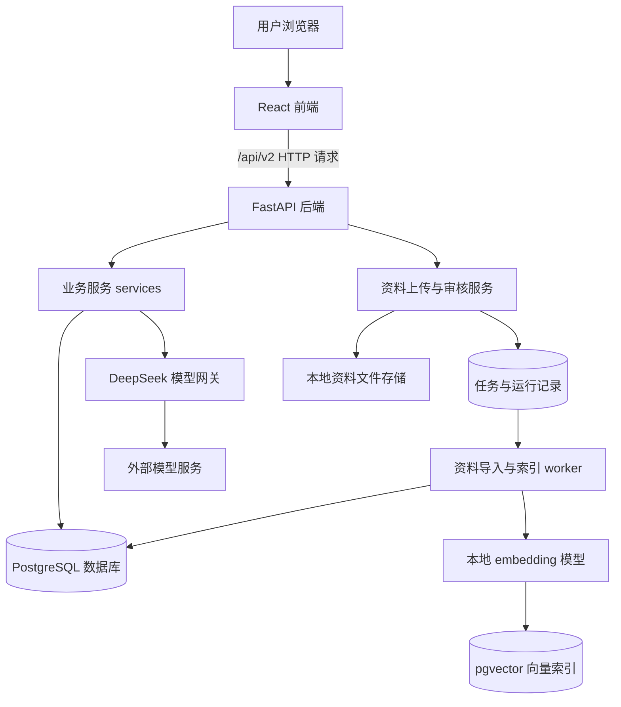

# 修途项目结构与模块实现详解

源码核对开始：2026-10-12；完稿：2026-10-13。面向：尚不熟悉项目结构、希望逐步理解功能与实现的项目拥有者。

本文根据当前 `<project-root>` 源码、当前独立模板包和迁移实施记录编写。本文介绍的是清理之后的结构；旧文档中的执行链不能直接当作当前主流程。本文没有修改源码、病例、数据库或模型设置。

配套阅读：[修途完整业务数据流与实现详解](data-flow.md)。本文回答“东西放在哪里、谁负责什么”，配套文档回答“点击之后，数据怎样一步一步变化”。

## 阅读导航

1. [先理解修途在做什么](#1-先理解修途在做什么)
2. [两个项目目录的关系](#2-两个项目目录的关系)
3. [运行架构和技术栈](#3-运行架构和技术栈)
4. [正式源码目录地图](#4-正式源码目录地图)
5. [前端如何组成页面](#5-前端如何组成页面)
6. [后端如何分工](#6-后端如何分工)
7. [模板、规则与维修资料](#7-模板规则与维修资料)
8. [数据库中有哪些数据](#8-数据库中有哪些数据)
9. [两种 AI 功能分别做什么](#9-两种-ai-功能分别做什么)
10. [资料中心与向量检索](#10-资料中心与向量检索)
11. [历史兼容和旧框架的边界](#11-历史兼容和旧框架的边界)
12. [配置、脚本、测试和迁移](#12-配置脚本测试和迁移)
13. [从哪里开始读源码](#13-从哪里开始读源码)
14. [以后修改功能应该找哪里](#14-以后修改功能应该找哪里)
15. [当前能力和实现边界](#15-当前能力和实现边界)

## 1. 先理解修途在做什么

修途是一个围绕车辆故障排查组织工作的平台。它保存车辆接诊信息，按适用范围加载排查模板，让用户逐项记录现场检查情况，再把有效记录和对应维修资料交给 AI 形成建议。实际进行了什么维修、维修后新取得什么结果，则由用户另外保存。

当前主流程是：

> 车辆信息与主诉 → 匹配模板 → 展示区域、分组和问题 → 可选 AI 排序 → 保存检查情况 → 综合 AI 分析 → 保存实际处理 → 独立复检 → 从历史病例继续或结束工作。

理解项目时，先区分以下五种东西：

| 内容 | 具体含义 | 典型例子 |
| --- | --- | --- |
| 模板 | 平台提供的可检查内容和适用关系 | 某故障对应哪些区域、每区有哪些问题 |
| 维修资料 | 支持检查与处理的方法说明 | 如何检查接头、如何解释不同结果 |
| 用户事实记录 | 用户提交的车辆信息和检查结果 | 接头松动、读数、无法完成原因 |
| 平台规则结果 | 按已保存记录算出的摘要或派生项 | 某项异常、数据不完整、数值关系冲突 |
| AI 建议 | 模型结合输入生成的判断与行动建议 | 优先核实什么、怎么处理、处理后怎么复查 |

这些内容不会因为出现在同一网页上就变成同一种数据。尤其是 AI 写“建议恢复接头”，不等于用户已经恢复接头；用户需要在维修处理区记录实际动作。

## 2. 两个项目目录的关系

### 2.1 正式实现：`<project-root>`

浏览器页面、后端接口、数据库访问、模型调用、运行脚本和测试主体在这里。判断某功能实际怎样运行，应以这里的当前源码为准。

### 2.2 规划与资料：`<authoring-workspace>`

这里保存需求、规划、交接、审计、迁移实施记录、维修资料包、候选模板和清理归档。本文也放在这里。

当前维修资料主要位于：

`<authoring-workspace>\docs\参考\专题资料包\探岳维修资料1`

独立模板 v2 的发布输入位于其中的 `模板候选-v2`，包括适用关系、模板 JSON 和区域资料清单。

### 2.3 文件与运行数据之间还有“发布”步骤

编辑规划目录的一份 Markdown，不会让已运行的 AI 自动使用新内容；编辑模板 JSON，也不会直接改变所有已有病例。

运行时读取的是数据库中的已登记模板与资料。模板匹配成功后，病例还会保存自己的模板快照。因此需要区分：

```text
资料包文件 / 模板配置
        ↓ 显式校验与登记
数据库中的模板版本 / 区域资料版本与绑定
        ↓ 新病例匹配与冻结
病例自己的接诊与模板快照
        ↓ 分析时再次冻结有效记录和绑定资料
某次 AI 分析的输入快照
```

“资料文件已经改了”“资料已经发布了”“病例用的是新模板”“旧 AI 已重新生成”是四件不同的事。

## 3. 运行架构和技术栈

### 3.1 架构图



主工作台的综合 AI 分析由后端接口直接调用模型网关。上图中的 worker 主要服务资料导入和索引，不能把它理解成当前每次综合 AI 分析都经过的执行器。

### 3.2 技术选择与作用

| 技术 | 在项目中的作用 | 先怎样理解 |
| --- | --- | --- |
| React 19 | 组成交互页面 | 页面由多个组件拼起来 |
| TypeScript | 检查前端数据类型 | 提前发现字段和类型不一致 |
| React Router 7 | 根据 URL 选择页面 | `/history` 和 `/workbench/:caseId` 显示不同内容 |
| TanStack Query 5 | 请求、缓存、刷新服务端数据 | 保存后重新获得权威数据 |
| Vite 7 | 前端开发与打包 | 本地网页服务和构建工具 |
| Python 3.12 | 后端实现语言 | 编写业务服务和脚本 |
| FastAPI | HTTP 接口框架 | 接收浏览器请求，返回 JSON |
| Pydantic 2 | 输入、输出结构校验 | 定义哪些字段允许传、数据是否合法 |
| SQLAlchemy 2 | 数据库语句与事务组织 | 将业务操作转换成数据库操作 |
| psycopg 3 | PostgreSQL 连接驱动 | Python 与数据库之间的连接 |
| PostgreSQL + JSONB | 持久保存病例、记录和结构化快照 | 既能存普通字段，也能存完整 JSON |
| pgvector | 资料检索的向量存储与距离计算 | 搜索语义相关的资料片段 |
| Alembic | 管理数据库结构版本 | 新增表和字段时有明确迁移记录 |
| LangChain 的模型适配层 | 封装模型消息和调用 | 当前综合分析并不因此成为自动多智能体系统 |
| LangGraph / checkpoint | 保留旧执行链及隔离回归所需能力 | 不是当前模板主流程的必经环节 |

前端 `package.json` 对 Node 版本有要求，不能用“任意 Node 都可以”理解项目。后端依赖以 `pyproject.toml`、锁定依赖文件和虚拟环境为准。

### 3.3 当前常用本地地址

既有 WP-15 本地实例使用网页 `http://localhost:5215`、后端 `http://127.0.0.1:8215`。这是本地运行脚本的实例配置，不是代码在所有环境中的固定端口。

Vite 通过代理转发 `/api`；浏览器通常只需要知道网页地址。前端开发默认端口、代理目标和本地 WP-15 配置可以不同，排查连接问题时要看当前启动配置。

## 4. 正式源码目录地图

以下是理解当前功能最有用的目录，省略缓存、依赖和大量历史证据文件。

```text
<project-root>
├─ frontend/
│  ├─ src/main.tsx                  前端启动入口
│  ├─ src/formal/                   正式页面、请求、状态和组件
│  │  ├─ FormalApp.tsx              应用路由与全局数据请求设置
│  │  ├─ api-client.ts              统一 HTTP 客户端、认证恢复、错误处理
│  │  ├─ session.tsx                登录会话状态
│  │  ├─ pages/                     工作台、历史病例、资料中心
│  │  ├─ components/                导航、标题、加载和错误状态
│  │  ├─ design/workbench-v2/       当前模板工作台及历史兼容页面
│  │  └─ diagnosis/                 历史区域诊断读取组件
│  ├─ src/generated/               从接口生成的类型
│  ├─ package.json                 前端依赖和命令
│  └─ vite.config.ts               前端开发、代理和构建配置
├─ backend/app/
│  ├─ main.py                      后端应用装配与健康检查
│  ├─ config.py                    配置项与环境约束
│  ├─ api/                         HTTP 路由、认证和错误封装
│  ├─ services/                    功能实现和业务编排
│  ├─ domain/                      数据契约、领域类型和规则
│  ├─ repositories/                部分病例与观察的数据访问封装
│  ├─ infrastructure/              数据库、事务、存储、模型与任务设施
│  ├─ topics/                      既有专题、规则和资料阅读配置
│  ├─ retrieval/                   解析、分块、稀疏与向量检索
│  ├─ tools/                       工具能力实现
│  ├─ mcp_server/                  独立工具服务
│  ├─ agents/                      仍被引用的共享类型等
│  ├─ legacy_execution/            旧诊断、报告与病例分析执行支持
│  ├─ legacy_preview/              旧预览支持
│  └─ worker.py                    默认资料导入、索引任务 worker
├─ migrations/versions/            按版本演进的数据库迁移
├─ scripts/                        启动、校验、发布和受控操作脚本
├─ tests/                          单元、集成、契约和探针测试
├─ deploy/                         Docker Compose 等部署配置
├─ docs/                           正式实现说明、运行手册和证据
├─ skills/                         工具/流程相关资源
├─ evals/                          评估相关内容
├─ .local-data/                    本地运行状态、文件、模型等
├─ .test-runs/                     本地测试运行产物
├─ pyproject.toml                  Python 项目与测试配置
├─ .env.example                   环境配置示例
└─ README.md                       项目入口说明
```

`.venv`、`frontend/node_modules` 等是依赖环境，不能当作业务源码；`.local-data` 中则可能有实际运行状态和持久文件，不能笼统按缓存删除。`.env` 可能含凭证，阅读结构文档不需要把其中内容复制出来。

## 5. 前端如何组成页面

### 5.1 应用入口与路由

`frontend/src/main.tsx` 启动 `FormalApp`。`FormalApp.tsx` 放置 QueryClient、会话边界、浏览器路由和应用外壳。

| 页面 URL | 页面主体 | 功能 |
| --- | --- | --- |
| `/workbench` | 新病例接诊表单 | 填写车辆信息，匹配模板并创建病例 |
| `/workbench/:caseId` | `WorkbenchPage.tsx` 按快照分流 | 恢复指定病例，进入对应工作台 |
| `/history` | `HistoryPage.tsx` | 查看、筛选、打开和继续病例 |
| `/documents` | `DocumentsPage.tsx` | 资料上传、查看版本、审核及索引相关操作 |

`AppShell` 是上方导航等共享外壳，业务主体不都写在这里。

### 5.2 为什么打开不同病例会进入不同实现

`WorkbenchPage.tsx` 先请求病例快照，再检查 `intake_snapshot.workbench_flow` 和历史专题绑定。

- `template-match-v1` 病例进入当前模板工作台。
- 历史 B01/B02 病例进入兼容展示分支。
- 更早的特定专题或区域病例按原结构只读展示。

所以，URL 都是 `/workbench/某个ID`，并不意味着后台数据结构完全一样。分流依据是保存的病例快照，而不是网页上看起来像哪个版本。

### 5.3 当前工作台的主要组件

| 文件 | 页面上的作用 | 实现要点 |
| --- | --- | --- |
| `MatchedVehicleIntake.tsx` | 车辆基础信息和主诉表单 | 必填校验、故障码规范化、发动机代码选填、带幂等键创建病例 |
| `TemplateWorkbenchPage.tsx` | 区域、分组、检查问题和综合摘要 | 从后端 topic/view 动态生成问题；保存队列；刷新服务端投影 |
| `AreaAnalysis.tsx` | 当前 AI 综合分析 | 读取资料与尝试状态；点击才 POST；展示结果与过期提示 |
| `TemplateRepairRetest.tsx` | 实际处理和独立复检 | 跟随所选区域；建立轮次；生成复检候选；保存新证据 |
| `TemplateCaseLifecycle.tsx` | 结束本次工作、继续病例 | 控制用户工作状态，不自动判定车辆已修好 |

`TemplateWorkbenchPage` 是当前模板工作台主体（原名 `FormalWorkbenchB01Page`，2026-10 改名；旧 B01/B02 演示病例也由它显示）。`LegacyDemoWorkbenchPage`（原名 `FormalWorkbenchV2Page`）只用于更早的 v2 演示台架病例的只读查看。`prototype-*` CSS 类名仍用于当前样式，不能仅凭 prototype 字样认定文件无用。

### 5.4 动态页面从哪些数据生成

后端返回的 `topic` 定义区域、卡片、问题、选项、字段和资料资产；`view` 定义当前有效答案、派生结果、异常与缺项等状态。

前端据此组织：

```text
topic.areas                 区域卡片
  └─ componentIds           区域下的分组
       └─ cards.questionIds 该分组的问题
            └─ questions    标题、选项、输入字段和操作说明

view.question_states        每题的已保存、未知、派生等状态
view.synthesis              已确认记录、问题、缺项与冲突摘要
```

标题和数量来自模板数据。前端有通用布局与通用交互，也有历史兼容逻辑；并不是所有前端内容都已经抽象成一个无需配置的页面引擎。

### 5.5 草稿、保存队列和缓存各自负责什么

用户点选或填写时，组件先保存本地草稿。满足输入完整性要求后，选择项会触发自动保存；多选用短暂延迟合并连续选择。数字项缺少必要字段时，不会把半成品当成已保存事实。

`useAnswerSaving` 用串行队列组织保存，避免同一病例的多个请求同时争用旧 revision；同一题正在保存时复用当前请求。保存成功后接收后端返回的新 `view`，更新缓存和最新版本引用。

React Query 的缓存只是浏览器暂存。数据库中的记录才是刷新、重开浏览器、从历史进入时恢复内容的来源。

### 5.6 统一请求和认证恢复

`api-client.ts` 给请求加 `/api/v2` 前缀，处理 JSON、上传文件、超时、取消、CSRF 和错误消息。

认证失效时它尝试读取 `/auth/session` 恢复会话；恢复成功会提示重新提交。它不会自动重放保存操作或 AI 请求，避免用户不知道的重复写入或付费调用。

## 6. 后端如何分工

### 6.1 一次请求通常经过四层

```text
api 路由：接收 HTTP、身份认证、输入类型
    ↓
service：检查业务条件、组织本次操作
    ↓
repository / SQLAlchemy 表：查询和修改数据
    ↓
UnitOfWork：提交或回滚同一组数据库操作
```

这不是所有文件都严格遵守的教科书式分层。当前有些 service 通过 repository 访问数据库，有些直接使用 SQLAlchemy 表。阅读时按实际调用关系看，不要以为每个 service 都必须再经过 repository。

### 6.2 后端入口：`backend/app/main.py`

这里加载 Settings、建立数据库与认证设施、创建服务对象，挂到 `app.state`，再注册路由和健康检查。

它主要负责把各部分接起来，不是保存检查和生成建议的完整业务实现。修改 AI 行为通常不应该只在 `main.py` 找。

### 6.3 当前主流程服务

| 服务文件 | 主要职责 | 关键入口或概念 |
| --- | --- | --- |
| `case_service.py` | 创建、读取和列出病例 | 创建事务、归属、幂等、当前进度 |
| `workbench_templates.py` | 适用匹配与冻结模板 | `resolve_template`、`frozen_snapshot`、`FrozenTemplate` |
| `workbench_observation_service.py` | 保存问题答案、更正和恢复完整视图 | `TopicService.get/save/history` |
| `workbench_answer_validation.py` | 检查提交答案是否合法 | 选项、字段、类型和问题定义一致性 |
| `workbench_topic_workflow.py` | 为当前模板和兼容专题选择记录流程 | 记录实例、前置条件、轮次规则 |
| `template_projection.py` | 把保存记录转换成当前页面视图 | 动态问题状态、摘要与派生计算 |
| `template_choice_calculation.py` | 简单选项派生 | `choice-v1` 声明式规则 |
| `template_evidence_calculation.py` | 数值和证据关系派生 | `evidence-v1` 通用算子 |
| `template_observation_rules.py` | 检查重点、冲突、操作条件 | 模板配置驱动，服务端也校验 |
| `area_ranking_service.py` | AI 对匹配区域排序 | 保留全部候选，单次排序尝试 |
| `area_analysis_service.py` | 组织资料与有效记录，生成 AI 建议 | `build_matched_input`、`start`、`get` |
| `analysis_context.py` | 记录角色与资料章节定位 | `enrich`、`model_payload` |
| `template_repair_service.py` | 保存实际处理和独立复检 | 创建维修轮次、完成该轮复检 |
| `template_case_history.py` | 病例进度、关闭与继续 | `load_summary`、`require_open`、`set_closed` |

### 6.4 基础设施文件

| 文件 | 职责 |
| --- | --- |
| `infrastructure/orm.py` | 声明数据库表、字段、约束与关联 |
| `infrastructure/uow.py` | 同一次业务操作的事务边界 |
| `infrastructure/db.py`、`db_target.py` | 连接数据库、检查操作目标 |
| `infrastructure/storage.py`、`upload.py` | 文件保存、上传、校验与候选文件处理 |
| `infrastructure/model_gateway.py` | 模型调用、结构化输出、响应采集、错误转换 |
| `infrastructure/model_budget.py` | 模型用量和调用额度相关设施 |
| `infrastructure/job_store.py` | 持久任务、领取、租约和结果完成 |
| `infrastructure/embedding_gateway.py`、`bge_gateway.py` | 本地向量模型能力 |
| `api/dependencies.py` | 身份、同源与 CSRF 校验 |
| `api/errors.py` | 对外统一错误响应 |

## 7. 模板、规则与维修资料

### 7.1 模板是结构化检查表，不是已经得出的答案

一个模板至少说明：适用什么车辆与故障、有哪些区域、区域下有哪些分组、每题有哪些选项或字段、选择怎样解释、哪些条件影响操作、怎样派生摘要。

例如同一个页面引擎可以读到五区域模板，也可以读到三区域模板。区别在模板数据，而不是为每个故障复制一套页面。

### 7.2 当前配置覆盖

已发布独立 v2 包对应大众探岳 2019 / DKVB 的两条适用关系：

| 故障码 | 区域 |
| --- | --- |
| P0299 | 增压空气通路、增压压力测量、增压调节机构、涡轮增压器本体、其他动力系统方向 |
| P0236 | 增压空气通路、增压压力测量、增压调节机构 |

发动机代码可以留空。后端只有在当前配置能得到唯一适用模板时才继续；不会把空白发动机代码偷偷填成 DKVB。匹配机制可扩展，不等于资料已覆盖所有车型、年份和故障。

### 7.3 独立模板与旧模板

原 v1 模板由已冻结 B02 内容安装，仍带显式旧计算兼容关系。新 v2 使用独立模板 JSON 和通用规则算子，不再把 B01/B02 完整计算目录作为新模板基础。

已有 v1 病例不会因为发布 v2 自动升级。原主病例可能继续使用自己的 v1 快照，这是数据保存策略，不是页面一定加载了错误版本。

### 7.4 通用算子怎样避免车辆专用代码

`evidence-v1` 提供的算子包括：

| 算子 | 用途 |
| --- | --- |
| `numeric_reference_consistency` | 比较保存的数字与参考值之间的关系 |
| `numeric_series_gap` | 分析多组数字之间的差值关系 |
| `evidence_gate` | 根据所需证据是否成立得出配置结果 |
| `independent_group_count` | 汇总独立证据分组 |
| `direction_set` | 汇总满足条件的方向集合 |

问题 ID、字段名、单位、批次、区间和输出选项由模板指定。程序实现“如何算”，模板配置“用哪些输入、怎样解释”。输入不完整或规则未命中时保留待补充，不能从缺失值算出正常。

### 7.5 维修资料绑定

一份区域资料通过“模板 ID + 模板版本 + 区域 ID”绑定到正文版本。

主流程对应三类配置：

- 模板适用关系与内容：独立包 `模板候选-v2/relations.json` 和相应模板 JSON。
- 区域资料清单：`area_reference_manifest_v2.json` 等版本清单。
- 记录角色：`backend/app/topics/record_roles_v1.json`（每题记录属于观察、检查状态、人工判断等哪类信息；按模板版本和题目定义哈希绑定，没有条目的模板记录为 unclassified）。
- 每份资料的必带章节：`backend/app/topics/reading_documents_v1.json`（按章节标题，只对写定时的正文哈希生效）。
- 发送哪些资料章节：分析时由 `backend/app/services/retrieval_reading.py` 检索资料原文选出（精准查找 + BM25 + 本地向量，RRF 融合，每题取前 3 个 `##` 章节），不再使用题目→章节对照表；原对照表移到 `evals/section-retrieval/reference_table_v1.json`，只作检索评测的标准答案。检索不可用时发送完整正文。

## 8. 数据库中有哪些数据

### 8.1 当前主流程的核心表

| 表 | 保存什么 | 为什么存在 |
| --- | --- | --- |
| `cases` | 车辆、主诉、故障码、接诊快照、revision、归属和时间 | 一份病例的主体 |
| `workbench_templates` | 模板 ID、版本、完整内容 JSON、内容哈希 | 保存已发布模板 |
| `workbench_template_matches` | 品牌、车型、年份范围、发动机、故障码与模板关系 | 决定匹配哪一个模板 |
| `observations` | 答案 payload、创建版本、更正关系和操作者 | 保存用户检查事实和历史 |
| `case_area_rankings` | 一例病例的排序输入、结果、模型、状态 | 恢复同一次 AI 排序 |
| `area_reference_documents` | 区域资料 ID、版本、正文、哈希和来源 | 保存实际用于分析的资料 |
| `area_reference_bindings` | 模板版本、区域与资料版本关系 | 确定每个参与区域用哪些资料 |
| `area_analysis_attempts` | 分析输入、结果、状态、错误、模型和诊断信息 | 冻结并恢复每次 AI 分析 |
| `template_repair_rounds` | 实际处理、处理前版本、复检工况、结果、新证据 | 独立保存维修后轮次 |
| `idempotency_keys` | 用户、操作范围、键、请求哈希和响应 | 防止支持幂等的写入被重复执行 |

### 8.2 `cases.intake_snapshot` 为什么重要

它是 JSONB，而不是单个字符串。当前模板病例会在这里保存：

```text
workbench_flow       说明使用 template-match-v1
template_binding     模板 ID、版本、标题和内容哈希
template_content     病例创建时冻结的完整模板
topic_plan           问题范围、采集批次、接诊工况等
case_lifecycle       关闭/继续状态及事件，操作后加入
```

页面恢复依据病例自己的快照；新增模板不会静默改写已有病例的问题定义。

### 8.3 用户检查答案在哪一层

`observations.payload` 保存 `question_id`、`option_ids`、`fields`、`note`、无法完成原因、批次、来源等。

当前模板的问题属于哪个区域，由冻结模板的 `question_id → area_id` 映射确定。不要以为 `observations.area_id` 这个历史 UUID 字段就是当前字符串区域标识；当前专题答案保存时该字段可以是空，业务映射在 payload 和模板中。

### 8.4 更正不是覆盖旧记录

更正时新增一条 observation，`supersedes_id` 指向原记录。原记录保留，页面与 AI 选取当前有效记录。有效状态是根据替代关系算出来的，不是每一行都存着一个 `effective` 布尔字段。

### 8.5 资料中心和历史执行表

资料中心使用 `documents`、`document_versions`、`document_reviews`、`chunks`、`index_versions`、`chunk_embeddings`，异步任务使用 `jobs`、`runs` 等。

历史执行链仍有 `diagnosis_areas`、`diagnosis_steps`、`graph_progress`、`reports`、`case_analyses` 等表。它们不等于当前模板工作台每次操作都会写的表；历史读取和隔离回归仍可能依赖它们。

## 9. 两种 AI 功能分别做什么

### 9.1 AI 区域排序

输入是主诉、故障码、症状工况及已经匹配好的候选区域。输出是排列顺序和每区简短理由。

服务校验输出必须完整保留候选集合，不能增删、重复区域。模型无法提供有效排序时，页面仍能按模板顺序展示。

排序是可选辅助，不是诊断，也不负责判断每个区域是否正常。当前实现按病例保存一条排序尝试；其授权、一次调用策略与综合分析的手动失败重试机制并不完全相同。

### 9.2 综合 AI 分析

只挑选有有效保存记录的区域，加入它们的对应资料、未记录项目、记录角色和适用上下文，一次生成整体建议。不会为了凑全五区把未检查区都送入，也不要求每题都填完。

实现主体是 `area_analysis_service.py`；资料阅读组织在 `analysis_context.py`；输出类型是 `domain/case_analysis.py` 中的 `AreaAdviceV3`；调用封装在 `model_gateway.py`。

### 9.3 内容结构与界面结构分开

模型输出 JSON 中有 `summary`、`steps`、`conditional_branches`、`missing`、`precautions`、`verification` 等字段。页面决定哪些展开、哪些折叠、怎样命名和显示。

删除页面的某个展示模块，不一定要删除模型字段或旧快照字段。历史结果仍可能保存这些字段，页面可选择不展示。

### 9.4 通用性来自哪些地方

当前组织代码依据区域、问题、有效记录、绑定资料和角色配置工作。提示词要求具体动作、条件和复检，但没有把 P0299 的结论或五区顺序固定成所有问题的答案。

输出字段是一种通用行动结构：需要做什么、前提是什么、何时停止、怎么复检。固定字段不等于固定故障答案；同一结构可以容纳不同数量、不同对象和不同路径的动作。

但是资料、模板和角色映射仍需要为新问题准备，不能认为有通用提示词就自动具备所有车型知识。

### 9.5 可靠性设施能证明什么

输入冻结、调用预算、JSON 类型校验、保存模型响应和过期判断，使平台能解释“这份建议由什么输入生成、是否失败、能否恢复”。

它们不自动证明建议已经达到资深维修师傅水平。结构合法与技术判断正确是不同验收维度。当前没有另外增加一套已完整实现的“所有事实必须映射到动作”的语义审核引擎；相应要求主要体现在通用提示词中。

## 10. 资料中心与向量检索

### 10.1 这是另一条完整子流程

资料中心允许上传资料、查看版本、解析正文、审核适用范围和授权、生成检索索引。解析器在 `retrieval/parsers`，分块在 `retrieval/chunker.py`。

文件实体由 Storage 保存，数据库记录文件版本、哈希、解析状态、片段和索引。上传后不是“文件进入数据库就立即能检索”，还要经历解析、审核和索引就绪。

### 10.2 检索怎样实现

`retrieval/service.py` 先限制用户拥有且当前允许使用的资料版本，再核对适用范围与可用索引。它同时使用：

- 稀疏排序：对文本、关键词与故障码等进行匹配。
- 向量排序：本地 embedding 生成查询向量，pgvector 计算余弦距离。
- 排名融合：代码用 RRF 汇总两类排名，再考虑适用匹配和故障码关联。

不同 embedding 配置的索引分组处理，不把不同维度直接混算。这里的“向量数据库”是 PostgreSQL 的 pgvector 能力，不是额外必须启动一个独立向量数据库产品。

### 10.3 为什么当前区域分析不用它

工作台当前已经知道问题属于哪个区域、区域绑定哪份资料，因此直接取 `area_reference_documents`，再按版本化阅读配置选择正文章节。

它没有调用 `/evidence/search` 自动检索资料中心，也不会把资料中心刚上传的文件自动绑定到所有区域。这两条链可以共存，但当前没有自动统一成一条检索生成链。

### 10.4 证据、规格比较与 MCP 工具是什么

项目还有 `EvidenceService`、测量规格与比较接口，以及 `tools`、`mcp_server`、MCP 客户端设施。它们用于证据来源读取、规格组织、数值比较和独立工具能力。

这些能力不能与当前模板中的数字派生混为一谈：模板算子直接读取保存的题目字段；规格比较子系统则有自己保存的规格、审核和比较记录。旧病例证据新增绑定入口已退休，相关历史来源和规格接口仍有保留。

MCP 是暴露工具的一种接口方式。当前综合分析没有自动执行一串 MCP 工具来修车；不要仅因为仓库存在工具服务器，就认为点击分析会进行联网查询、控制设备或自动测量。

## 11. 历史兼容和旧框架的边界

### 11.1 “旧内容清理结束”不是“删掉所有历史表”

清理的目标是让当前主流程不再误走旧创建、旧任务、旧 AI 发布和不可用的操作入口，同时保留历史记录读取和必要回归支持。

目前应按三类理解：

| 类别 | 例子 | 怎样看待 |
| --- | --- | --- |
| 当前执行 | 模板匹配、topic 保存、区域分析、独立处理复检 | 当前使用路径 |
| 历史读取/兼容 | B01/B02 冻结记录、旧分析快照和旧报告 | 为已有数据保留，不能随意删除 |
| 显式隔离支持 | `legacy_execution`、旧 worker dispatcher、旧预览 | 服务隔离回归，默认主流程不执行 |

### 11.2 默认 worker 已收口

`worker.py` 的默认入口领取资料导入、索引和 `no_op` 任务。旧执行能力必须显式指定，且要求隔离测试数据库；CLI 默认不会开启旧诊断执行器。

因此，仓库仍有旧图执行代码，不等于浏览器的当前 AI 按钮仍调用旧图。

### 11.3 哪些公共旧入口退休了

旧创建、旧诊断写入、旧病例分析生成入口已退出当前正式执行。部分 URL 仍保留，用明确退休响应拒绝旧调用；历史 GET 读取仍保留。

当前 AI 按钮调用的是 `matched-areas/analysis`，不是旧 `analyses`。这也是此前“删除旧 AI 入口”并未删除当前 AI 按钮的原因。

## 12. 配置、脚本、测试和迁移

### 12.1 配置

`backend/app/config.py` 定义数据库、文件目录、模型、索引、认证和运行模式。Settings 默认不直接加载项目 `.env`；启动脚本和显式环境选项决定哪些配置进入进程。

数据库就绪、凭证已配置、模型可访问、一次分析成功是不同状态。健康接口 `model_verified=false` 是当前固定输出，不能单独用它判断某次真实模型请求失败。

当前认证是配置操作者身份与内存会话存储，没有实现完整的多用户账号注册和长期会话数据库系统。服务重启会使旧内存会话失效，本机开发身份可在限制范围内恢复。

### 12.2 当前常用脚本

| 脚本 | 作用 | 注意 |
| --- | --- | --- |
| `scripts/wp15_workbench.py` | 管理本地工作台实例 | 读取登记的运行状态；使用相应环境配置 |
| `scripts/seed_workbench_templates.py` | 校验并登记模板与匹配关系 | 不覆盖已发布同版本内容 |
| `scripts/seed_area_references.py` | 校验、组合和登记区域资料 | 核对来源、正文哈希和绑定 |
| `scripts/publish_independent_templates.py` | 独立模板与资料受控发布 | 默认预检；`--apply` 才写入 |
| `scripts/verify_workbench_templates.py` | 模板相关核验 | 核验脚本不等于发布 |
| `scripts/export_frontend_openapi.py` | 更新前端接口类型资源 | 类型生成不是运行时数据生成 |
| `scripts/test.ps1` | 测试入口 | 测试范围和数据库目标要看配置 |

旧的一次性安装脚本、历史回放脚本不能不看前置条件就重复运行。例如 `install_area_references.py` 有特定迁移版本假设，不是当前任何数据库都适用的万能安装入口。

### 12.3 数据库迁移

`migrations/versions` 从初始表结构一路演进到当前模板、排序、区域分析、失败重试和维修复检结构。重要节点包括：

- `0018_workbench_templates.py`：模板及适用匹配。
- `0019_case_area_rankings.py`：区域排序。
- `0020_area_analysis.py`：区域资料与分析尝试。
- `0021_area_input_identity.py`：输入身份相关调整。
- `0022_area_analysis_failed_retry.py`：失败尝试重试约束调整。
- `0023_template_repair_retest.py`：当前维修处理与复检轮次。

迁移文件是从旧结构升级到新结构的路径，不应因为里面提到历史功能就删除。空数据库初始化也可能需要依次执行已有迁移。

### 12.4 测试怎样分类

| 测试 | 主要验证 | 不能替代 |
| --- | --- | --- |
| unit | 规则、输入组织、边界与纯函数 | 真实网页操作、真实模型质量 |
| integration | API、事务、数据库保存和恢复 | 用户实际体验、车辆维修效果 |
| contract | 接口和输出契约 | 所有业务场景完整正确 |
| probes | 显式运行环境/流程探针 | 可以随意调用模型或修改库的授权 |
| 前端测试 | 按钮、组件状态、只读及轮次交互 | 浏览器和后端全链路验收 |

当前清理后的主流程已完成两种模板的隔离功能验收、一次真实 AI 生成与用户网页体验确认。具体证据见 [清理后主流程功能验收](../archive/records/current-flow-acceptance.md)。旧执行链另有已记录的历史测试问题，不能把局部通过描述为整个仓库所有旧测试全绿。

## 13. 从哪里开始读源码

不要第一次就按整个目录从头读到尾。建议沿一个实际操作读：

| 顺序 | 文件 | 带着什么问题读 |
| --- | --- | --- |
| 1 | `frontend/src/formal/FormalApp.tsx` | 页面 URL 怎样映射到组件？ |
| 2 | `frontend/src/formal/pages/WorkbenchPage.tsx` | 当前病例和历史病例如何分流？ |
| 3 | `MatchedVehicleIntake.tsx` | 表单怎样变成创建请求？ |
| 4 | `backend/app/api/cases.py` | 请求进入哪个后端入口？ |
| 5 | `case_service.py`、`workbench_templates.py` | 怎样匹配并冻结病例？ |
| 6 | `TemplateWorkbenchPage.tsx` | 区域和问题从哪里来，怎样保存？ |
| 7 | `workbench_observation_service.py` | 答案和更正怎样进库？ |
| 8 | `template_projection.py` | 保存记录怎样变成页面摘要？ |
| 9 | `AreaAnalysis.tsx`、`area_analysis_service.py` | AI 按钮送什么、结果存哪里？ |
| 10 | `analysis_context.py`、`model_gateway.py` | 资料怎么组织、模型怎么调用？ |
| 11 | `TemplateRepairRetest.tsx`、`template_repair_service.py` | 原事实与复检如何分开？ |
| 12 | `HistoryPage.tsx`、`template_case_history.py` | 怎样从历史继续工作？ |
| 13 | `infrastructure/orm.py` 与相关迁移 | 上述对象实际由哪些表保存？ |

第 3 步以后，最好打开配套数据流文档对照阅读。一次只追一条请求，先弄清输入与输出，再读辅助函数。

## 14. 以后修改功能应该找哪里

| 想修改什么 | 优先查看 | 通常还要核对 |
| --- | --- | --- |
| 页面文案、布局、展开折叠 | 对应 React 组件与 CSS | 历史页面是否共用样式 |
| 新增一个车辆/问题模板 | 模板包适用关系和独立 JSON | 发布校验、资料覆盖、通用算子是否够用 |
| 新增题目或选项 | 模板 questions/cards/areas | 保存校验、派生依赖、资料角色映射 |
| 改某个数值判断范围 | 模板 calculation_rules | 单位、批次和规则测试；不要直接改模型答案 |
| 改操作前置条件 | 模板 prerequisites 与 observation_rules | 前端提示和后端写入校验一致性 |
| 补维修知识 | 区域资料 Markdown 与资料清单 | 发布新版本、哈希、章节定位和绑定 |
| 改 AI 如何利用资料 | `analysis_context.py` 与配置 | 不丢原文、不误把资料示例当车辆事实 |
| 改 AI 建议组织方式 | 通用提示词、`AreaAdviceV3`、`AreaAnalysis.tsx` | 输入身份/提示词版本和历史快照兼容 |
| 改维修轮次交互 | `TemplateRepairRetest.tsx` | service、接口输入和表结构 |
| 改历史列表分类 | `HistoryPage.tsx`、CaseService 与进度摘要 | 分页、所有权和测试标签规则 |
| 增加真正的多用户认证 | auth API、AuthStore、session | 持久会话、权限与部署设计 |

## 15. 当前能力和实现边界

当前已形成可用的“模板 + 保存事实 + 绑定资料 + AI 建议 + 实际处理复检 + 历史恢复”闭环。它同时保留资料中心与检索子系统，历史执行支持则已隔离。

仍须按当前实现理解以下边界：

1. 当前接诊匹配只支持已配置的单一故障码关系，多故障码组合还没有通用匹配方案。
2. 现有已发布知识覆盖有限，不等于模板引擎支持所有车辆。
3. 综合 AI 当前发送检查 observations；独立 `template_repair_rounds` 的新处理/复检文本没有自动并入这条 AI 输入。页面会提示建议之后有新处理，不能把旧建议当作处理后新判断。
4. 复检项目的选择和新答案在提交前是前端草稿；提交后合并成人可读新证据文本，存入轮次，不是逐题独立的结构化复检 observation。
5. 结束病例是用户工作状态，不等于自动通过最终维修报告，也不等于验证车辆修复。
6. 当前 AI 结构校验、输入冻结与状态保存已经实现；更强的语义正确性仍需实际内容验收。
7. 仓库有历史兼容代码和历史数据，这是保留读取能力的需要；它们与默认正式执行路径分开。

学习这个项目最有效的方式，是先能回答“一份检查答案从页面如何进库，再如何进入 AI”，之后再扩展到资料中心、索引和历史兼容。配套文档按这个顺序展开。

## 附录：可直接打开的代码定位入口

以下链接指向本机当前正式源码，方便边看说明边看实现。

- [应用与路由](../../frontend/src/formal/FormalApp.tsx)
- [病例工作台分流](../../frontend/src/formal/pages/WorkbenchPage.tsx)
- [接诊表单](../../frontend/src/formal/design/workbench-v2/MatchedVehicleIntake.tsx)
- [当前工作台与答案保存队列](../../frontend/src/formal/design/workbench-v2/TemplateWorkbenchPage.tsx)
- [AI 分析界面](../../frontend/src/formal/design/workbench-v2/AreaAnalysis.tsx)
- [处理复检界面](../../frontend/src/formal/design/workbench-v2/TemplateRepairRetest.tsx)
- [后端应用入口](../../backend/app/main.py)
- [病例服务](../../backend/app/services/case_service.py)
- [模板匹配与冻结](../../backend/app/services/workbench_templates.py)
- [检查保存与更正](../../backend/app/services/workbench_observation_service.py)
- [模板规则投影](../../backend/app/services/template_projection.py)
- [AI 输入组织与生成](../../backend/app/services/area_analysis_service.py)
- [资料阅读组织](../../backend/app/services/analysis_context.py)
- [模型调用网关](../../backend/app/infrastructure/model_gateway.py)
- [实际处理与复检服务](../../backend/app/services/template_repair_service.py)
- [数据库表定义](../../backend/app/infrastructure/orm.py)
- [资料检索服务](../../backend/app/retrieval/service.py)
- [独立模板发布脚本](../../scripts/publish_independent_templates.py)
