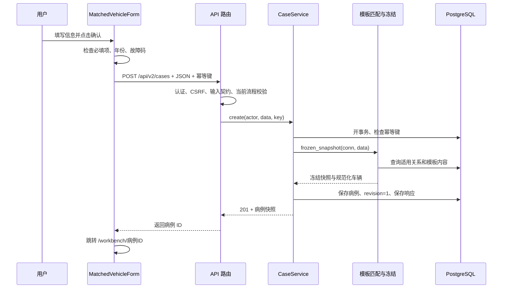

# 源码阅读 01：接诊表单到模板病例创建

日期：2026-10-13。依据：当前 `<project-root>` 源码。本轮只读核对与编写笔记，没有创建病例、修改程序、重启服务或调用模型。

本篇只回答一件事：**用户填写车辆信息，点击确认，为什么会得到一份带排查区域的新病例？**

阅读时不用先掌握所有框架。先看每段代码的输入、处理和输出，再理解 React、FastAPI 和 SQLAlchemy 在其中承担什么角色。

## 1. 先看整个调用链



这里没有模型请求。匹配区域来自已发布模板，AI 排序和分析是后续独立操作。

## 2. 第一个文件：表单怎样变成请求

打开：[MatchedVehicleIntake.tsx](../../frontend/src/formal/design/workbench-v2/MatchedVehicleIntake.tsx#L13)。重点看 `MatchedVehicleForm`。

### 2.1 draft 是用户正在填写的内容

```tsx
const [draft, setDraft] = useState<Draft>(initial ?? empty);
```

`draft` 是浏览器组件中的表单状态。用户填写品牌时，`setDraft` 更新 brand；填写主诉时，更新 complaint。

这一步没有保存到数据库。输入框里能看到文字，不等于已经有一份病例。

`initial` 用于已有病例页面上的嵌入表单：把原病例的信息放进表单，让用户不必从头填写。`embedded` 主要改变展示方式，不把创建接口变成更新接口。

### 2.2 submit 做前端检查

打开：[submit](../../frontend/src/formal/design/workbench-v2/MatchedVehicleIntake.tsx#L29)。

| 检查 | 当前具体行为 | 失败后 |
| --- | --- | --- |
| 正在提交 | `create.isPending` 时退出 | 避免连续点同一提交 |
| 必填项 | 品牌、车型、年份、主诉、故障码不能为空 | 显示错误，不发送 |
| 年份 | 转为数字，要求整数，1886～2100 | 显示错误，不发送 |
| 故障码 | 大写、按分隔符拆分、去重，检查格式 | 显示错误，不发送 |
| 发动机代码 | 去空格、转大写；空白转 null | 不因空白而拒绝 |

故障码正则要求形如 `P0299` 的字母与四位十六进制字符。前端可以整理多个格式合法的码，但当前后端匹配器只支持单码，因此格式合法不等于业务上一定能匹配。

### 2.3 页面字段名与请求字段名不完全相同

| 页面 draft | 发给后端的位置 |
| --- | --- |
| brand/model/year | `vehicle.brand/model/year` |
| engine | `vehicle.engine_code` |
| complaint | `fault_description` |
| codes | `fault_codes` 数组 |
| condition | `topic_intake.symptom_condition` |
| safety | `topic_intake.safety_gate` |

理解这一层转换之后，就不会拿着前端 `complaint` 在数据库里寻找一个同名列。

示意请求，主诉为教学示例而非新保存事实：

```json
{
  "workbench_flow": "template-match-v1",
  "vehicle": {
    "brand": "大众",
    "model": "探岳",
    "year": 2019,
    "engine_code": null
  },
  "fault_description": "压力信号间歇变化",
  "fault_codes": ["P0236"],
  "topic_intake": {
    "symptom_condition": "intermittent",
    "safety_gate": ""
  }
}
```

`workbench_flow` 告诉后端走当前模板病例流程。它不是模板版本；`template-match-v1` 仍可以匹配模板内容 v2。

### 2.4 create.mutate 是提交，不是 AI 分析

```tsx
return apiClient.request<CaseSnapshot>('/cases', {
  method: 'POST', body, idempotencyKey: attempt.current.key
});
```

React Query 的 mutation 管理正在提交、成功和失败状态。`apiClient` 给路径加 `/api/v2`，发送 JSON，并按当前会话添加 CSRF 和幂等键。

源码：[统一请求客户端](../../frontend/src/formal/api-client.ts#L67)。

### 2.5 fingerprint 和幂等键为什么存在

`fingerprint = JSON.stringify(body)` 用于比较前端本次内容是否变化。同一内容重试时，在该组件实例内继续使用原 key；内容改变后生成新 key。

例如第一次创建已成功，但浏览器没拿到响应。同一个 key 和内容再次发送时，后端返回原结果，不创建第二份病例。

这不是“相同车辆永远只有一份病例”：重新打开表单、产生新 key 后，同样的接诊信息仍可以合法创建另一份病例。

## 3. 两个中间环节：请求没有直接跳到数据库

### 3.1 HTTP 路由

打开：[create_case](../../backend/app/api/cases.py#L190)。

路由接收 `CreateCase`，要求写入认证，并读取 `Idempotency-Key`。它调用 `reject_legacy_creation`，然后调用 `case_service.create`。

`principal.actor_id` 来自已验证会话，不由用户在 JSON 里自由填写病例所有者。

### 3.2 Pydantic 输入契约

打开：[CreateCase 与 VehicleContext](../../backend/app/domain/schemas.py#L39)。

契约决定哪些字段允许出现、长度范围、类型与默认值。例如发动机空字符串会转成 None，故障码在服务端再统一大写、去重并排序。

前端检查方便用户即时反馈；服务端检查防止绕过页面后提交不合法内容。两者不能互相代替。

这次观察到的细节：后端基础故障码字段使用较宽的 ShortCode 格式，再由适用匹配决定是否覆盖；不要以为它与前端那条故障码正则完全相同。

## 4. 第二个文件：CaseService 怎样组织创建

打开：[CaseService.create](../../backend/app/services/case_service.py#L28)。它负责组织一次完整创建，而不亲自定义某故障该检查哪些区域。

### 4.1 再检查当前流程与幂等键

旧 workbench_flow 会被拒绝；幂等键必须符合允许字符和长度。服务还对整个请求计算 SHA-256，以检查“同 key 是否仍是同请求”。

前端 fingerprint 是组件内比较字符串；后端 request_hash 是稳定请求摘要，二者用途相关但不是同一个字段。

### 4.2 用事务把创建操作包起来

```python
with UnitOfWork(self.engine) as uow:
    conn = uow.connection
    ...
```

UnitOfWork 开始数据库事务，正常结束时 commit，发生异常时 rollback。

这份事务同时覆盖幂等记录、模板匹配、病例插入、初始版本和响应保存。模板匹配失败，不会留下已占用但没有实际病例的成功幂等记录。

源码：[UnitOfWork](../../backend/app/infrastructure/uow.py)。

### 4.3 owner_lock 与幂等记录

服务对当前操作者取得事务锁，再尝试插入 `idempotency_keys`，身份是“操作者 + 创建路由范围 + key”。数据库唯一约束协助控制重复请求。

| 数据库情况 | 处理 |
| --- | --- |
| 没有这个 key | 当前请求获得创建资格，继续执行 |
| 已有 key，request_hash 相同 | 返回已保存的 HTTP 状态与病例响应 |
| 已有 key，request_hash 不同 | 返回 `IDEMPOTENCY_CONFLICT` |

返回缓存创建响应，不等于重新生成当前病例的所有最新状态；前端进入病例后会再读取当前状态。

### 4.4 调用冻结函数

```python
snap = frozen_snapshot(conn, data)
```

这一行进入第三个文件，完成适用匹配和快照构建。返回之后，service 用其中规范化后的车辆数据构建保存请求。

### 4.5 真正保存病例

```python
row = CaseRepository(conn).create(
    actor, normalized, [], intake_override=snap
)
```

打开：[CaseRepository.create](../../backend/app/repositories/cases.py#L22)。

它执行 `cases.insert()`，主要保存：

| 列 | 内容 |
| --- | --- |
| owner_id | 当前操作者 |
| vehicle_json | 规范化车辆信息 |
| fault_description | 主诉 |
| fault_codes | 故障码列表 |
| intake_snapshot | 冻结模板、接诊工况、计划等 |
| corpus_manifest | 当前创建调用传入空列表；不自动绑定资料中心全部文件 |
| revision/status | 仓储插入的初值随后在同一事务调整 |

病例 UUID 由表定义的默认生成机制提供。仓储插入时 revision=0/status=draft，CaseService 随即在同一事务设置 revision=1/status=waiting_input。外部成功读取的创建结果是最终状态，不是这个中间状态。

### 4.6 返回病例与进度

`with_active` 把数据库行转换成前端使用的 CaseSnapshot，并计算模板进度。新病例没有用户检查记录，也没有维修轮次。

响应保存到幂等记录后返回 201。创建过程没有新增 observation、没有创建 AI 尝试，也没有创建维修轮次。

## 5. 第三个文件：模板究竟怎样匹配

打开：[resolve_template](../../backend/app/services/workbench_templates.py#L52)。

### 5.1 先规范化车辆名称

`normalize_vehicle` 去空格，映射已配置别名，例如 VW/VOLKSWAGEN 到大众、TAYRON 到探岳，并把发动机代码转大写或 None。

这是有限别名映射，不是 AI 模糊识别：陌生的简称和任意错别字不会自动被理解成正确车型。

### 5.2 查询适用关系

条件是品牌、车型、年份处于范围内、故障码相同。发动机代码有值时再按该值筛选。

查询的是 `workbench_template_matches`，不是逐份阅读维修 Markdown 猜哪份适合。

### 5.3 最新版本如何选择

`_active_matches` 按“模板 ID + 发动机 + 品牌车型 + 年份范围 + 故障码”分组，在每组内取最新版本。

代码采用数字片段感知的版本排序；它没有让不同模板之间因为版本号更大就互相替代，也不是一个完整通用 SemVer 发布系统。

例如同一适用关系内有 v1 和 v2，新病例选择 v2；已有 v1 病例不会在这里被自动改写。

### 5.4 发动机空白怎样处理

空白时不加发动机筛选，但最后仍要求只得到一个 `(template_id, version)`。

因此需要准确理解“唯一”：当前代码判定的是唯一模板身份，不是必须唯一适用关系行。多行适用关系如果最终指向同一个模板 ID 和版本，也可以匹配成功。

匹配成功后用户的 engine_code 仍为 None，不把资料适用范围中的 DKVB 写成用户确认的车辆身份。

### 5.5 匹配错误

| 错误 | 为什么发生 |
| --- | --- |
| `MULTIPLE_CODES_NOT_CONFIGURED` | 当前没有多码组合匹配方案 |
| `TEMPLATE_NOT_FOUND` | 没有覆盖车型年款故障，或显式发动机不匹配 |
| `TEMPLATE_AMBIGUOUS` | 筛选后有不止一个模板身份 |
| `TEMPLATE_CONTENT_CHANGED` | 数据库模板正文与登记哈希不同 |

其中“目前覆盖探岳、P0299/P0236”的错误提示和前端覆盖文案是当前包的具体文字；匹配查询本身读配置关系。以后扩大资料覆盖时，需要同步维护这些提示，不能把它们误认为整个匹配器的固定分支。

## 6. 冻结：为什么要复制模板内容

打开：[frozen_snapshot](../../backend/app/services/workbench_templates.py#L86)。

它深拷贝 `template.content_json`，校验接诊工况和风险枚举，生成计划，再返回病例快照。

### 6.1 三个最重要字段

| 字段 | 初学时怎样理解 |
| --- | --- |
| template_binding | 我领的是哪套检查表、哪个版本、内容哈希是什么 |
| template_content | 本例实际使用的完整检查表副本 |
| topic_plan | 初始问题范围、采集批次和接诊条件 |

区域数量、问题定义和选项来自这份 template_content。后续页面读病例快照，不临时重新匹配另一套检查表。

### 6.2 build_plan 生成计划，不生成事实

独立模板 `build_plan` 校验通用规则，生成非自动派生问题集合、采集批次 UUID、空的扩展区域及轮次，并保存 intake。

`required_question_ids` 的名称在统计中仍存在，不代表 AI 必须等待所有题目回答完毕。当前综合 AI 的参与条件要在分析服务里单独看。

如果模板明确属于旧计算兼容目录，会选择对应兼容 build_plan；独立新模板走通用实现。

源码：[独立计划生成](../../backend/app/services/template_projection.py#L31)。

### 6.3 为什么字段看起来有重复

车辆、主诉和故障码既有病例主体字段，也出现在接诊快照；模板身份和完整模板也同时保存。

主体字段方便列表与常规查询，快照保留创建时的上下文与完整定义。这里不是所有重复都应马上删除；需要理解它的读写依赖与保存语义。

快照还保留 `demo`、`formal_usable` 等旧技术标记。它们不应被当作用户已做的检查，也不是本轮要直接清理的对象。

## 7. 成功之后，前端如何找到排查区域

表单的 `onSuccess`：

```tsx
onSuccess: item => navigate(`/workbench/${item.id}`)
```

创建响应给出 id，浏览器据此跳转。工作台路由再 GET 病例，确认使用 template-match-v1，然后主页面 GET workbench-v2，读取冻结 topic 与计算 view。

所以五区/三区的出现过程是：

```text
适用关系选出模板
  → 模板内容冻结到病例
  → 返回病例 ID
  → 工作台读取病例定义
  → React 按 topic.areas/cards/questions 生成页面
```

创建接口没有直接返回一整段 HTML，也没有让 AI 返回五张网页卡片。

## 8. 已有病例顶部表单的特别注意点

顶部嵌入表单仍使用 MatchedVehicleForm，仍提交 POST /cases。修改主诉或车辆信息后确认，会创建新病例并跳转。

原病例的观察、更正历史、AI 结果和维修轮次不会随表单自动迁移到新病例。这与“在原病例某题上更正答案”是两条不同操作。

同一份旧请求复用幂等键时可以回到原创建结果；正常的新内容或新表单实例则使用新的创建尝试。

## 9. 可以用自己的话怎样讲

> 用户提交车辆和主诉后，前端把表单整理成结构化请求。后端校验身份与输入，通过数据库适用关系选择模板，把完整模板和接诊上下文冻结到新病例。同一次事务保存病例和幂等响应，避免重复请求创建两份。前端拿到病例 ID 后进入工作台，再根据冻结模板动态展示排查区域。这个阶段不调用 AI，也不预填现场检查结果。

这段话中的每个环节都能对应到上面的当前源码。

## 10. 本轮需要记住的五点

1. 表单 draft 在浏览器，点击确认并成功返回后才有持久病例。
2. 适用关系选择模板，模板内容决定区域和问题。
3. 发动机选填；匹配成功不会把空白发动机改为资料适用身份。
4. 幂等防同一次请求重复执行，事务防只完成一半。
5. 冻结使已有病例定义稳定；修改接诊表单则是创建另一份病例。

本轮停在这条创建链读懂并形成笔记。下一条适合阅读“选择答案 → 保存观察 → 更正链 → 当前有效记录”，不在本轮自动推进。
