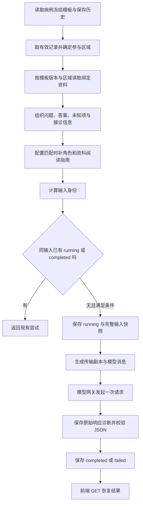

# 源码阅读 03：资料组织、模型输入与分析结果

日期：2026-10-13。依据当前正式源码 `<project-root>`。本轮只读核对与文档编写，没有请求模型、修改病例或程序，也没有启动服务。

前一篇：[检查保存、更正与页面摘要](02-observations-and-projection.md)。这篇回答：**用户已经保存的检查结果和平台资料，究竟怎样成为一次 AI 分析？**

## 1. 四个最重要的文件

| 文件 | 作用 |
| --- | --- |
| [AreaAnalysis.tsx](../../frontend/src/formal/design/workbench-v2/AreaAnalysis.tsx#L101) | 读取输入预览和尝试状态；用户点击才提交生成 |
| [area_analysis_service.py](../../backend/app/services/area_analysis_service.py) | 选择区域、查询资料、冻结输入、生成并保存结果 |
| [analysis_context.py](../../backend/app/services/analysis_context.py) | 识别记录角色、定位方法章节、生成发送副本 |
| [model_gateway.py](../../backend/app/infrastructure/model_gateway.py) | 预算、脱敏、外部请求、结构校验和调用诊断 |

前端负责什么时候发起、怎样显示；后端决定实际送什么。浏览器不是把整张网页 HTML 直接发给模型。

## 2. 完整链路



GET 预览也会组织当前输入并计算过期状态，但不会发起模型请求。只有用户点击对应 POST 才生成。

## 3. 前端点击到底提交了什么

`AreaAnalysis` 没有传 areaId 时走当前综合入口：

```text
GET  /api/v2/cases/{caseId}/matched-areas/analysis
POST /api/v2/cases/{caseId}/matched-areas/analysis
```

有 areaId 时走单一区域 `/areas/{areaId}/analysis`。服务内部用 `__matched_areas__` 标识综合范围，这不是一个真实车辆部件区域。

POST 的主要请求体只有：

```json
{"expected_revision": 6}
```

前端不把用户可编辑的一包资料或答案作为本次权威输入。服务端核对病例归属和版本，再从数据库、病例快照重新组织。

接口入口：[area_analyses.py](../../backend/app/api/area_analyses.py)。

### 3.1 为什么按钮可能不可点

当前组件检查：正在提交、相同输入已有非失败尝试、模型配置可用性、资料是否存在、综合范围是否有记录区域、参与区是否缺绑定资料。

不是必须填满全部题目才能分析。模型 key 已配置，也只说明具备配置条件，不保证外部服务当前可访问或预算一定充足。

### 3.2 状态读取与生成分开

组件按 caseId、范围和 revision 查询状态。发现 running 时约每 2.5 秒 GET 一次；POST 当前等待上限为 135 秒。GET 轮询不是反复生成。

用于按钮判断的 `current` 是第一条未过期尝试；正文展示则读取最新 `history[0]`。两者不是完全同一个选择条件，因此要结合 stale 和 status 理解页面。

## 4. 后端先取得权威工作台视图

`AreaAnalysisService._view` 锁定病例，校验归属及可选 expected_revision，要求它是 template-match-v1 病例，随后使用 TopicService 的视图组织逻辑。

它取得冻结 topic、当前 plan、完整历史及 effective 标记。上一章的更正链因此会影响本次输入：被替代记录不会作为当前答案继续进入。

当前分析没有运行旧诊断图来决定下一题，也不使用旧 case_analyses 的生成入口。

## 5. 怎样确定参与区域

源码：[AreaAnalysisService._payload](../../backend/app/services/area_analysis_service.py#L180)。

```text
有效记录的 question_id 集合
  → 冻结题目定义中的 area_id
  → 有记录区域集合
  → 只读取这些区域的资料
```

举例：五区模板只保存空气通路和压力测量记录，就只参与这两区。未参与区没有被检查，不能自动当作正常；参与区没填写的题目仍需说明未知。

当前判定依据是存在 effective observation，不另要求 option_ids 非空。多选清空仍保留有效记录行时，也可能被算作有记录区域。这与上一章“页面没有有效选项仍显示未回答”的统计口径不同；本文按实际代码解释，不把它写成程序自动忽略所有空答案。

## 6. 对应资料怎样查询

源码：[load_documents](../../backend/app/services/area_analysis_service.py#L58)。

```text
病例 template_binding.template_id + version
                        加上 area_id
                              ↓
area_reference_bindings：document_id + document_version
                              ↓
area_reference_documents：title、body、content_hash、provenance
```

资料由已发布绑定确定，不是由模型临时选择。服务校验 SHA-256(body) 与登记 hash 一致，否则返回 `REFERENCE_VERSION_CHANGED`。

这一步没有读规划目录的 Markdown，也没有查 pgvector。修改 Markdown 要通过资料版本登记和绑定才能进入这条运行链。

一块区域可以绑定多份资料；不同区使用同一资料版本时，综合输入按 `(document_id, version)` 去重。不能假设永远每区只有一份资料。

## 7. 单区输入如何组织

源码：[build_input](../../backend/app/services/area_analysis_service.py#L75)。

它从区域问题定义和 effective 记录生成：

| 对象 | 内容 |
| --- | --- |
| vehicle / complaint / fault_codes | 车辆、主诉和故障码 |
| intake | 接诊工况和风险 |
| template_binding | 模板身份和内容哈希 |
| area | 区域 ID、标题、描述 |
| observations | 保存记录 ID、题目、选项 ID/文字、字段、备注、无法完成原因 |
| questions | 题目 ID、标题、答题类型、字段定义和是否有记录 |
| unknown_question_ids | 没有记录且非自动派生的题目 |
| documents | 绑定资料正文、版本和来源 |

模板有 observation_rules 时，另加 suggested_focus 和 execution_blockers。

原 observation 的全部 payload 并非原封不动发送：这里重建了一个分析字段集合，例如批次和操作类型不在上述 observations 复制字段中。规则冲突可以另行进入综合输入，但不能假设整个 view.derived 都直接送给模型。

选项同时保留 ID 和 label：ID 方便追踪引用，中文 label 帮助模型理解语义。

## 8. 角色配置：区分事实与人工安排

源码：[analysis_context.enrich](../../backend/app/services/analysis_context.py#L17)。

记录角色读取 `backend/app/topics/record_roles_v1.json`，先匹配模板 ID、版本、content_hash，再校验各题 definition_hash；没有条目时记录为 unclassified，分析照常进行。发送哪些章节由检索资料原文选出（`retrieval_reading.py`），不再查题目→章节对照表。

| 角色 | 说明 |
| --- | --- |
| observation | 用户保存的现象或测量 |
| inspection_status | 检查是否能完成、是否支持等状态 |
| human_judgment | 人工判断 |
| disposition | 下一步安排，例如交接方向 |
| completed_action | 保存的已完成动作 |
| retest | 保存的复检类记录 |
| unclassified | 配置未覆盖或不能可靠分类 |

“建议交接”不能直接变成“某部件已确诊”。“不支持设置”也不能直接变成“已经证明执行器损坏”。

自由备注保留原义，角色为 unclassified；这里没有让关键词规则重写用户记录。

角色配置不匹配时回到 unclassified，不猜一个角色。参与区的未知人工判断/安排会从 unknown_question_ids 分到 unrecorded_decision_question_ids，避免当成缺少测量事实。

注意：角色 retest 存在，不代表当前独立 template_repair_rounds 已接入。它只能分类本次 observations 中实际包含的记录。

## 9. 资料章节选择怎样实现

### 9.1 先核对资料身份

正文 ID、版本、哈希和实际 SHA-256 都与配置一致，且模板匹配，才使用章节组织规则。

若参与区有未配置的问题、位置无效或标题对不上，保留完整正文，不继续使用旧偏移切片。

### 9.2 章节来源有四类

1. `always_include`：共同条件、背景、复检等必要上下文。
2. 已记录题目关联的方法。
3. 未知事实题目关联的检查方法。
4. 已选具体选项关联的处理或检查原文。

章节由配置的 start/end 定位，核对开头标题后截取，重叠范围合并一次。

这种方法不是另一轮模型摘要，也不是向量检索。程序知道“某题/某选项应该阅读哪些已登记章节”，但不会据此直接得出故障结论。

### 9.3 两个新增对象

- `analysis_extracts`：关联章节的原文片段。
- `reference_reading_guide.result_methods`：具体选项关联的方法原文，以及所依据 observation/option ID。

方法原文供模型使用，不是预先写死本例该做哪一步。未知项目的方法也保留，避免只给结论不给检查手段。

## 10. 完整快照与实际发送正文分开

源码：[model_payload](../../backend/app/services/analysis_context.py#L112)。

### 10.1 数据库存什么

`area_analysis_attempts.input_json` 保存完整组织输入，包括原资料正文、原哈希、有效记录、章节提取和阅读指南。它保留当时的来源，后续配置变化不会修改旧快照。

### 10.2 给模型发什么

`model_payload` 深拷贝输入，生成传输副本：

```text
有有效 analysis_extracts：
  body = 合并的章节原文
  body_scope = retrieved_sections_with_context
  full_content_hash = 完整资料原哈希
  content_hash = 发送章节正文的新哈希

没有有效提取：
  body = 完整正文
  body_scope = full_document_fallback
```

深拷贝意味着这一步不直接把数据库留存的完整资料改成删减版。

网关还会对消息文本进行 VIN、邮箱、手机号等模式脱敏，因此留存快照与最终外发消息也不能简单当作逐字完全相同。章节字符偏移主要用于本地核对，稳定标题用于外发后的定位。

## 11. 合并成一次综合输入

源码：[build_matched_input](../../backend/app/services/area_analysis_service.py#L113)。

它逐区构建输入、跳过无 observation 的区域，合并记录、问题、未知项、角色指南和资料版本集合。

最终保留 areas 中的区域→记录→资料关系，方便解释哪些区域参与。模板有观察规则时加入参与问题内的 rule_conflicts，并使用相应提示词版本字段。

正文不按区域数量硬编码；问题数量、资料数量和动作数量也不固定。资料映射仍需配置，通用组织器不能替代知识覆盖。

## 12. 输入身份与过期判断

源码：[input_identity](../../backend/app/services/area_analysis_service.py#L161)。

它对 payload 的稳定 JSON 算 SHA-256，排除 case_revision 和 max_output_tokens。

| 变化 | 典型影响 |
| --- | --- |
| 改选或更正检查 | 记录 ID/内容变化，旧输入不一致 |
| 增加另一参与区记录 | 区域与资料集合变化 |
| 绑定资料版本/正文变化 | 资料身份变化 |
| 阅读配置变化 | guide 中 config_hash 等变化 |
| 提示词版本字段变化 | payload 身份变化 |
| 只增加病例 revision | 不单凭版本数字判过期 |
| 只改输出 tokens 上限 | 不构成新输入身份 |

提示词文本本身不作为完整字符串进入这个哈希，改提示词时还应维护对应版本。不能认为改了任意系统文本就一定自动标旧结果过期。

即使把某题改回原来的文字，新 observation ID 仍不同，也可能形成新的输入身份；哈希不是纯粹比较页面显示文字。

## 13. start：保存尝试后才请求模型

源码：[AreaAnalysisService.start](../../backend/app/services/area_analysis_service.py#L220)。

### 13.1 同输入不重复生成

先查本例、分析范围、input_hash 是否已有 running/completed；有则返回已有记录。数据库对应的唯一索引也限制这两种状态的同输入尝试。

failed 不占同一活动输入资格，允许用户明确手动重新分析；未知结果仍不能直接当失败重试。

### 13.2 前置检查

没有模型配置、综合范围没有记录区、资料为空、任一参与区缺资料，都会明确拒绝。

单区路径检查字符预算；综合路径使用 matched_areas 配置并进入模型网关预算。不能把单区字符上限误写成所有综合请求都会执行同一截断规则。

程序不会为满足预算偷偷截掉所有超出字符；实际检查不通过会返回错误，不把半份资料冒充完整输入。

### 13.3 先落库

创建尝试 UUID，保存 running、input_revision、input_hash、模型、提示词版本、完整 input_json，并提交事务。

随后才创建网关并发请求。这段外部请求不一直占着前面那笔病例事务。

当前实现直接在 POST 处理过程中调用，不进入旧 LangGraph 或默认 worker 队列。

## 14. messages_for 与模型网关

`messages_for` 把通用分析原则作为 SystemMessage，把 `model_payload` JSON 作为 HumanMessage。网关再加入 `AreaAdviceV3` 的输出 schema 要求。

通用原则要求区分未知与正常、使用已有结果、给具体操作、保留执行条件和独立复检；没有把 P0299 的固定维修结论放成所有病例答案。

源码：[generate_structured_once](../../backend/app/infrastructure/model_gateway.py#L339)。

该路径：

- 最多一次 provider 尝试。
- SDK 重试为 0，传 retry_transient=False。
- 不发起输出结构修复的第二次模型请求。
- 使用 budget ledger 预留本次调用预算。
- 拒绝截断、非法 JSON、工具调用或不符合输出结构等结果。

网关还存在 `generate_structured`、`run_tools` 等其他方法，但本次 start 调用的是 generate_structured_once。不要因为类里有重试/工具函数就断言当前综合分析会调用它们。

当前综合连接超时配置为 90 秒；整体网关回合预算也有自己的限制。前端等待、网关时间与外部模型耗时不是同一个计时器。

## 15. 输出结构与内容保证

[AreaAdviceV3](../../backend/app/domain/case_analysis.py) 用 Pydantic 定义 summary、steps、conditional_branches、missing、precautions、verification 等字段。

每项行动包含 title、kind、action、前提、复检、中止条件和来源/记录引用。

结构校验确认字段、类型、长度等符合约定；当前没有另一个已完整实现的语义核验器，证明每项动作技术上正确、所有异常无遗漏或引用一定真正支持结论。

具体方法主要来自资料与模型判断，组织要求来自通用提示词。JSON 合法与维修建议有指导价值仍要分别验收。

## 16. 原始响应、结果与错误存在哪里

`capture(raw, meta)` 回调先保存原始响应和用量等 diagnostic 信息，然后完成解析与结构校验。

最终更新 `area_analysis_attempts`：completed 时保存 result_json；失败时保存 error_code 与已有诊断信息。服务关闭网关连接，并重新读取状态返回。

分析保存不修改 observations，不自动新增 template_repair_rounds，也不提高病例事实 revision。

| 状态 | 当前语义 |
| --- | --- |
| running | 请求已登记，尚未完成 |
| completed | 已通过结构校验并保存结果 |
| failed | 本次尝试失败，可由用户手动重新请求 |
| GET 返回 unknown | 底层仍为 running，但已超过当前 150 秒阈值 |

unknown 是读取时派生显示，不等于数据库已把 status 改为 failed；也不等于 provider 一定没有执行。

## 17. 为什么刷新不会重复调用

刷新执行 GET，读取当前 payload 与已保存尝试，计算每条 stale。前端显示保存结果与错误，不重新 POST。

同输入 completed 显示分析已完成；输入变化可重新生成；最新 failed 显示手动重新分析。原生成内容不被程序悄悄按新答案改写。

## 18. 独立维修复检目前在哪里断开

当前输入构建只读 TopicService 的 observations、冻结定义、接诊及绑定资料；没有把 template_repair_rounds 中的 repair_action/retest_evidence 追加进 payload。

前端另读取轮次时间，发现建议后有新处理或复检时提示旧建议不能当作处理后判断。这个提示不等于复检已经送给模型。

因此只保存一轮复检，病例 revision 会变，但分析输入可能相同，按钮也可能仍显示原输入已有结果。要分析维修后的新证据，需正式接通轮次输入；这不是只改一句提示词就已经完成的能力。

本篇说明现状，不新增这项功能。

## 19. 用自己的话讲这一条链

> 用户点击分析后，后端从病例冻结模板和数据库有效记录确定参与区域，查询各区绑定资料，再按版本化角色与章节配置组织输入。数据库保存完整快照，外发副本使用关联章节，失配时回退完整正文。系统用输入哈希防重复和判断旧结果过期，先登记尝试，再通过统一网关调用一次模型，保存原始响应、结构化结果和失败状态。页面刷新读取同一结果，建议不自动成为检查或维修事实。

## 20. 本轮停止点

本轮完成“输入组织 → 一次生成 → 结果恢复”的源码阅读与讲解，没有真实请求。下一条可读“实际处理 → 独立复检 → 历史进度与结束/继续”，补齐当前主流程最后的记录闭环。
