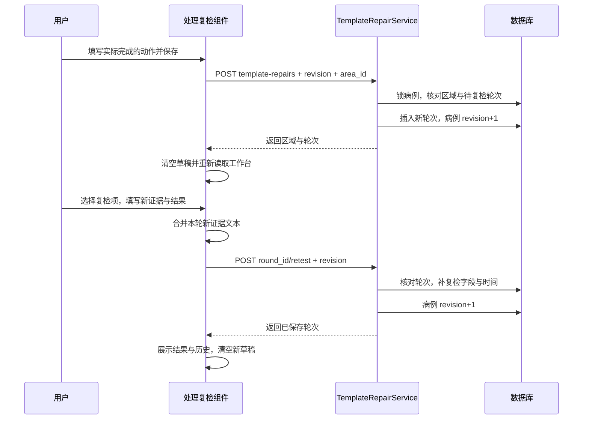

# 源码阅读 04：处理复检、历史恢复与病例生命周期

日期：2026-10-13。依据当前正式源码 `<project-root>`。本轮只读核对与编写笔记，没有保存处理、复检或生命周期操作，没有改代码、重启服务或调用模型。

前一篇：[资料组织、模型输入与分析结果](03-analysis-and-references.md)。这一篇补齐主流程最后一段：**做了什么处理、后来取得什么证据，怎样保存、恢复并结束或继续工作。**

## 1. 先区分四件事

| 对象 | 来源与存储 | 不能等同于 |
| --- | --- | --- |
| 维修前检查 | 用户填写，observations 保存 | 维修后的新检查 |
| AI 建议 | 模型生成，area_analysis_attempts 保存 | 用户已经实施处理 |
| 实际处理 | 用户记录动作，template_repair_rounds 保存 | 已确认故障修复 |
| 独立复检 | 用户取得新证据，补到对应维修轮次 | 覆盖原检查答案 |

“结束本次工作”则是用户工作状态，另外保存在病例快照的 case_lifecycle 中。它不自动生成新最终报告，也不证明车辆已修好。

## 2. 相关文件地图

| 文件 | 负责什么 |
| --- | --- |
| [TemplateRepairRetest.tsx](../../frontend/src/formal/design/workbench-v2/TemplateRepairRetest.tsx#L24) | 区域处理表单、动态复检候选、新证据组织、轮次展示 |
| [template_repairs.py](../../backend/app/api/template_repairs.py) | 处理、复检、生命周期 HTTP 输入与路由 |
| [template_repair_service.py](../../backend/app/services/template_repair_service.py) | 校验区域与轮次，在事务中保存 |
| [template_case_history.py](../../backend/app/services/template_case_history.py) | 进度汇总、关闭判断、关闭/继续事件 |
| [TemplateCaseLifecycle.tsx](../../frontend/src/formal/design/workbench-v2/TemplateCaseLifecycle.tsx) | 结束确认与继续按钮 |
| [HistoryPage.tsx](../../frontend/src/formal/pages/HistoryPage.tsx) | 分页、筛选、按体验状态分组、打开病例 |
| [CaseService.with_active](../../backend/app/services/case_service.py#L94) | 给病例响应加当前进度和历史列表分类 |

## 3. 一轮处理到复检的流程



前端选择复检项目本身不写库。必须提交复检，处理后的新证据才持久保存。

## 4. 当前区域怎样传进组件

主工作台把当前 area.id、冻结题目、分组、effective observations 和 revision 传给 TemplateRepairRetest。

组件再用 `key = caseId + areaId` 渲染内部 RepairArea。切换病例或区域会重建草稿，因此区域 A 的未保存文本不会被带入区域 B。

它读取 GET `/api/v2/cases/{id}/template-repairs`，返回：

```text
revision：病例当前版本
areas：冻结模板的区域 ID → 标题
rounds：该病例的处理复检轮次，按创建时间从新到旧
```

当前区的轮次由前端按 area_id 过滤；latest 是本区最新一轮，未有 retested_at 时视为 pending。

这条 GET 不新增轮次，也不会推断用户执行过 AI 建议。

## 5. 草稿与展开状态怎样重置

内部 state 包含动作、说明、工况、结果、补充证据、逐题新答案、勾选题目、变化标签和下一地区。

`open` 初值为 null，卡片默认折叠，点击标题才展开。

轮次身份由 `latest.id + latest.retested_at` 构成。读到身份变化后，组件清掉上一轮草稿、勾选、错误与展开状态；保存成功也显式清空它们。

需要区分：

- **勾选与草稿重置**：防止上一轮结果被带入新轮。
- **候选题目重新计算**：依据当前有效维修前记录；如果这些记录没变，候选列表可以仍相同。

因此新轮次不必自动换一整套问题；它应该重新由用户选择本次需要复查的项目。

## 6. 保存实际处理

### 6.1 请求内容

源码：[saveRepair](../../frontend/src/formal/design/workbench-v2/TemplateRepairRetest.tsx#L91)。

示意请求，动作文字不是本轮实际执行记录：

```json
{
  "expected_revision": 8,
  "area_id": "boost-air",
  "repair_action": "用户实际完成的处理对象、动作和范围",
  "repair_note": "实际补充说明"
}
```

动作不能为空，动作与说明各自最多 4000 字符；页面 busy 时避免重复提交。

### 6.2 服务端检查

源码：[record_repair](../../backend/app/services/template_repair_service.py#L33)。

依次检查：病例归属和版本、病例未关闭、确实是模板病例、area_id 属于冻结模板、动作去空格后非空、该区没有未复检轮次。

有 pending 时返回 `RETEST_PENDING`，要求先完成本轮复检。限制按区域判断，不是整个病例只能存在一轮待复检；另一区域可以有自己的待复检轮次。

### 6.3 数据库变化

新增 template_repair_rounds 行：

| 字段 | 意义 |
| --- | --- |
| id | 本轮 UUID |
| case_id / area_id | 属于哪例病例、哪个区域 |
| repair_action / repair_note | 实际动作与说明 |
| pre_repair_revision | 保存处理之前的病例版本 |
| created_at | 处理记录创建时间 |
| retest_* / retested_at | 尚未复检时为空 |

同一事务将 cases.revision 加一。原 observations 不变。

`pre_repair_revision` 是定位处理前状态的版本信息，不等于另外复制了一套完整维修前 observations；原观察历史本来就保留。

## 7. 动态复检项目从哪里来

源码：[availableTargets](../../frontend/src/formal/design/workbench-v2/TemplateRepairRetest.tsx#L59)。

候选要求：属于当前区域、有 effective observation、不是 automatic_derived。

再根据保存的选项 outcome 分类：

| 分组 | 当前分类依据 |
| --- | --- |
| 异常优先 | 至少一个选项 outcome=abnormal |
| 待确认/无法检查 | 无选项、选项未知，或结果不在 normal/recovered/abnormal 中 |
| 正常/已完成按需添加 | 剩余明确 normal/recovered 项 |

正常组默认通过 details 收起，异常和待确认优先显示。用户勾选后，题目按原 cardId 分组生成复检卡片。

候选不是 AI 生成，也不是程序从实际动作文本中自动识别所有相关零件。未在原题保存过的对象可以通过补充证据记录，但不会自动变成候选题。

## 8. 逐题变化、工况与整体结果是三种信息

### 8.1 逐题变化

`improved/persists/uncertain` 对应已改善、仍有异常、尚不能判断。

它是用户对选中检查项的变化说明，另需填写处理后新现象或读数。只点“已改善”而没有新记录文字，不算该题已取得证据。

### 8.2 本轮工况

`same/different/unavailable` 对应可比工况、工况不同、无法复现或比较。

### 8.3 本轮整体结果

`resolved/persists/uncertain` 对应原问题未再出现、仍存在、尚不确定。

一项接头改善，不自动说明整个主诉消失；不同工况下未再出现，也不自动说明同条件故障已经解决。界面用这些维度保存用户判断，不替用户进行现场复核。

## 9. 新证据如何组织成保存文本

源码：[recordedEvidence](../../frontend/src/formal/design/workbench-v2/TemplateRepairRetest.tsx#L76)。

前端取选中且已填写新答案的题目，加入可选变化标签，再追加补充证据：

```text
原问题标题
复检变化：已改善
处理后新记录：本轮新取得的现象、数值与单位

其他新证据

本轮已选但尚未取得新记录：
未填写项目的标题
```

未填写列表仅在已有新证据时追加，不能只勾选一堆项目就形成合格新证据。可以不勾选候选，直接在补充证据里记录本轮新结果。

合并后的 evidenceText 总长度不能超过 4000。每个输入框允许 4000，不代表多个输入框合并后能保存更多。

当前保存的是人可读文本，不是 question_id 对应的独立结构化复检答案数组。页面重新打开会显示保存文本，不恢复成原先每个输入框与勾选状态。

## 10. 保存本轮独立复检

源码：[saveRetest](../../frontend/src/formal/design/workbench-v2/TemplateRepairRetest.tsx#L102)、[record_retest](../../backend/app/services/template_repair_service.py#L55)。

```json
{
  "expected_revision": 9,
  "retest_condition": "same",
  "retest_outcome": "uncertain",
  "retest_evidence": "本轮实际新证据文本",
  "next_area_id": "pressure"
}
```

路径：POST `/cases/{id}/template-repairs/{roundId}/retest`。

后端锁定病例和轮次，核对版本与归属、病例开放、轮次存在且未复检、证据非空，以及下一地区属于本例且不同于本轮区域。

通过后补写这条轮次的 retest_condition、retest_outcome、retest_evidence、next_area_id、retested_at，并将病例 revision 加一。没有创建维修前 observation，也没有覆盖它。

本轮只能完成一次复检，没有当前轮次的更正接口；再次处理应新建轮次。保存错误的历史轮次如何修正，不在当前这一入口实现。

这些接口没有使用 Idempotency-Key；依靠病例版本、待复检状态与已复检检查防重复写入。不能把上一章创建/观察的幂等机制原样套到它们。

## 11. 保存后与下一排查区域

保存成功：清空草稿，重新读取轮次，通知主工作台刷新。主页面取得新 revision 和当前观察投影。

失败时也读取服务端状态，并保留相应错误信息；若请求结果不明，重新读取有助于确认是否已保存，不自动再次提交。

前端在同工况且 resolved 时不提交下一地区；其他结果允许选择不同匹配区域。后端主要校验地区身份，不独立证明 resolved 与证据之间的维修语义一致性。

点击“前往某区”只修改主页面 areaId/cardId 并滚动定位，不新增检查、不创建新病例、不请求 AI。

## 12. 刷新怎样恢复轮次

数据来源是 template_repair_rounds，按创建时间及 ID 从新到旧读取。前端在本区显示最新结果和历史轮次。

轮次序号是本区域记录数量和顺序换算的显示，不是数据库单独保存的统一全病例轮次编号。

刷新保留已经保存的动作、工况、整体结果与新证据文本；未保存的勾选和输入是浏览器草稿，不能把它们称为数据库已经丢失的记录。

## 13. 历史列表怎样知道病例做到哪一步

源码：[load_summary](../../backend/app/services/template_case_history.py#L37)、[summarize](../../backend/app/services/template_case_history.py#L20)。

load_summary 读取该病例全部观察的 ID/替代关系/payload 和维修轮次，再汇总：

- recorded、total：有记录的问题和非自动派生区域题目数量。
- pending_retests：没有 retested_at 的轮次数。
- repair_rounds：全部处理轮次数。
- latest_repair、latest_retest_outcome：按创建顺序最新轮次的动作和结果。

这里 recorded 根据有效行的 question_id 计算，不要求 option_ids 非空；与区域投影中“有有效选项才计已答”不是完全同一口径。因此统计差异要先看函数定义，不直接判断保存失败。

“最近复检”字段来自最新创建轮次，不是另按 retested_at 挑最近完成的一次。如果最新处理尚待复检，其结果为空，列表可能不显示此前已完成轮次的复检结果。

## 14. 进度标签与列表分组

summary.state 依次判断：

```text
closed 为真 → 用户已结束
否则存在待复检 → 待复检
否则有维修轮次 → 已复检 · 待确认
否则有检查记录 → 检查中
否则 → 尚未检查
```

CaseService 将它转换成 experience：

| 条件 | 分类 |
| --- | --- |
| 用户已关闭 | completed，已结束 |
| 没关闭但有 pending | waiting，待复检或待补充 |
| 其他当前模板病例 | continue，可继续 |

所以“已复检 · 待确认”通常仍在可继续；“尚未检查”也可继续。completed 在这里表示工作关闭，不代表平台判定维修成功。

这些值由记录汇总，不要求把 cases.status 改成旧执行器的 completed 才能显示已结束。

## 15. HistoryPage 怎样读取和打开

历史页默认日常范围，可切换测试与验证或全部。后端按所有者和范围分页返回，前端去重、按体验优先级和更新时间排列，再在已加载内容中做关键词筛选。

每次最多请求 50 项，旧页通过游标继续加载。数据库分页本身主要按创建时间与 ID 排序；前端对已加载记录再按进度/更新时间展示，两层排序目的不同。

范围分类依据明确主诉标签等规则，不是看到 demo 技术标记就将所有模板病例归入测试。关键词筛选不能保证未加载页的所有内容已被搜索。

点击病例只导航 `/workbench/{id}`，后续读取档案、冻结题目、观察历史、分析与处理轮次。当前模板可继续，退休旧工作流则按对应历史只读分支展示。

历史不是另外一份复制的病例数据库，也不是保存网页截图供恢复。

## 16. 结束本次工作

TemplateCaseLifecycle 先显示确认提示，确认后提交：

```json
{"expected_revision": 10, "closed": true}
```

路径：POST `/cases/{id}/template-lifecycle`。

源码：[set_closed](../../backend/app/services/template_case_history.py#L45)。

服务核对病例版本、归属与模板流程；状态变化时，保存：

```text
intake_snapshot.case_lifecycle
  closed：当前关闭标志
  at：事件时间
  actor_id：操作者
  events：保留此前关闭/继续事件
```

同时 revision 加一。如果当前已经是请求的状态，不重复增加事件与版本，但进入函数时仍先核对 expected_revision。

不删除观察、分析或轮次；也不要求待复检数为零才能关闭。关闭后待复检数依然保留，只是列表分组优先使用已关闭状态。

## 17. 继续此病例

提交 closed=false，将同一病例重新开放，追加继续事件。不创建新病例，也不抹掉此前关闭和处理历史。

检查保存、处理、复检服务通过 require_open 拒绝关闭病例的新写入，返回 CASE_CLOSED。因此想继续填写需要先继续病例。

当前 AI 分析服务没有同样调用 require_open，不能把生命周期说明扩大成“关闭后所有 API 都自动禁止”。关闭是哪些操作的限制，要逐个服务确认。

前端在生命周期保存后使病例与历史查询缓存失效，并刷新主页面，重新取得版本与状态。

## 18. 这条链与 AI 的当前关系

实际处理和复检都没有调用模型。它们保存的独立文本目前也没有直接合并到综合 AI payload。

AI 组件通过轮次时间提示建议之后有新处理，不能把原建议当作处理后判断；这与“新证据已经进入下一次模型分析”仍是两回事。

这也是当前记录闭环完整与连续 AI 推理输入完全接通之间的边界。

## 19. 用自己的话讲

> 用户记录实际动作后，后端为选定区域创建一个维修轮次，保留处理前病例版本。用户按需选择原有检查项，取得新证据，保存本轮工况与结果；复检补到该轮次，不覆盖原观察。历史进度由有效记录、轮次和用户关闭标志计算。结束只是暂停/关闭这次工作，记录全部保留，之后可以继续同一病例。

## 20. 四篇主流程阅读已齐

1. [接诊 → 模板匹配 → 病例创建](01-intake-and-template.md)
2. [选择 → 保存 → 更正 → 规则摘要](02-observations-and-projection.md)
3. [有效记录与资料 → 模型输入 → 保存结果](03-analysis-and-references.md)
4. 本篇：实际处理 → 独立复检 → 历史恢复 → 结束与继续。

本轮停在主流程源码讲解完成，不自动进入代码修补、再次清理或 GitHub 整理。下一步可以结合网页体验，汇总当前能力与实际需要处理的缺口。
