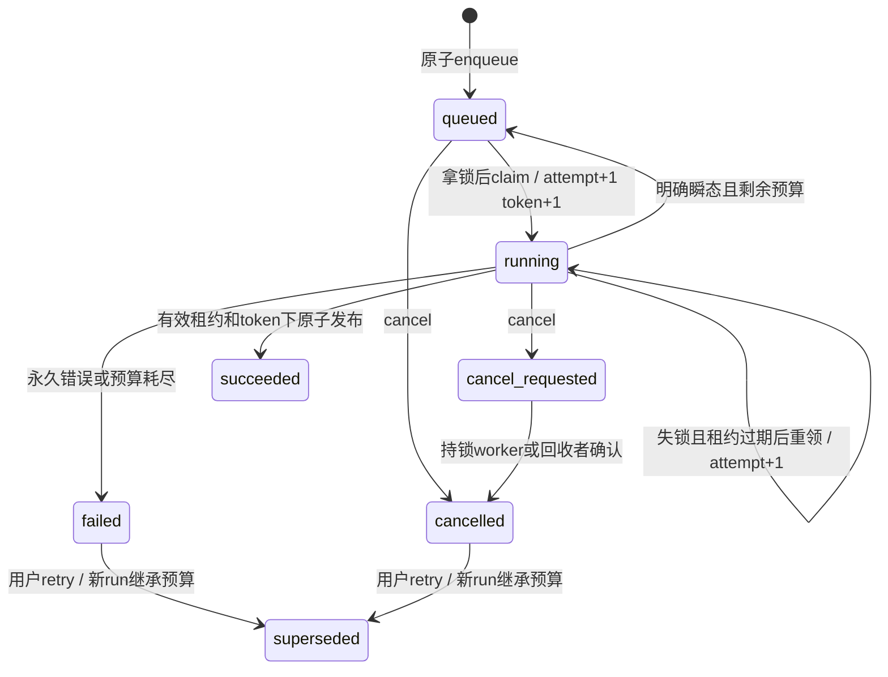

# WP-03 持久任务契约

仅后台任务、租约、事件与取消；唯一成功处理器为明确标识的no_op测试任务。不是导入、诊断或Agent。WP-02已接受，原契约和迁移不覆盖。

## 状态、事务及互斥

run queued→running→succeeded/failed/cancelled；瞬态失败running→queued。job queued→running→completed/failed/cancelled。running取消先run.cancel_requested，再由持锁worker或失锁后回收者转cancelled；queued取消直接cancelled。终态取消200，非终态202；重复请求不重复事件。取消不增加case.revision。

入队同事务写run/job/run.queued；case行锁验证owner、expected_revision及活跃run约束。case任务owner来自cases.owner_id；无case必须持久owner_id，历史无owner记录对所有用户404。0003增加nullable owner_id（兼容历史不可访问记录）与领取/事件索引，不修改0001/0002。

领取先候选查询，再专用数据库会话取得稳定SHA256(case_id或run_id)的64位advisory lock，再短事务FOR UPDATE SKIP LOCKED锁job、锁run。复核due/状态后attempt与token递增，默认60秒租约、15秒独立心跳。锁竞争跳过，不增加attempt。过期但锁仍存在不能被新执行者推进。锁连接保持至本轮结束，禁止连接池归还锁会话；心跳/finish/fail在同一持锁连接上串行短事务操作，检查worker/token/有效租约/run状态；断连不重连接管，停止发布。失效后不发布迟到成功。无业务副作用的no_op只能安全恢复测试处理，不承诺外部调用exactly-once。

每次run事件写入先锁run行再分配identity，锁持有至提交，保证同run ID顺序即提交顺序（不同run无此承诺）。取消/发布按job→run顺序加锁，串行裁决；取消先提交则成功不能覆盖，成功先提交则取消读到终态。所有数据库发布与状态事件同事务。

## 尝试与重试

整个parent_run链总尝试最多3次，attempt在用户retry新job中继承累计值，max_attempts固定3。自动重试仅明确瞬态处理器错误，持久available_at，前两次失败分别2秒/8秒加少量抖动；第3次失败终止。总指南2/8/30含三档等待而总尝试仅3次：本包解释为三次总尝试（初次+两次重试），30秒档不使用，不能另造run绕开。失进程重领也消耗剩余尝试；锁竞争不消耗。结构/权限/未知/未实现处理器永久失败，无自动重试。

显式retry仅cancelled或可重试failed且有剩余预算；新run记录parent_run_id、同turn/workflow并继承累计attempt；原run置superseded防分叉，事务幂等。case任务要求当前expected_revision；无case请求expected_revision必须null。无剩余/状态不符409 RETRY_NOT_ALLOWED。

## API

GET /api/v2/runs/{id}：200 {id,case_id,kind,status,attempt,max_attempts,parent_run_id,error,usage}；隐藏owner、payload和租约秘密。cookie认证；越权/无归属404。

POST /runs/{id}/cancel：无请求体，认证+Origin+CSRF+Idempotency-Key；202 {run_id,status}，终态200。同key重放原响应但每次先认证授权；不同请求同key409。

POST /runs/{id}/retry：JSON {expected_revision:int>=0|null}，extra=forbid，同上安全要求；202 {run_id,status:queued,parent_run_id}。所有错误沿用WP-02安全envelope，422输入、401认证、403Origin/CSRF、404owner、409revision/活跃run/幂等/预算，数据库错误沿用现有分类。

不开放POST /cases/{id}/runs的start/reassess。测试CLI以受保护本地operator_id提交no_op，可指定case及expected_revision；无case以配置操作员为owner。no_op只等待指定0..300秒后发布测试完成。测试屏障和故障注入仅由tests隔离入口配置，须通过xiutu_test_*门禁，生产CLI不接受这些参数。

WP-02 active_run由固定null衔接为当前活跃run摘要{id,kind,status}或null；get/list即时查询，同事务创建响应仍可为null（幂等历史响应不回写）。report_gate仍NOT_IMPLEMENTED，不修改诊断revision/status。

## SSE

GET /runs/{id}/events：同源cookie；Origin若提供必须匹配（同源原生EventSource可能无Origin），跨站Fetch-Metadata拒绝。Last-Event-ID缺省0；非十进制/负数/其他run ID/不存在ID返回400 INVALID_CURSOR。重放id>cursor升序，每批短连接查询，不持连接等待客户端；每15秒注释心跳，轮询避免历史/实时切换窗口。终态且该run事件全部发送后关闭。会话失效/注销在下一轮检测关闭，不发送虚构业务事件；重连401。连接断开释放资源。仅实际run.queued/started/retry_scheduled/cancel_requested/cancelled/succeeded/failed/superseded概要事件，不含隐藏推理、资料或秘密。初版不清理事件。

## 验证与保留项

聚焦D204—D206，真实PG、独立进程与屏障，覆盖领取、心跳、崩溃前后、旧锁/过期token、取消竞争、预算、HTTP/SSE。完整入口交付前一次；按失败范围修正复跑。E10 NOT_VERIFIED最迟WP-09；资料NOT_MET最迟WP-10/真实效果验收前。实现完成仅IMPLEMENTED_NOT_ACCEPTED。

## 状态图

