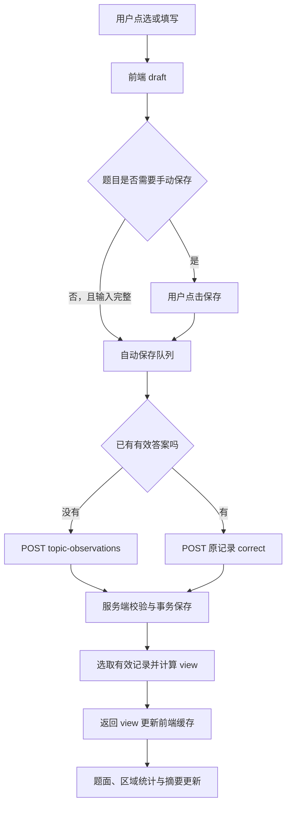

# 源码阅读 02：检查保存、更正与页面摘要

日期：2026-10-13。依据当前正式源码 `<project-root>`。本轮只读核对并编写笔记，没有提交检查、修改病例、改程序或调用模型。

前一篇：[接诊表单到模板病例创建](01-intake-and-template.md)。这一篇解释：**用户选择一个答案后，怎样保存、更正，并让页面摘要跟着变化。**

## 1. 先认识三个不同层次

| 层次 | 在哪里 | 意义 |
| --- | --- | --- |
| draft 草稿 | 前端 React 状态和 ref | 用户正在选择、填写的内容，尚不一定入库 |
| observation 观察记录 | 数据库 observations | 一次实际提交成功的用户记录 |
| view 页面投影 | 后端根据记录计算，返回前端 | 当前答案、区域统计、派生值与摘要 |

选择按钮变成绿色，只说明当前 draft 选择了该项；“已保存”才表示相应保存状态。摘要使用服务端保存记录，不读输入框里的未提交数字。



## 2. 第一个文件：前端如何处理答案

打开：[FormalWorkbenchB01Page.tsx](../../frontend/src/formal/design/workbench-v2/FormalWorkbenchB01Page.tsx)。重点先读 `AnswerForm`，再读 `useAnswerSaving`。

虽然文件名带 B01，它也是当前模板工作台的主体；不能只看名字认为这是已经不用的历史代码。

### 2.1 一个草稿里有哪些东西

```tsx
type Draft = {
  selected: string[];
  fields: Record<string, string>;
  unavailableReason: string;
  retestFrames: Record<string, string>[];
};
```

`selected` 保存选项 ID；`fields` 保存输入框文字。数字在输入阶段也是字符串，提交时再转换。后三帧字段主要用于保留的题目兼容逻辑，不能与当前独立维修复检组件的证据保存混为一谈。

没有本地草稿时，`fromSaved(existing)` 从当前有效记录构造表单显示值，因此重开一道题可以看到已保存内容。

### 2.2 AnswerForm 决定自动还是手动

源码：[AnswerForm](../../frontend/src/formal/design/workbench-v2/FormalWorkbenchB01Page.tsx#L216)。

点选调用 `autosave.change`，其自动保存条件为 `!needsManualSave(question, after)`。

| 情况 | 当前行为 |
| --- | --- |
| 普通单选，选项不要求额外字段 | 校验通过后安排自动保存 |
| 普通多选，不要求额外字段 | 约 350 毫秒延迟合并连续选择后自动保存 |
| 当前选择显示需要填写的字段 | 修改字段保持草稿，点击“保存”提交 |
| 无法完成/非执行选项 | 可填写原因，再手动保存；原因可选 |
| 兼容题要求处理后三帧 | 填齐相关数据后手动保存 |

因此“自动保存”不是所有字段一变化就发送。这样可以避免选择“已记录”之后，还没填数值就先提交半份结果。

### 2.3 draftCheck：先做即时完整性检查

它检查是否选了结果、必需字段是否填写、数字是否有效，以及兼容三帧是否完整。

当前前端数字检查要求有限正数；通用后端则使用字段 minimum/maximum 等定义校验。两者不是完全相同的实现，未来增加允许零或负数的测量类型时，需要一起核对。

多选空集合可以表示“未选择”，不等于“未发现”。点击“下一项”时，`finishMulti` 要求选具体项目或明确的“无此现象”。

### 2.4 normalizedAnswer：草稿变成提交数据

选项按模板顺序整理，输入字段根据 type 转成数字或去空格文字，单位从字段定义取得。

示意格式：

```json
{
  "option_ids": ["recorded"],
  "fields": {
    "pressure": {"value": 1000, "unit": "hPa"}
  }
}
```

字段名与选项是否真的存在，以具体冻结模板为准；这个结构示例不是本轮提交的病例事实。

只发送当前显示且填写的字段，不把先前隐藏的输入随意带到新选项下。`visibleFields` 当前仍含部分题号/选项特例；并非这一层已经完全由模板字段条件驱动。

### 2.5 三种前端对象为什么并存

| 对象 | 用途 |
| --- | --- |
| `drafts` | React 渲染表单 |
| `draftsRef` | 保存任务执行时拿到最新草稿 |
| `dataRef` | 保存任务执行时拿到最新服务端版本与有效记录 |

状态更新与异步请求存在时间差。ref 帮助排队的任务读取最新值，避免一开始捕获的旧 revision 一直被使用。

## 3. 保存队列：为什么不能所有题同时提交

源码：[useAnswerSaving](../../frontend/src/formal/design/workbench-v2/FormalWorkbenchB01Page.tsx#L86)。

### 3.1 同一页面按顺序保存

`queue.current` 把保存串起来。假设页面当前 revision=5，用户连续改两题：

```text
第一题用版本 5 提交 → 成功返回版本 6
第二题开始执行时读取最新 dataRef → 用版本 6 提交
```

如果两题都立即拿版本 5 并发提交，第一题成功后第二题可能版本冲突。队列减少这种页面自己制造的冲突，但无法阻止另一浏览器同时修改，所以后端仍必须校验。

### 3.2 重复点击同一道题复用正在执行的请求

`pending.current[id]` 已存在时，save 返回同一个 Promise，而不是再发一笔。

提交内容的 fingerprint 包括 path 和 body。同内容尝试保留幂等键；改动草稿或同步冲突后，可能形成新的请求内容和尝试。

### 3.3 没变就不新增记录

`matchesSaved` 比较整理后的选项、字段、无法完成原因和兼容帧。

如果草稿与服务端有效记录相同，清理草稿并标为已保存，不发送新请求，不增加 observation 或 revision。

### 3.4 保存中又改了答案怎样处理

若请求发出后用户产生新草稿，旧请求成功时不能清掉新草稿。代码比较草稿对象身份：

- 草稿仍是本次提交对象：清掉它并显示已保存。
- 草稿已经改变：保留为 dirty；允许自动保存的类型再安排新草稿保存。

这是两次不同的编辑，不是对失败请求自动重试。

### 3.5 前端状态的含义

| 状态 | 含义 |
| --- | --- |
| idle | 未发生本地修改 |
| dirty | 有草稿，可能尚缺字段或等待保存 |
| saving | 已进入本次提交 |
| saved | 当前内容保存成功或与原保存内容相同 |
| failed | 保存失败，草稿保留 |
| conflict | 返回 409，同步服务端后保留草稿供重试 |

代码把 409 统一显示为冲突提示；实际 409 还可能是更正对象已变化、病例已结束等业务原因，不能所有情况都断言另一窗口修改了数据。

## 4. 请求如何进入后端

### 4.1 第一次保存与更正的两个路径

```text
无当前有效记录：POST /api/v2/cases/{caseId}/topic-observations
有当前有效记录：POST /api/v2/cases/{caseId}/topic-observations/{obsId}/correct
```

两者最终都进入 `TopicService.save`，更正额外提供 `original_id`。

主要请求字段：

| 字段 | 作用 |
| --- | --- |
| expected_revision | 基于哪一版病例提交 |
| topic_version | 使用哪一版题目定义 |
| question_id | 哪一道题 |
| option_ids | 选了什么 |
| fields | 数字、文字及单位 |
| unavailable_reason | 为什么无法完成 |
| batch_id | 属于哪个受控采集批次 |
| round_id | 适用的题目轮次身份 |

当前这个表单构建请求时 `note` 为一个空字符串，不能据此假设所有历史备注都在此表单可编辑或会随更正自动复制。原历史记录中的备注仍保存。

### 4.2 不只靠页面选项限制

后端通过 `workbench_answer_validation.validate_answer` 再核对：

- 题目存在且不是自动派生题。
- topic_version 与冻结定义一致。
- 选项存在、不重复、数量符合单选/多选。
- “无此现象”等排他选项不能和具体项目混选。
- 字段属于该题，当前选择允许使用该字段。
- 必需字段已填写，字段结构正确，单位与定义一致。
- 数字有限、不是 bool、满足配置范围。
- 无法完成时不附带不适用的测量结果。
- 需要采集批次时，批次与服务端分配一致。

源码：[答案校验](../../backend/app/services/workbench_answer_validation.py#L16)。

服务校验单位是完全匹配，不在此处自动把 kPa 换算成 hPa。不能只换单位文字却沿用原数字。

## 5. 第二个文件：一次保存事务怎样执行

源码：[TopicService.save](../../backend/app/services/workbench_observation_service.py#L146)。

### 5.1 锁定病例、确定定义、处理幂等

服务锁定病例并核对归属，通过病例快照取得 FrozenTemplate。幂等范围区分病例、保存/更正及原记录 ID。

业务 action 中再核对 expected_revision，并要求病例未结束。幂等重复已完成请求可以返回原响应，而不是再次执行后面的写入。

### 5.2 查当前有效记录

`workflow.effective` 从该病例该专题版本的完整历史中，排除已被替代行，并按题目与适用轮次选当前记录。

普通检查与轮次题不能只凭题号混在一起。当前独立维修复检组件用自己的 rounds 表；共享观察服务仍保留题目轮次的通用/兼容支持。

### 5.3 更正必须指向当前记录

提交 correct(A) 时，A 必须仍是该题当前有效记录。若另一个操作已把 A 更正成 B，再更正 A 会返回 `CORRECTION_CONFLICT`。

首次保存入口若发现该题已有有效记录，通常要求改走更正入口，不再创建第二条没有替代关系的普通答案。

### 5.4 检查操作前提

对于 conditional_operation，workflow 检查配置的安全或已有记录条件。选择“无法执行”等 bypass 结果可记录不能执行；填写原因不会把不满足的实际执行条件解锁。

因此需要区分“允许保存无法完成”与“允许保存已实际执行”的条件。

### 5.5 写入数据库

同一事务中：

```text
topic_plan.version + 1
cases.revision + 1
保存更新后的 intake_snapshot.topic_plan
插入 observation
重新计算 view
保存幂等响应
```

observation 的 payload 包括：题目定义身份、选项、规范字段、用户来源、批次、轮次、operation_type、instance_id 等。

外层保存 created_revision、actor_id、时间，以及更正时的 supersedes_id 和 correction_reason。

当前模板用字符串区域 ID，保存这类观察时外层 area_id/step_id 为 None；区域归属由 payload.question_id 对应冻结模板得到。

### 5.6 返回的是新视图

响应不只是“成功”两个字：

```json
{
  "observation_id": "新记录UUID",
  "revision": 6,
  "view": {"case": {}, "topic": {}, "observations": [], "view": {}}
}
```

这里内部也叫 view，是完整工作台响应；其中的 `view.view` 才是计算后的投影。同名容易混淆，读代码时注意层次。

事务发生异常会回滚，避免版本增长而记录缺失。这一过程不调用模型。

## 6. 更正链：保留历史，又只用当前答案

例如从“未闭合”改成“损伤”，再改成“未发现”：

```text
A：未闭合，supersedes_id = null
B：损伤，  supersedes_id = A
C：未发现，supersedes_id = B

被替代集合 = {A, B}
当前有效行 = C
历史记录   = A、B、C
```

数据表没有靠一个可变 effective 字段把 A/B 标废；`TopicService._serialize` 根据替代集合生成响应里的 effective。

源码：[历史读取与 effective 标记](../../backend/app/services/workbench_observation_service.py#L44)。

注意两个口径：一行未被替代，可以 effective=true；但多选保存空集合时，页面投影仍可能显示 unanswered，且不计为已回答。有效行不等于一定有明确检查结果。

## 7. 第三个文件：保存记录怎样形成摘要

源码：[template_projection._project_template](../../backend/app/services/template_projection.py#L51)。

### 7.1 先选 current，再计算

投影从完整 records 建立题目到有效行的映射，排除被替代行、未知题目和不属于当前适用轮次的答案。

这是“当前事实基底”，后面区域统计、规则重点和派生计算都据此组织，不能把 A/B/C 全部当作同时发生的三种现象。

### 7.2 自动派生不是 observation

通用规则按模板配置调用 choice-v1 或 evidence-v1 计算。结果包含 option_id、reason、basis_observation_ids 和 detail。

它们进入 `view.derived`，不在这里作为用户答案插入 observations。自动派生题不能从保存接口手工提交。

缺输入或规则没命中时保留不可计算状态，不把尚未填写值当作零，也不让模型替用户补测量。

### 7.3 每题状态怎样得到

| 状态 | 当前通用投影含义 |
| --- | --- |
| derived | 存在派生计算对象；不一定已算出选项 |
| saved | 有有效选项 |
| unanswered | 没有有效选项 |

`calculation` 有对象但 option_id 为空时，页面应看 reason，不能因为 derived 字样就认定结果已成立。

状态还携带 observation_id、条件阻碍、是否建议关注和 required 统计标记。

### 7.4 摘要如何分类

对有用户记录、有选项、属于区域的问题：

- unavailable 或相关 bypass：进入无法完成集合。
- 含 abnormal 选项：进入问题集合。
- 其余：进入 facts 集合。

facts 是当前记录分类，不等于服务端独立证明该部件正常。页面栏目“已确认事实”也不应被理解成平台现场复核过车辆。

冲突与重点由 observation_rules 计算。该摘要没有经过真实模型生成；所谓综合诊断分析与下面的 AI 分析建议属于不同处理层。

### 7.5 区域统计

区域通过模板 question.area_id 汇总已记录数、异常数、无法完成数和缺项。

当前 missing 是配置范围中没有有效选项的题目；选了“无法完成”的题目有记录，却仍可能缺少可用测量。不能用“缺项为零”代替证据充分。

`ready_for_first_advice` 表示已有事实/问题/无法完成记录可供分析，不自动证明维修结论成立，也不要求全区域填完。

## 8. 回到浏览器：怎样避免旧响应覆盖新状态

保存成功后，前端把 response.view 写进 `dataRef` 和 React Query 缓存。它比较 revision，只接受不比现有状态更旧的数据。

若本次草稿没再改，清除草稿；若还有更新草稿，继续保留。题面、区域统计和综合摘要使用新的服务端投影显示。

刷新页面则 GET workbench-v2，从数据库重新组织；浏览器缓存不是唯一保存来源。

## 9. 当前共享实现中的特定内容

本轮核对发现前端仍有 `AIR-14`、`PRS-02`、`RET-04` 等题号特例，以及多选中 none/none_known 的固定互斥处理。后端则按显式 profile 保留旧规则兼容，独立模板使用通用校验及配置。

这解释了“模板动态”与“所有代码完全无题号”是不同程度的通用性。本文只说明现状，不为讲解顺手重构，也不把现有特例全部称为无用代码。

## 10. 用自己的话讲这条链

> 用户选项先进入浏览器草稿。普通题可以自动保存，带字段的题目需要填完整并确认。前端把保存串行排队，取最新病例版本，已有答案就走更正接口。后端用冻结题目定义校验答案，在同一事务新增观察并更新版本；更正记录指向原行，因此历史保留。随后从有效记录生成题目状态、区域统计和规则摘要，返回前端更新。这个过程不调用 AI，AI 下一步读取的是保存后的记录。

本轮停在检查保存、更正和规则投影。下一篇可阅读“有效记录与绑定资料怎样组成模型输入”，无需同时学习旧执行器或资料中心全部索引代码。
