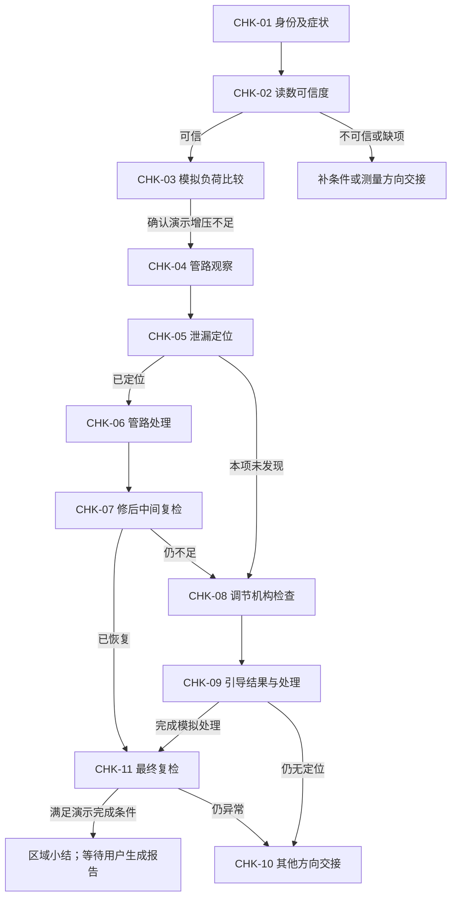

# 探岳DKVB加速无力／P0299：检查、分支与复检

资料ID：DKVB-P0299-MANUAL-v1。整份资料用途为synthetic演示，禁止自动授予正式维修资格。

本手册组合已核对原页的FACT、作者整理的EDITORIAL和虚构的DEMO。每张卡均标性质。FACT为来源摘意，不意味着本地资料已认证为最新官方标准。检查代码是作者知识ID，不是业务UUID。

## 1. 入口与范围

车型范围：资料S01的DKVB列列有TAYRON 2019起；本专题不使用DPLA、DKXA或GTE混动车型的参数。具体车辆仍需身份适配；演示中使用无真实VIN的虚拟车辆。

症状入口：较大负荷时加速无力，伴随P0299记录。网页应首先展示“增压不足是现象，不等于涡轮总成已损坏”。P0299的通用诊断参考支持管路、增压控制、涡轮及分流阀等多个候选方向，不能将其他发动机专属通报移植为DKVB标准。[S04：Ross-Tech](https://wiki.ross-tech.com/wiki/index.php/16683/P0299/000665)

覆盖：资料适配、测量可信度、模拟动态比较、空气管路定位、V465调节分支、处理后的再判断与演示报告。未覆盖：完整电气针脚诊断、燃油／失火／排气故障定位、真实诊断仪版本的全部引导条件、实际路试方案。

## 2. 对象与原文位置

| 对象ID | 对象与识别 | 图纸／来源 | 不应混淆 |
|---|---|---|---|
| OBJ-AIR | 增压空气管路、软管接头及卡箍；按实际图识别，不把整个系统当单一零件 | [S02-P1](figures/S02-1.png)、[S02-P2](figures/S02-2.png) | 接头局部泄漏与涡轮本体故障 |
| OBJ-COOLER | 增压空气冷却器；S02-P1标号7 | [S02-P1](figures/S02-1.png)、[S02-P3](figures/S02-3.png) | 增压空气冷却器与发动机冷却液散热器 |
| OBJ-G31 | 增压压力传感器G31，装配图标号15；拆装位置参见A21-10817 | [S02-P4](figures/S02-4.png) | 传感器读数、真实空气压力和ECU请求压力 |
| OBJ-V465 | 增压压力调节器V465；S03-P2标号19，连接机构含螺杆、球座等 | [S03-P2](figures/S03-2.png)、[S03-P8](figures/S03-8.png) | 调节机构设置、连接异常与执行器电气损坏 |
| OBJ-N249 | 涡轮增压器循环空气阀N249，装配与安装方向见原图 | [S03-P1](figures/S03-1.png)、[S03-P2](figures/S03-2.png) | 不可套用其他发动机的膜片结构或损坏通病 |
| OBJ-TURBO | 废气涡轮增压器总成 | [S03-P1](figures/S03-1.png) | 不能仅因P0299直接确定总成损坏 |

观察中的接头标签仅用于关联用户已提交的对象与定位证据；DEMO虚拟标签不是厂家零件号，也不是原图新增标号。没有对应原页依据时，不推定接头位于实车左侧或右侧，也不根据标签预判故障。

## 3. 调度原则

资料卡之间的关系是本专题的EDITORIAL/DEMO组织，不是原厂固定诊断树。

允许用户先提供已经完成的有效检查记录；系统不应强迫重复执行。检查记录必须带stage/run_id。修复会开启新阶段，旧异常保留在历史中，不再冒充当前测量，但未复核的问题也不能自动清零。

## CHK-01：确认车辆、故障记录和本次任务

性质：FACT适配＋EDITORIAL询问＋DEMO病例。来源：S01-P1、S04。

**目的：** 确认本资料是否适用，以及本次要解释的症状，而不是立即定位故障件。

页面询问：发动机代码、车型、症状出现条件、P0299是否真实读取或本次模拟、是否伴随其他代码、近期是否拆装增压管路。演示选择“虚拟探岳／DKVB”，不要求填写虚假VIN。

记录：`engine_code`、`vehicle_family`、`symptom`、`dtc`、`other_dtc`、`recent_work`、`synthetic=true`。未知值为unknown，不等于无故障。

下一步：身份匹配且P0299入口成立→CHK-02；身份未知→仅追问身份；其他发动机→退出本专题。明显其他故障主导时给出超范围交接，不机械把全部故障归入增压。

本检查不产生维修结论。

## CHK-02：先判断压力读数是否值得相信

性质：DEMO检查设计；G31对象存在由S02-P1/P4支持，以下数值标准不来自手册。

**目的：** 避免将类型不明或基准明显异常的读数直接当作真实增压不足。

演示操作：点击“读取静态模拟数据”，取得同次run_id的虚拟环境压力与G31显示压力，确认两者均为hPa绝对压力。本卡不要求现场接表或探针测电。

记录：`ambient_abs_hpa`、`g31_abs_hpa`、`pressure_type=absolute`、`condition=DEMO_STATIC`。以DS-01比较差值；页面显示原始值、差值和“演示标准”。

| 结果 | 解释 | 下一步 |
|---|---|---|
| 差值在DEMO范围内 | 静态模拟读数相容，允许继续；不是G31全工况正常证明 | CHK-03 |
| 超出DEMO范围 | 当前测量链可信度不足，不能据此判涡轮损坏 | 核对单位、类型和连接观察；转CHK-10测量方向 |
| 类型／单位缺失 | 尚不能比较 | 只补所缺字段，不重新询问全部病例 |

绝对压力与表压不能混算；真实零点校验公差待补。本卡结果不批准更换G31。

## CHK-03：确认负荷回放中确实存在不足

性质：DEMO；通用症状方向参考S04，比较阈值为DS-02。

**目的：** 将“感觉无力”变成有对象、有工况、有数值的本次观察。

演示操作：播放固定的虚拟负荷片段，读取三条同步的目标／实际绝对压力。工况标签固定为DEMO_LOAD_STABLE。这些是模拟器提供的已稳定采样，不要求真实道路急加速。

记录：同一run_id下每帧`target_abs_hpa`与`actual_abs_hpa`，同步时间、片段标签和症状是否重现。单位相同；不从不同阶段拼帧。

逐帧计算目标减实际的有符号差。按DS-02：三帧均显著偏低→演示增压不足；三帧均在演示带内→该片段未见增压偏差；混合→补连续数据；明显高于目标→超出本专题，不当作不足。

下一步：不足→CHK-04；其他结果按缺项或超范围处理。即使压力跟随合格，仍有无力症状也不能宣告整车修好。

## CHK-04：沿空气通路观察接头与管路

性质：FACT原文要求＋EDITORIAL卡片化。来源：S02-P1/P2；位置见装配图，不新增针脚或方位。

**目的：** 找到可核对的异常线索，避免先拆涡轮。

来源支持：测试或维修前检查空气软管和管路的座合是否牢固及是否泄漏。S02-P2说明软管插入止动位置、安装标记对齐，安装前相关连接面应无油脂，夹箍型式应符合原件要求。

演示操作：选择观察到的状态：接头座合疑似不到位／管壁可见损伤／仅见油迹／未见明显异常／无法观察。可以附模拟照片编号。仅见油迹不能直接当成已定位漏点。

记录：`object_id`、`visual_state`、`location_ref`、`checked`。按用户实际提交的观察记录对象与状态；若发现疑似座合不到位，仍需CHK-05确认是否存在局部泄漏。

下一步：观察后进入CHK-05；观察不到的部位保持未检查。本卡不自动授权更换任何总成。

## CHK-05：按增压空气系统的方法定位泄漏

性质：FACT方法与限制＋DEMO结果输入。来源：S02-P5/P6。

**目的：** 确认有无可定位漏点，而不是用整个系统压降推断泄漏。

来源工具：V.A.G 1687、V.A.G 1687/14及1687/10接头，原页包含接法。原文规定测试压力不得超过0.5 bar，并通过听、摸、检漏喷剂或超声检漏设备检查泄漏。完整连接和卸压步骤应查原页，本卡不替代工具操作培训。

**关键限制：S02-P6说明部分空气会经气门进入发动机，因此不能进行保压试验。不得套用冷却系统的10分钟压降规则，也不得自创“压力下降＝漏气”的判定。**

演示操作只填写已给出的模拟结果，不操作真实气源：`leak_result=localized/not_found/inconclusive`；如localized，必填`leak_object_id`、`leak_location`、`evidence_kind`。支持的模拟证据为局部检漏液气泡／局部超声定位／可重复局部漏气记录。

下一步：localized→CHK-06；not_found→CHK-08；inconclusive→补定位观察。未发现不等于排除所有工况泄漏。只有下降曲线而无局部证据时不生成“已定位”结论。

## CHK-06：处理已确认的空气接头问题

性质：FACT装配要求＋DEMO处理记录。来源：S02-P2。

**进入条件：** CHK-05已定位到本卡覆盖的增压空气接头连接问题，具有明确对象、位置及局部证据，且不存在与其冲突的有效记录。未定位或问题不属于接头连接时，本卡不可用；不能仅凭对象标签进入处理。

若已确认问题为接头装配异常，可记录“重新正确装配虚拟接头并处理已确认的连接问题”的模拟动作；动作必须对应已提交的定位证据，不预设必须换涡轮、冷却器或整条管路。真实软管接头安装需要遵循原图的座合、标记、清洁及适用夹箍要求；原页的5.5 Nm只对应明确的螺旋卡箍A，不能给全部螺栓使用。

页面动作：“记录模拟处理完成”。记录处理对象、模拟动作、完成状态、操作者输入和新阶段after_air_repair。真实零件号与适配不在本演示中编造。

下一步：完成不等于修好，必须CHK-07；未完成保留待处理。

## CHK-07：管路处理后是否真的解决症状

性质：DEMO中间复检，复用DS-02。

演示操作：重新查看局部泄漏结果，然后回放新的同类负荷片段。新run_id与旧记录分别保存。显示处理前后差值变化，不覆盖原数据。

| 结果 | 当前小结 | 下一步 |
|---|---|---|
| 漏点未再发现，压力及症状恢复 | 本项修复有效，待最终核对 | CHK-11 |
| 漏点未再发现，压力改善但仍不足 | 已解决一个问题，仍有残余异常 | CHK-08 |
| 同处仍可定位泄漏 | 该项处理未闭环，不盲目找第二故障 | 返回CHK-05/06，附复查理由 |
| 压力无异常但症状仍在 | 不能以压力合格替代整车诊断 | CHK-10 |

是否改善、是否恢复均由本次复检输入决定。若改善但仍异常，不能出最终成功报告；若恢复，则按表进入最终核对，不强制追加第二个故障。

## CHK-08：观察增压调节器及连接机构

性质：FACT结构＋DEMO观察逻辑。来源：S03-P2/P8。

**目的：** 在压力可信、空气通路已检查的前提下，进入增压调节方向。结构图能够证明部件和连接存在，不能单独证明它们损坏。

位置：OBJ-V465见S03-P2标号19，连接机构随原图识别；未核对电路端子，不提供虚构电压或针脚。演示只选择模拟观察：连接完整／连接异常／无法观察，以及是否存在明确的既往引导调整结果。

记录：`connector_state`、`linkage_state`、`prior_guided_result`。不将“未保存基本设定记录”当作“基本设定失败”。

下一步：连接异常→记录待处理，处理完成后CHK-09；连接完整或状态未知但可进入模拟测试→CHK-09；无法测试→CHK-10。此处不发布V465本体已坏结论。

## CHK-09：依据引导测试结果决定处理或继续检查

性质：FACT引导入口＋DEMO结果类型与流程。来源：S03-P8/P9。

原文提供诊断仪引导功能中的V465调整入口，并要求按设备说明进行连接调整。原文没有给出本包所需的全套返回码、学习电压或杆长公差。因此本包只使用虚构的易读结果，不创造实车调整量。

演示输入：

- `not_run`：尚未运行，保持未检查。
- `setup_required`：**DEMO结果**，演示设备表示需要按引导进行设置；不是已确认硬件损坏。
- `completed`：**DEMO结果**，引导过程完成；仍须复检动力表现。
- `failed`：**DEMO结果**，引导未完成；保留失败，不循环宣布成功。

当setup_required且机构模拟观察无损坏时，可点击“完成模拟引导处理”，生成一条completed新记录并进入after_control_setup阶段。此按钮只在模拟环境改变病例状态，不向实车发送命令，不指导旋转实车螺杆。

完成→CHK-11；失败、矛盾或依旧异常→CHK-10。输出应为“增压调节设置方向需处理／已完成模拟设置”，不能凭此升级为执行器内部损坏。

## CHK-10：其他方向和无法定位时交接

性质：EDITORIAL；通用候选参考S04，本车型部件存在性参考S03-P1/P2。

按尚未解决的问题生成具体交接，而不是重复“资料不足”：

| 未解决问题 | 应交接的后续资料／检查 | 当前不能说什么 |
|---|---|---|
| 静态压力不可信 | 适用的G31测量链、电路与参考压力核对程序 | G31必坏／涡轮必坏 |
| 管路未见漏点、引导未解决 | N249适用功能检查、涡轮调节机械状态与对应诊断程序 | 仅凭P0299换总成 |
| 引导failed | 诊断仪具体失败记录、条件、电气与机械分项检查 | 失败就是电机损坏 |
| 压力已恢复但仍无力 | 其他故障码、燃油／点火／排气等对应资料 | 增压正常所以整车正常 |

演示输出“本专题未完成定位”的阶段报告；保留已检查正常项的限定范围。不要使用其他发动机的真空机构、膜片通病或调节间隙作为DKVB事实。

## CHK-11：最终复检及结束条件

性质：DEMO复检设计；真实路试方案未提供，使用虚拟回放。

完成条件同时满足：最新阶段的三帧压力比较在DS-02演示带内；模拟原症状不再出现；模拟复检P0299未再出现；所有已定位且计划处理的问题均有新阶段复核；无未解决冲突。

只清除代码、只完成设置、只修好一个漏点或只有一帧压力正常都不能满足本演示完成条件。条件缺失时只追问缺项。模拟检查两轮可用作该病例演示，不宣称等同厂家监测周期或法规就绪条件。

达到条件时显示区域小结及“生成演示报告”按钮；不得自动出具实车修复证明。报告引用实际执行的检查和原始观察；未走的分支写未检查，不写已排除。

## 4. 本专题允许的阶段结论

| 结论ID | 含义 | 需要的最低依据 |
|---|---|---|
| CON-01 | 测量可信度待核对 | DS-01异常或类型不明 |
| CON-02 | 模拟工况下存在增压不足 | CHK-02通过且DS-02显示三帧不足 |
| CON-03 | 已定位演示接头泄漏 | 有局部证据及位置的CHK-05结果 |
| CON-04 | 接头处理有效但仍有残余异常 | 新局部复核无漏点，新的压力仍不足 |
| CON-05 | 演示引导设置待完成／已完成 | 对应阶段的CHK-09记录，不推出硬件失效 |
| CON-06 | 本病例演示复检通过 | CHK-11全部条件成立 |
| CON-07 | 本专题未完成定位 | 具体未解决项及CHK-10交接 |

结论模板仅为作者级语义，未注册为xiutu-v5可信规则。引用存在、文档已上传和事实来源正确，都不自动批准这些结论。
