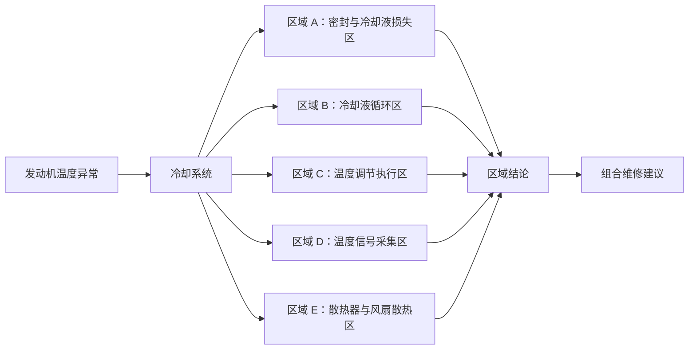
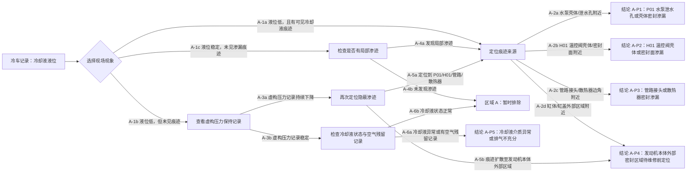
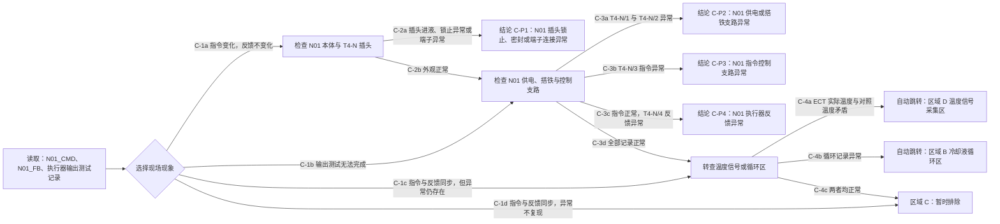
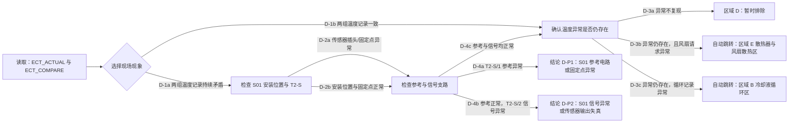
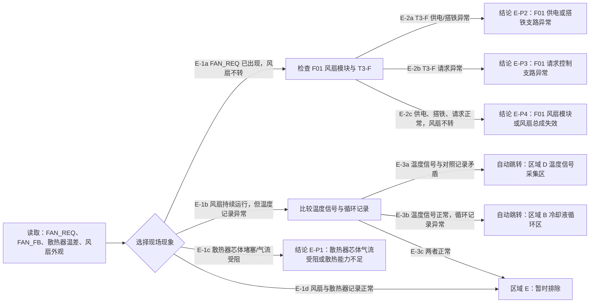

# 冷却系统完整清晰维修树（虚构交互样例）

> **用途：** 这是给汽修程序演示“系统 → 部件组 → 具体部件 → 现象 → 多跳检查 → 区域结论 → 维修方案”的虚构数据样本。
>
> **禁止用于真实车辆：** 本文的车型 `HT-2.0`、部件编号、位置、插头、线路、参数窗口、检查结论和维修工序均为杜撰。`Ux` 是非物理虚构单位。真实车辆必须用 VIN 对应的官方维修手册、电路图和诊断计划替换全部内容。

---

## 1. 这棵树解决什么问题

故障描述不是直接跳到一根线或一个插头，而是按下面的层级逐步缩小范围：

```text
发动机温度异常
  ↓
冷却系统
  ↓
可疑问题区域（能在发动机舱定位的部件组）
  ↓
具体部件
  ↓
可点击的现象 / 诊断记录
  ↓
下一检查节点
  ↓
该部件：暂时排除 / 重点怀疑 / 进入维修前复核
  ↓
组合维修建议与维修后验证
```

### 1.1 冷却系统的五个可疑问题区域



| 区域 | 页面卡片上显示的名称 | 下面包含的具体部件 |
|---|---|---|
| A | 密封与冷却液损失区 | 膨胀壶、壶盖、水泵壳体、温控阀壳体、管路接头、散热器、缸体/缸盖外部区域。 |
| B | 冷却液循环区 | 电动水泵、温控阀、旁通流路、主水管、散热器流路。 |
| C | 温度调节执行区 | 虚构 N493 温度调节执行器、执行器插头、执行器控制/反馈支路。 |
| D | 温度信号采集区 | 虚构 S-ECT 冷却液温度传感器、传感器插头、信号/参考支路。 |
| E | 散热器与风扇散热区 | 散热器芯体、冷却风扇、风扇控制模块、风扇供电支路。 |

---

## 2. 虚构车型的部件位置与参数索引

这一页相当于程序中每个“检查节点”可以引用的部件卡片。真实版本必须替换为车型专用位置图和电路图。

| 部件 | 虚构位置 | 虚构接口 / 参数位置 | 虚构记录名称 |
|---|---|---|---|
| P01 电动水泵 | 发动机左前下方，水泵支架内 | `T3-P`：1 供电、2 搭铁、3 转速指令 | `PUMP_CMD`、`PUMP_FB`、`PUMP_FLOW` |
| H01 温控阀总成 | 发动机后侧，回流管汇处 | `T5-H`：1 供电、2 搭铁、3 指令、4 反馈、5 参考 | `VALVE_CMD`、`VALVE_FB` |
| N01 温度调节执行器 | 发动机前侧，上导流壳后方 | `T4-N`：1 供电、2 搭铁、3 指令、4 反馈 | `N01_CMD`、`N01_FB` |
| S01 冷却液温度传感器 | 上回流管测温座内 | `T2-S`：1 参考、2 信号 | `ECT_ACTUAL`、`ECT_COMPARE` |
| F01 风扇控制模块 | 散热器框架右下方 | `T3-F`：1 供电、2 搭铁、3 请求 | `FAN_REQ`、`FAN_FB` |

---

## 3. 区域 A：密封与冷却液损失区

### A-0：区域的实际含义

这个区域不直接判断“水泵坏了”或“缸垫坏了”。它先回答一个简单问题：**冷却液是否正在从某个可定位的位置流失，或系统是否无法保持密封？**

### A-1：从液位现象开始



### A-2：页面逐步显示的部件与现象

| 当前子问题组 | 页面显示的可点现象 | 到达的结论 |
|---|---|---|
| 膨胀壶与液位组 | 液位持续下降 / 液位稳定且未见渗漏 | 进入痕迹定位或局部渗迹复核。 |
| 水泵密封组 | P01 壳体或泄水孔附近有痕迹 / 无痕迹 | P01 泄水孔或壳体密封渗漏，或转向其他来源。 |
| 温控阀密封组 | H01 壳体或密封面有痕迹 / 无痕迹 | H01 壳体或密封面渗漏，或转向其他来源。 |
| 管路与散热器组 | 卡箍、接头、散热器边角有痕迹 / 无痕迹 | 管路接头或散热器密封渗漏。 |
| 冷却液状态组 | 液体异常 / 有空气残留记录 / 正常 | 排气、加注或密封问题方向。 |

### A-3：区域 A 的虚构维修方案

| 叶子结论 | 虚构维修方案 | 完成后重新进入的节点 |
|---|---|---|
| A-P1 P01 水泵泄水孔或壳体密封渗漏 | `A-R01`：处理 P01 密封接触面或总成；执行受控加注与排气流程。 | A-0，确认液位和渗迹。 |
| A-P2 H01 温控阀壳体或密封面渗漏 | `A-R02`：处理 H01 壳体密封面与密封件；执行受控加注与排气流程。 | A-0。 |
| A-P3 管路接头或散热器密封渗漏 | `A-R03`：修复或替换已定位的管路、接头或散热器部件。 | A-0。 |
| A-P4 发动机本体外部渗漏来源待定位 | `A-R04`：建立“发动机本体外部密封定位工单”；不直接给出拆卸方案。 | A-3/A-5，补齐来源定位。 |
| A-P5 冷却液介质异常或排气不充分 | `A-R05`：执行冷却液置换与排气流程，再重新观察液位。 | A-0。 |

---

## 4. 区域 B：冷却液循环区

### B-0：区域的实际含义

这个区域要确认：**冷却液能否按需要在水泵、温控阀、管路和散热器之间流动。**

### B-1：从循环现象进入部件树

```mermaid
flowchart LR
    B0[读取：PUMP_FLOW、暖机记录、散热器温差记录] --> B1{选择现场现象}
    B1 -->|B-1a 循环记录不稳定| B2[先检查 P01 水泵]
    B1 -->|B-1b 暖机过慢或过快| B3[检查 H01 温控阀流路]
    B1 -->|B-1c 散热器前后温差异常| B4[检查散热器与主水管流路]
    B1 -->|B-1d 三项记录正常| BE[区域 B：暂时排除]

    B2 -->|B-2a PUMP_CMD 正常，PUMP_FB 异常| BP1[结论 B-P1：P01 水泵反馈失效或泵体工作异常]
    B2 -->|B-2b PUMP_CMD 异常| B5[检查 P01 插头与控制支路]
    B2 -->|B-2c 指令与反馈均正常，流量仍异常| B3

    B3 -->|B-3a VALVE_CMD 正常，VALVE_FB 异常| BP2[结论 B-P2：H01 温控阀反馈失效或阀体卡滞]
    B3 -->|B-3b VALVE_CMD 异常| B6[检查 H01 插头与控制支路]
    B3 -->|B-3c 指令与反馈均正常| B4

    B4 -->|B-4a 主水管折弯、松脱或虚构堵塞记录| BP3[结论 B-P3：主水管或旁通段流路受限]
    B4 -->|B-4b 散热器芯体外部堵塞或内部流路异常记录| BP4[结论 B-P4：散热器芯体气流受阻或流路受限]
    B4 -->|B-4c 流路记录正常| BE

    B5 -->|B-5a T3-P 供电/搭铁异常| BP5[结论 B-P5：P01 供电或搭铁支路异常]
    B5 -->|B-5b T3-P 支路正常| BP1

    B6 -->|B-6a T5-H 供电/搭铁/指令异常| BP6[结论 B-P6：H01 供电、搭铁或指令支路异常]
    B6 -->|B-6b T5-H 支路正常| BP2
```



### B-2：水泵 P01 的明确检查卡

```text
检查对象：P01 电动水泵
位置：发动机左前下方 → 水泵支架内 → T3-P 插头

先选择：PUMP_CMD 正常但 PUMP_FB 异常？
  是 → P01 水泵本体高度怀疑
  否 → 继续看 T3-P

检查点：T3-P/1 → T3-P/2（虚构供电/搭铁窗口）
检查点：T3-P/3 → T3-P/2（虚构 PUMP_CMD 窗口）

结果：
  供电或搭铁异常 → P01 外部支路问题
  指令异常 → 回到控制侧分支
  供电、搭铁、指令正常但反馈仍异常 → P01 本体问题
```

### B-3：区域 B 的虚构维修方案

| 叶子结论 | 虚构维修方案 | 验证 |
|---|---|---|
| B-P1 P01 水泵反馈失效或泵体工作异常 | `B-R01`：更换 P01 水泵总成，完成排气。 | 重新读取 `PUMP_CMD/PUMP_FB/PUMP_FLOW`。 |
| B-P2 H01 温控阀反馈失效或阀体卡滞 | `B-R02`：更换 H01 温控阀总成，完成匹配。 | 重新读取 `VALVE_CMD/VALVE_FB` 与暖机记录。 |
| B-P3 主水管或旁通段流路受限 | `B-R03`：复原定位到的主水管、接头或旁通段。 | 重新记录循环状态。 |
| B-P4 散热器芯体气流受阻或流路受限 | `B-R04`：处理散热器芯体或流路。 | 重新记录散热器温差。 |
| B-P5 / B-P6 对应总成的供电、搭铁或指令支路异常 | `B-R05`：修复对应总成的外部线路支路。 | 回到 P01/H01 的首次节点。 |

---

## 5. 区域 C：温度调节执行区

### C-0：区域的实际含义

这里排查的是**温度调节执行器 N01 是否按控制单元要求改变流路，以及它是否正确返回位置状态。**

### C-1：N01 执行器树



### C-2：区域 C 的虚构维修方案

| 叶子结论 | 虚构维修方案 | 验证 |
|---|---|---|
| C-P1 N01 插头锁止、密封或端子连接异常 | `C-R01`：复原 T4-N 的锁止、密封和端子连接。 | 重新执行输出测试。 |
| C-P2 N01 供电或搭铁支路异常 | `C-R02`：处理 `T4-N/1`、`T4-N/2` 对应支路。 | 重新读取 N01_CMD/N01_FB。 |
| C-P3 N01 指令控制支路异常 | `C-R03`：处理 `T4-N/3` 对应控制支路。 | 重新执行输出测试。 |
| C-P4 N01 执行器反馈异常 | `C-R04`：更换 N01 温度调节执行器，执行基本设定。 | 重新读取指令、反馈和暖机记录。 |

---

## 6. 区域 D：温度信号采集区

### D-0：区域的实际含义

这个区域不先说“传感器坏了”，而是确认：**温度传感器的信号是否和可用对照记录一致；若不一致，是传感器本体还是它的外部支路问题。**

### D-1：S01 温度传感器树



### D-2：区域 D 的虚构维修方案

| 叶子结论 | 虚构维修方案 | 验证 |
|---|---|---|
| D-P1 S01 参考电路或固定点异常 | `D-R01`：处理 `T2-S/1` 对应参考支路与固定点。 | 重新对照 ECT_ACTUAL/ECT_COMPARE。 |
| D-P2 S01 信号异常或传感器输出失真 | `D-R02`：替换 S01 温度传感器。 | 重新对照两组温度记录。 |

---

## 7. 区域 E：散热器与风扇散热区

### E-0：区域的实际含义

这个区域回答的是：**发动机产生的热量是否能够被散热器和风扇带走。** 它与水泵、温控阀、传感器是并列候选，不是它们的附属线路。

### E-1：风扇与散热器树



### E-2：区域 E 的虚构维修方案

| 叶子结论 | 虚构维修方案 | 验证 |
|---|---|---|
| E-P1 散热器芯体气流受阻或散热能力不足 | `E-R01`：处理散热器芯体外部气流或内部流路问题。 | 重新记录散热器温差与风扇状态。 |
| E-P2 F01 供电或搭铁支路异常 | `E-R02`：处理 `T3-F/1`、`T3-F/2` 对应支路。 | 重新读取 FAN_REQ/FAN_FB。 |
| E-P3 F01 请求控制支路异常 | `E-R03`：处理 `T3-F/3` 对应请求支路。 | 重新读取 FAN_REQ/FAN_FB。 |
| E-P4 F01 风扇模块或风扇总成失效 | `E-R04`：替换 F01 风扇控制模块或总成。 | 重新验证风扇启动、停止和温度记录。 |

---

## 8. 叶子结论处理卡：从“现象”到“维修工单”

本章是页面最终建议的唯一内容来源。每个叶子结论都必须同时给出：**已记录的现象依据、可定位的处理对象、处理前必须核对的车型资料、完工后的复核项目**。不能只因为一个现象就写“直接换件”。

### 8.1 区域 A：密封与冷却液损失区

| 叶子结论 | 已命中的现象链 | 工单处理对象 | 维修前核对 | 完工复核 |
|---|---|---|---|---|
| A-P1：P01 水泵泄水孔或壳体密封渗漏 | 冷车液位下降 → 痕迹位于 P01 壳体或泄水孔附近。 | P01 水泵总成及其密封接触面。 | VIN 对应的水泵零件号、密封件是否单独供应、拆装与冷却液加注程序。 | 冷车液位、P01 周边干燥状态、循环记录、故障码和暖机后的液位变化。 |
| A-P2：H01 温控阀壳体或密封面渗漏 | 冷车液位下降 → 痕迹位于 H01 壳体拼接面或接口。 | H01 温控阀总成、密封圈和相邻接口。 | H01 与发动机配置的适配关系、密封面清洁要求、排气/基本设定要求。 | H01 周边无渗迹、暖机过程、阀门指令与反馈记录。 |
| A-P3：管路接头或散热器密封渗漏 | 冷车液位下降 → 痕迹位于管路接头、卡箍位置或散热器边角。 | 已定位的软管、快接头、卡箍或散热器本体。 | 该管段走向、快接头锁止形式、冷却液规格及散热器安装资料。 | 接头锁止到位、周边干燥、液位稳定、散热器温差与风扇状态正常。 |
| A-P4：发动机本体外部密封区域待维修前定位 | 液位下降 → 痕迹集中在缸体/缸盖外侧，且非 P01、H01、管路或散热器来源。 | 发动机本体外部渗漏区域；先建立定位工单，不直接判定内部故障。 | 官方外部泄漏定位程序、周边附件拆装范围、是否需要清洁后复检。 | 渗迹源已明确；若未明确，不进入拆解或更换结论。 |
| A-P5：冷却液介质异常或排气不充分 | 压力保持稳定 → 冷却液状态异常或空气残留现象存在。 | 冷却液介质、加注/排气流程和液位恢复情况。 | 指定冷却液型号、加注设备、排气路径和冷车液位基准。 | 冷热循环后的液位、加热性能、循环记录及渗漏检查均正常。 |
| AE：区域 A 暂时排除 | 液位稳定，复核后未见局部渗迹，冷却液状态正常。 | 不更换密封部件。 | 保留本轮液位与外观记录。 | 在后续温度异常排查中，如再次出现液位下降，重新从 A-0 进入。 |

### 8.2 区域 B：冷却液循环区

| 叶子结论 | 已命中的现象链 | 工单处理对象 | 维修前核对 | 完工复核 |
|---|---|---|---|---|
| B-P1：P01 水泵反馈失效或泵体工作异常 | 循环不稳定 → `PUMP_CMD` 正常、`PUMP_FB` 异常。 | P01 电动水泵总成。 | 泵的车型适配、供电条件已正常、冷却液排放与排气程序。 | `PUMP_CMD/PUMP_FB/PUMP_FLOW` 逻辑一致，暖机与温差恢复正常。 |
| B-P2：H01 温控阀反馈失效或阀体卡滞 | 暖机异常 → `VALVE_CMD` 正常、`VALVE_FB` 异常。 | H01 温控阀总成。 | 阀体型号、连接管路、基本设定或自学习要求。 | 暖机曲线、阀门反馈、散热器温差和故障码复核。 |
| B-P3：主水管或旁通段流路受限 | 散热器温差异常 → 主水管折弯、松脱或流路受限现象成立。 | 已定位的主水管、旁通段或接头。 | 管路布置图、固定夹位置、替换件规格。 | 管路无折弯/干涉，循环记录和散热器温差恢复。 |
| B-P4：散热器芯体气流受阻或流路受限 | 散热器前后温差异常 → 芯体外部气流或内部流路异常成立。 | 散热器芯体及其外部导风区域。 | 散热器型号、冷凝器/导风件安装关系、冷却液程序。 | 芯体无明显受阻，温差、风扇请求和发动机温度趋势正常。 |
| B-P5：P01 供电或搭铁支路异常 | 循环不稳定 → `PUMP_CMD` 异常，且 T3-P 供电/搭铁记录异常。 | P01 对应供电、搭铁或控制支路。 | 原厂电路图、保险丝编号、搭铁点、端子修复规范。 | 支路记录恢复、P01 指令/反馈一致；不得未核图就替换水泵。 |
| B-P6：H01 供电、搭铁或指令支路异常 | 暖机异常 → `VALVE_CMD` 异常，且 T5-H 支路异常。 | H01 对应供电、搭铁或控制支路。 | 原厂电路图、端子定义、保险丝/继电器和搭铁位置。 | 支路记录恢复，H01 指令、反馈和暖机曲线一致。 |
| BE：区域 B 暂时排除 | 循环、暖机、散热器温差三项记录均正常。 | 不更换水泵、温控阀或散热器。 | 保留三项正常记录。 | 继续转查温度信号、执行器或风扇区域。 |

### 8.3 区域 C：温度调节执行区

| 叶子结论 | 已命中的现象链 | 工单处理对象 | 维修前核对 | 完工复核 |
|---|---|---|---|---|
| C-P1：N01 插头锁止、密封或端子连接异常 | `N01_CMD` 变化、`N01_FB` 不变化 → T4-N 外观或锁止异常。 | N01 插头壳、二次锁、端子和密封件。 | 原厂插头维修件、端子压接/退针要求。 | 锁止和密封到位，输出测试后指令与反馈同步。 |
| C-P2：N01 供电或搭铁支路异常 | 输出测试无法完成 → T4-N/1 或 T4-N/2 异常。 | N01 供电及搭铁支路。 | 电路图、保险丝、搭铁点及线束维修标准。 | 供电/搭铁记录正常，输出测试可完成。 |
| C-P3：N01 指令控制支路异常 | 输出测试无法完成 → T4-N/3 指令异常。 | 控制单元至 N01 的控制支路。 | 控制单元端子号、线束走向、端子维修规范。 | 指令记录恢复且执行器反馈随指令变化。 |
| C-P4：N01 执行器反馈异常 | 供电、搭铁、控制记录正常，T4-N/4 反馈仍异常。 | N01 温度调节执行器总成。 | 部件适配、安装位置、基本设定程序。 | 基本设定完成，N01_CMD/N01_FB 同步，温度异常不再复现。 |
| CE：区域 C 暂时排除 | 指令与反馈同步，异常不复现，且未触发跨区条件。 | 不更换 N01。 | 保存输出测试结果。 | 转入区域 D、B 或 E 的相应现象分支。 |

### 8.4 区域 D：温度信号采集区

| 叶子结论 | 已命中的现象链 | 工单处理对象 | 维修前核对 | 完工复核 |
|---|---|---|---|---|
| D-P1：S01 参考电路或固定点异常 | 两组温度持续矛盾 → 安装/插头复核后，T2-S/1 参考异常。 | S01 参考支路、固定点及相关端子。 | 原厂电路图、参考源定义、传感器安装位置。 | `ECT_ACTUAL/ECT_COMPARE` 对照一致，温度趋势合理。 |
| D-P2：S01 信号异常或传感器输出失真 | 两组温度持续矛盾 → 参考正常、T2-S/2 信号异常。 | S01 传感器本体及信号端。 | 传感器零件号、密封件、安装扭矩和插头维修要求。 | 两组温度记录一致，风扇请求恢复正常逻辑。 |
| DE：区域 D 暂时排除 | 两组温度记录一致，异常不复现。 | 不更换 S01。 | 保存同工况下的对照记录。 | 若异常再次出现，先重复同工况对照再进入 D-0。 |

### 8.5 区域 E：散热器与风扇散热区

| 叶子结论 | 已命中的现象链 | 工单处理对象 | 维修前核对 | 完工复核 |
|---|---|---|---|---|
| E-P1：散热器芯体气流受阻或散热能力不足 | 芯体堵塞或气流受阻现象成立。 | 散热器芯体、导风件及相邻气流通道。 | 散热器型号、冷凝器与导风件安装关系。 | 芯体清洁/替换后温差正常，风扇调速逻辑正常。 |
| E-P2：F01 供电或搭铁支路异常 | `FAN_REQ` 出现、风扇不转 → T3-F/1 或 T3-F/2 异常。 | F01 供电、搭铁、保险丝和线束支路。 | 原厂电路图、保险丝额定值、搭铁点和端子维修规范。 | 供电/搭铁正常，风扇可按请求动作。 |
| E-P3：F01 请求控制支路异常 | `FAN_REQ` 出现、风扇不转 → T3-F/3 请求异常。 | 控制单元至 F01 的请求控制支路。 | 控制单元端子、线束路由和端子定义。 | 请求与反馈逻辑一致，温度变化时风扇按要求启停。 |
| E-P4：F01 风扇模块或风扇总成失效 | 供电、搭铁、请求均正常，风扇仍不转。 | F01 风扇控制模块或总成。 | 风扇模块与散热器框架的车型匹配关系。 | `FAN_REQ/FAN_FB` 一致，风扇各工作状态正常。 |
| EE：区域 E 暂时排除 | 风扇、散热器和温差记录均正常。 | 不更换 F01 或散热器。 | 保存正常记录。 | 若温度异常仍存在，按跨区规则转入 B 或 D。 |

---

## 9. 跨区域组合维修建议

组合规则只使用已收敛的叶子结论；它的作用是避免两个区域都命中时重复换件。

| 组合规则 | 同时成立的结论 | 处理优先级与原因 | 固定维修顺序 | 联合复核 |
|---|---|---|---|---|
| X-CA01 | A-P1 + B-P1 | 先处理 P01：同一部件同时出现密封和循环证据。 | 1. 核对 P01 适配与密封件；2. 处理 P01 总成/密封；3. 按车型资料完成加注与排气。 | 冷车液位、P01 周边干燥、`PUMP_CMD/PUMP_FB/PUMP_FLOW`、暖机记录。 |
| X-CA02 | A-P2 + B-P2 | 先处理 H01：密封和阀门反馈指向同一阀体。 | 1. 核对 H01 型号；2. 处理阀体和密封面；3. 完成资料要求的设定。 | H01 周边无渗迹、`VALVE_CMD/VALVE_FB`、暖机和散热器温差。 |
| X-CA03 | B-P5 + C-P2 | 先处理公共供电/搭铁：两个执行部件同时出现供电类异常。 | 1. 对照电路图确认共用保险丝、继电器或搭铁点；2. 修复共同支路；3. 再分别复核 P01 与 N01。 | P01、N01 的供电/搭铁记录均恢复；不得先替换两个总成。 |
| X-CA04 | C-P3 + D-P1 | 先处理控制/参考共用路径：执行器控制和温度参考均异常。 | 1. 核对控制单元端子与共用线束段；2. 修复已定位支路；3. 重做 N01 输出和温度对照。 | `N01_CMD/N01_FB` 同步；`ECT_ACTUAL/ECT_COMPARE` 一致。 |
| X-CA05 | D-P2 + E-P3 或 E-P4 | 先处理温度信号：错误温度信号可能导致风扇策略失真。 | 1. 处理 S01 信号/本体；2. 复核温度对照；3. 仅在风扇异常仍存在时处理 F01。 | 温度对照正常后，`FAN_REQ/FAN_FB` 与实际风扇状态一致。 |
| X-CA06 | B-P4 + E-P1 | 先处理热交换通道：循环流路和散热气流同时受限。 | 1. 核对散热器、导风件和主流路；2. 处理已定位受阻处；3. 重复温差与循环复核。 | 散热器温差、循环记录、风扇状态均正常。 |

---

## 10. AI 最终维修建议的固定输出格式

AI 只能将已命中的叶子结论和上表组合规则排成工单；不得新增部件、端子、线路、数值、扭矩或拆装步骤。没有命中的区域必须明确写为“暂时排除”，而不是猜测故障。

```text
冷却系统最终维修建议

一、会话与适用条件
- 车型 / 年款 / VIN / 发动机代码：<从会话原样读取；缺失项明确标“未填写”>
- 故障描述与故障码：<从会话原样读取>
- 资料依据：<本次命中的维修资料名称、页码或节点编号>

二、已收敛的子区域结论
1. <区域名称>
   - 现象链：<每一步已选择的现象，用“→”连接>
   - 结论：<叶子编号 + 重点怀疑或暂时排除>
   - 处理对象：<唯一部件/支路/流路>
2. <区域名称>
   - 同上。

三、命中的跨区域规则
- <规则编号>：<为什么两个区域指向同一处理顺序>
- 未命中组合：<明确列出“无”，不得编造组合>

四、建议维修顺序
1. 维修前核对：<只列车型资料、零件适配、工单条件>
2. 优先处理：<来自组合规则或单区处理卡的具体对象>
3. 次级处理：<仅在优先处理复核不通过时执行>
4. 禁止直接处理：<被暂时排除的部件或尚无叶子结论的部件>

五、完工复核
- 密封/液位：<来自命中区域的复核项>
- 循环/温度：<来自命中区域的复核项>
- 控制/反馈：<来自命中区域的复核项>
- 故障码与试车：按 VIN 对应官方资料执行，不在本树中编造条件。

六、限制与交接
- 本树只给出受控交互样例的处理顺序；实际拆装、扭矩、冷却液、匹配和测试条件必须以 VIN 对应官方资料为准。
```

---

## 11. 真实版本替换清单

将这棵树用于真实车辆前，每一个括号或虚构字段都必须替换为 VIN 对应资料：

1. 真实车型、年款、发动机代码和热管理系统配置。
2. 水泵、温控阀、执行器、传感器、风扇模块的真实位置图和零件号。
3. 真实插头名称、针脚、线色、保险丝、搭铁点、控制单元端子。
4. 真实诊断仪数据流名称、测试条件、标准值和允许偏差。
5. 真实拆装、扭矩、密封件、冷却液规格、加注排气、基本设定和验证流程。
6. 每个节点的官方资料出处、页码或诊断计划编号。

在这些资料补齐前，这份文件只能作为页面交互、树状规则、状态机和 AI 汇总逻辑的样例。
